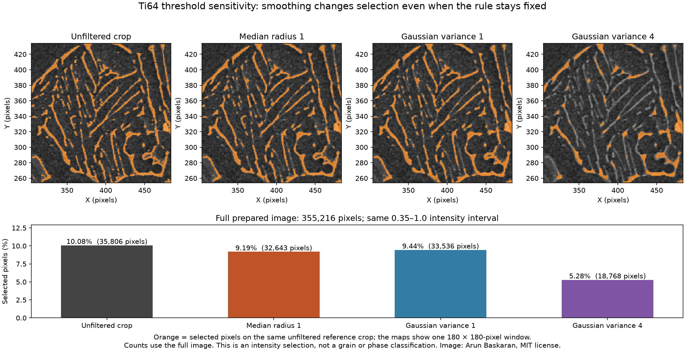
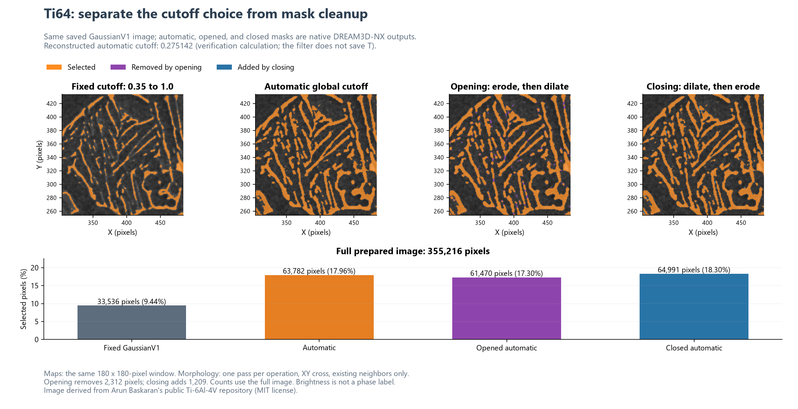

# Ti64 Threshold Sensitivity

Executable pipeline: `(03) Ti64 Threshold Sensitivity.d3dpipeline`

> **Before adapting:** These masks select image brightness, not validated material phases. Recheck intensity scaling, illumination, and which small structures matter before changing the threshold or morphology.

## At a glance

- **Input:** `Data/Output/Ti64_Image_Cleanup_Examples/Smoothing/Ti64_SmoothingComparison.dream3d`, made by `(02) Ti64 Smoothing Comparison.d3dpipeline` after `(01) Ti64 Image Preparation.d3dpipeline`.
- **Result:** Four fixed-cutoff `uint8` masks, one automatic `bool` mask, independent opened/closed copies, counts, and all predecessor data.
- **Main choices:** Compare the same inclusive 0.35-1.0 interval across four image versions; then compare a gradient-weighted global cutoff on `GaussianV1` and one-cell XY opening/closing. No cutoff is stored by the automatic filter.
- **Run order:** Run preparation, smoothing, then this threshold pipeline. Preparation alone does not contain the three smoothing outputs required here.

## Purpose and real-world setting

A metallographer can inspect how an image preparation choice changes which pixels exceed a fixed brightness cutoff. A selected pixel may be part of a bright boundary, a bright constituent, or an image artifact. This pipeline compares the masks created from `UnitIntensity`, `MedianR1`, `GaussianV1`, and `GaussianV4` while holding the selection rule constant. It then holds `GaussianV1` fixed while comparing the manual cutoff with a global gradient-weighted cutoff, followed by two independent mask-cleanup choices. These controls separate smoothing, threshold selection, and morphology; they do not identify microstructural phases or grains.

The prepared `Ti64` crop is 596 × 596 × 1, with 355,216 cells, origin [4, 4, 0], and spacing [1, 1, 1] in uncalibrated pixels. `UnitIntensity` is the unfiltered, normalized **crop**, not the full 604 × 604 source frame. The three smoothing arrays are `float32` outputs from the same crop. The smoothing checkpoint retains `Source Image`, the cropped source intensity, preparation arrays, prior summaries, and both image geometries.

The raster derives from the public [Arun Baskaran paper-linked Ti-6Al-4V repository](https://github.com/ArunBaskaran/Image-Driven-Machine-Learning-Approach-for-Microstructure-Classification-and-Segmentation-Ti-6Al-4V). The RGBA source was converted to grayscale without resizing. `SourceDataLicense.txt` beside this pipeline contains the MIT notice; `Data/ImageProcessing_Examples/Provenance.json` in the data archive records hashes and transformations. [Fotos, Campbell, Murray, and Yakushina (2023)](https://doi.org/10.1007/s10853-023-08901-w) provide the material context. Their learned boundary-class method and watershed are outside this example.

Run from a working directory containing `Data`. In the GUI, set absolute paths if relative paths do not resolve. The `.d3dpipeline` defines the executable arguments; the `.yaml` companion repeats them for discovery.

## Data flow and choices

| Stage | Why this choice; alternative and pitfall |
|---|---|
| Read DREAM3D | Load the **full smoothing checkpoint**. Reading the preparation checkpoint would omit `MedianR1`, `GaussianV1`, and `GaussianV4`. Keeping both geometries and all earlier arrays makes the branches traceable. |
| Binary Threshold Image × 4 | Read `Ti64/Cell Data/UnitIntensity`, `MedianR1`, `GaussianV1`, and `GaussianV4` independently; write `BrightOriginal`, `BrightMedianR1`, `BrightGaussianV1`, and `BrightGaussianV4` under `Ti64/Cell Data`. Each output is `uint8`: 1 for input intensity **greater than or equal to 0.35 and less than or equal to 1.0**, 0 elsewhere. This fixed interval isolates the effect of smoothing on selected pixels. |
| Compute Array Statistics × 4 | Write `Ti64/BrightOriginalSummary`, `BrightMedianR1Summary`, `BrightGaussianV1Summary`, and `BrightGaussianV4Summary`. Each uses all 355,216 cells without a mask or feature index. It records Length, Minimum, Maximum, Mean, Median, population StandardDeviation, and Summation. On a 0/1 mask, Summation is selected-pixel count and Mean is selected-pixel fraction. |
| Gradient Magnitude Image | Read `GaussianV1` and create `GaussianV1Gradient`. Central differences measure local contrast changes; use image spacing is off because these coordinates are uncalibrated pixels. Gradient weights come from the same smoothed array being thresholded, not from the sharper original. |
| Robust Automatic Threshold | Compute one global gradient-weighted cutoff and create `RobustGaussianV1` as a bool mask. This offers a data-derived comparison with the fixed 0.35 cutoff; it is not locally adaptive thresholding or a guarantee of a better selection. |
| Copy Data Object twice | Preserve `RobustGaussianV1`; create `_OpenedXY1` and `_ClosedXY1` copies under `Ti64/Cell Data`. Both branches start from the same automatic mask, so closing does not act on the opened result. |
| Erode/Dilate Mask, two passes per copy | Opening is erode then dilate; closing is dilate then erode. Each pass uses one iteration, X/Y on and Z off. The cross-shaped, four-neighbor operation tests a small pixel-scale change without introducing a physical-size claim. |
| Compute Array Statistics, three new masks | Save only `Length` and `Summation` under the corresponding `Ti64/RobustGaussianV1*Summary`. Summation counts true pixels; calculate the fraction as Summation / Length. The new bool summaries have no Mean array. |
| Write DREAM3D | Save `Data/Output/Ti64_Image_Cleanup_Examples/Threshold/Ti64_ThresholdSensitivity.dream3d`, compression level 5, XDMF off. The source geometry, prepared crop, smoothing branches, original masks/summaries, gradient, and new masks/counts remain in the checkpoint. |

The 0.35 lower bound is an **illustrative choice** that selects visible bright structures in the common 0–1 range. It is not optimized, calibrated, or taken from the paper. Upper bound 1.0 matches the prepared normalized range. Check an adapted image's range before reuse: changing minimum–maximum normalization changes which source intensities correspond to 0.35, and data above 1.0 would be excluded. An Otsu or local adaptive threshold would apply another selection rule. The added global automatic branch uses only `GaussianV1` so that its cutoff change can be compared with the fixed-cutoff result for the same saved image.

The threshold filter compares stored `float32` pixels after promotion to `double` against the `float64` bounds. It does **not** round image values to the displayed decimal 0.35. For example, a stored `float32` approximation of 0.35 can be slightly below the `double` lower bound and produce 0. This matters when checking every mask bit. Numeric 0/1 output makes the sum a count and mean a fraction; changing the inside value to 255 would change both interpretations. Display these masks over the range 0–1.

### Automatic cutoff and morphology limits

Robust Automatic Threshold uses `T = sum(I * G) / sum(G)`, where `I` is `GaussianV1` and `G` is its nonnegative gradient magnitude. Strong local transitions contribute more than flat areas. All pixels are then compared against the **same** threshold using `I >= T`; there is no 1.0 upper cutoff in this branch. The current filter accumulates in float32 tuple order and saves only the mask. A value reconstructed during verification must not be presented as a native output array. A constant image has zero total gradient and an undefined threshold; the current filter does not reject this case, so an all-false result is not sufficient evidence of a valid selection.

Opening can remove small selected islands, narrow bridges, and thin protrusions. Closing can fill small false holes or join nearby selected regions. Neither operation knows whether an island or gap is physically important. The filter changes its bool input **in place**, which is why the copies matter. Existing fixed masks are uint8; Erode/Dilate Mask requires bool and cannot consume them directly.

The XY neighborhood is the center plus its existing left/right/up/down neighbors, not a 3-by-3 square or circular kernel. Outside-image neighbors are ignored rather than padded with false, so crop-edge results may differ from a library's default erosion. One pass means one cell layer, not one micrometer. Gradient calculation has its own edge rule: out-of-image intensities are clamped to the edge pixel. Repeating morphology or enabling Z changes the task and needs a fresh comparison.

## Comparison and interpretation

Open the output checkpoint and display the four masks at the same zoom and location. Inspect isolated bright pixels, thin structures, and boundaries where smoothing changes the selection. Compare each mask pixel by pixel with the fixed rule applied to its corresponding saved `float32` input. Check that every mask has 355,216 `uint8` values and that `Source Image` and the predecessor summaries remain present. Structural preservation and numerical agreement do not establish a useful material classifier.

| Mask | Selected pixels (`Summation`) | Selected fraction (`Mean`) |
|---|---:|---:|
| `BrightOriginal` | 35,806 | 0.10080064 |
| `BrightMedianR1` | 32,643 | 0.09189620 |
| `BrightGaussianV1` | 33,536 | 0.09441016 |
| `BrightGaussianV4` | 18,768 | 0.05283546 |

These reference values describe the supplied crop. Each summary has Length 355,216; Mean = Summation / 355,216 and population StandardDeviation = √(Mean × (1 − Mean)), within floating-point rounding. Median is the median of the 0/1 values. These identities help detect mistakes but do not replace comparison against the saved input values. The figure overlays selected pixels on one common reference crop; its counts use the full prepared image.

Selected-pixel fraction is a **brightness fraction**, not a physical phase fraction, alpha fraction, grain fraction, or porosity measurement. Smoothing may move mask boundaries, remove thin bright regions, or join nearby ones. This bundle does not use reference labels to determine whether those changes improve accuracy. A defensible choice needs a labeled reference and a metric aligned with the intended task.

### Automatic selection and independent cleanup

On the same `GaussianV1` input, the automatic branch selects 63,782 pixels, compared with 33,536 for the fixed rule. The cutoff reconstructed for verification from the saved input/gradient using the filter's float32 accumulation is **0.2751420736**. It is not a saved native output parameter. A float64 weighted ratio is slightly different (0.2751449552), which illustrates why a different accumulation method should not be assumed bitwise equivalent.

| Mask | Selected pixels | Fraction, calculated as count / 355,216 |
| --- | ---: | ---: |
| `RobustGaussianV1` | 63,782 | 0.179558 |
| `RobustGaussianV1_OpenedXY1` | 61,470 | 0.173050 |
| `RobustGaussianV1_ClosedXY1` | 64,991 | 0.182962 |

Opening removes 2,312 pixels from the automatic mask; closing adds 1,209 to it. Each is compared with the unchanged automatic selection. The lower cutoff explains the larger automatic selection; morphology then changes local mask geometry. Neither difference establishes material accuracy.

The maps show the same 180-by-180-pixel window as the first figure, now over the saved `GaussianV1` image. Purple marks pixels removed by opening; blue marks pixels added by closing. All reported counts use the full crop. The gradient and masks were computed by DREAM3D-NX; plotting only overlays and summarizes saved values. Check counts against each bool summary's `Summation` and `Length`, and inspect altered thin structures and gaps before choosing either operation.

## Differences from the paper and extension

Fotos et al. use learned boundary-class semantic predictions and marker-based watershed for microstructural analysis. This example omits inference and watershed to isolate brightness-selection and mask-cleanup choices. The added automatic cutoff and opening/closing are exploratory controls, not substitutes for the learned boundary class or paper-prescribed operations. It creates no grain identities and supports no HADMA accuracy claim. A connected bright region would still be only a connected bright region, not automatically a grain.

To extend toward the paper, obtain verified model weights and reproduce the documented model preprocessing. Retain class and boundary probability maps, implement the specified marker and watershed steps, and compare predicted labels with an independent reference on a documented split. Calibrate pixel size before reporting physical dimensions. The threshold masks here can be exploratory inputs to that work, but they cannot substitute for its semantic model or validation.

The authors publish a separate [GroundTruth dataset](https://pureportal.strath.ac.uk/en/datasets/groundtruth-sets/). Before using it, establish image identities and label meanings, align the image/label dimensions and crop, and preserve the training/test separation. Correspondence between this selected image and those labels has not been checked here.
