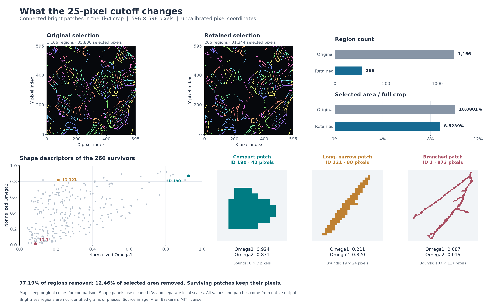
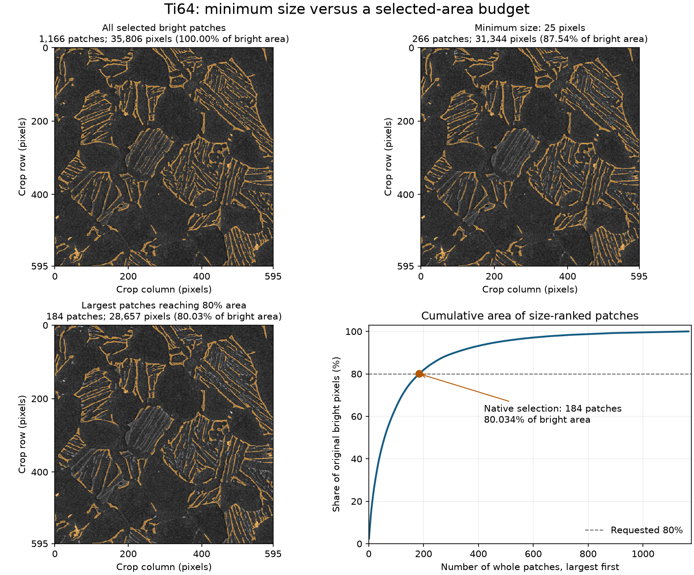

# Ti64 Minimum Size Cleanup

Executable pipeline: `(03) Ti64 Minimum Size Cleanup.d3dpipeline`

> **Before adapting:** These are connected brightness patches in one uncalibrated image. Recheck the brightness threshold, connectivity, pixel size, 25-pixel cutoff, and 80% selected-area target for another image; the reported counts, selected-area fractions, and shapes do not establish grain or material-phase identity.

## At a glance

- **Input:** `Data/Output/Ti64_Segmentation_Examples/Connected/Ti64_ConnectedRegions.dream3d`, made by stage 01.
- **Result:** The existing 25-pixel cleanup and shape measurements, plus a separate selection of whole bright patches covering at least 80% of bright-pixel area. Both share one DREAM3D checkpoint; the ranked selection has its own CSV.
- **Main choice:** Compare an absolute minimum patch size with an area-based review budget. These rules answer different questions; neither identifies noise or material phases.
- **Run order:** Run cleanup 01 → 02 → 03, then segmentation 01; this stage does not depend on segmentation 02.

## Purpose and real-world setting

Connected-component labeling keeps every selected patch, including a single bright pixel. This stage compares a report-only flag with a new image that drops regions below 25 pixels to background. It then measures how much that rule changes the number of regions and their share of the crop. Shape descriptors describe the surviving patches. The cutoff is an exploratory choice, not a physical detection limit or a validated noise cutoff. A second branch keeps the largest whole bright patches until they account for at least 80% of all selected bright pixels. This helps prioritize a limited inspection budget while making the omitted area explicit.

The source is a grayscale conversion, without resizing, of `Images1/image_500.png` in [Arun Baskaran's public Ti-6Al-4V repository](https://github.com/ArunBaskaran/Image-Driven-Machine-Learning-Approach-for-Microstructure-Classification-and-Segmentation-Ti-6Al-4V). The MIT notice is in [SourceDataLicense.txt](SourceDataLicense.txt); the data archive's `Provenance.json` records image transformations and hashes. [Fotos, Campbell, Murray, and Yakushina (2023)](https://doi.org/10.1007/s10853-023-08901-w) supply a microstructural-analysis setting. Their HADMA workflow uses learned class and boundary predictions followed by watershed. These native-filter examples are illustrative and neither reproduce that model nor assign grain or phase identities.

The `Ti64` image is a 596 × 596 × 1 crop of the 604 × 604 source. Its origin is [4, 4, 0] and spacing is [1, 1, 1] in uncalibrated pixels. `UnitIntensity` is a normalized, unfiltered crop. `BrightOriginal` is the preceding pipeline's 0/1 `uint8` selection using the inclusive [0.35, 1.0] interval. It is a brightness selection only. The input checkpoint also retains the source geometry, preparation, smoothing branches, and whole-crop summaries. All new arrays in this suite are added alongside those inputs.

Run the executable `.d3dpipeline` from a writable CLI folder containing `Data`. Relative inputs and outputs resolve from that folder. In the GUI, set absolute paths when `Data/...` does not resolve from the application launch directory. The matching `.yaml` lists the precise stored arguments for discovery; the pipeline is the executable authority. All three examples require the cleanup suite's preparation, smoothing, and threshold pipelines in that order. This suite then runs 01 before 02 or 03. Examples 02 and 03 each read the saved output of 01 and are independent of each other.

## Data flow and choices

| Stage | Choice, alternative, and pitfall |
|---|---|
| Read DREAM3D | Load stage 01, including original `FaceConnectedLabels`, `FaceRegionIds`, `FaceRegionData`, `BrightOriginal`, and source intensity. Preserve these baseline objects. |
| Multi-Threshold Objects, feature table | Compare `Ti64/FaceRegionData/PixelCount > 24` to create `ReportableFaceRegions`. Its true rows have at least 25 pixels; original `Feature_ID` values stay stable. It marks a report and does not remove pixels or modify `FaceConnectedLabels`. |
| Relabel Component Image | Read `FaceConnectedLabels`, set `minimum_object_size=25` and `sort_by_object_size=true`, and write `uint32` `LargeRegionLabels`. Regions under 25 pixels map to zero. Survivors get new consecutive IDs ordered by decreasing pixel count; ties keep their original label order. This operation changes an output image, not the predecessor mask. |
| Convert and mask | Copy cleaned labels to `int32` `LargeRegionIds`. Select `LargeRegionLabels > 0` into the `uint8` mask `LargeRegionMask` so removed pixels and existing background cannot contribute to indexed statistics. |
| Keep region statistics | Group `UnitIntensity` by `LargeRegionIds` under `LargeRegionMask` into `LargeRegionData`, including `PixelCount`, min/max/mean intensity, and `FeatureHasData`. This is the appropriate aggregation for varying pixel intensities. |
| Make two selection classes | Create `SelectionClassData` with two rows. Convert `BrightOriginal` and `LargeRegionMask` to `int32` classes: 0 is the unselected complement; 1 is selected. `CreateFeatureArrayFromElementArray` copies each class to its corresponding original or cleaned feature table. This copy is safe because every pixel within a region has the same class; it must not replace intensity aggregation. |
| Count regions and selected area | `ComputeNumFeatures` counts original and retained positive feature rows by class. `ComputeVolumeFractions` counts selected pixels over all 355,216 crop pixels. Although these filters name their inputs "phases," the inputs here are selection classes. On this one-slice crop the fraction measures 2D area. |
| Describe retained shapes | `ComputeFeatureRect` supplies inclusive pixel-index bounds. `ComputeMomentInvariants2D` computes normalized `Omega1`, `Omega2`, and the nine `CentralMoments` components for `LargeRegionIds`. Measure retained regions only: original labels include singleton patches, which the current moment implementation cannot safely handle. |
| Segment and classify both brightness classes | `ScalarSegmentFeatures` groups equal 0/1 values of `BrightOriginal` with tolerance 0, face adjacency, no mask, no periodic wrapping, and no ID randomization. Both dark and bright components initially receive positive IDs. Indexed statistics and `ComputeFeaturePhasesBinary` give each component a pixel count and uniform `BrightnessClass`. Unlike foreground-only connected components, this makes selection from a complete two-class partition explicit. |
| Select bright components on a copy | Copy the IDs and feature table, flag `BrightnessClass < 1`, and use `RemoveFlaggedFeatures` with **Remove** and **Fill-in Removed Features off**. Dark components become background zero; surviving rows compact together with their `OriginalComponentId`. No neighboring intensity is substituted. |
| Rank the prepared bright population on a copy | `KeepRemoveRankedFeatures` uses **Keep**, **Largest**, **Percent of Summed Value = 80**, ranking by `PixelCount`, with filling off. Rank a copy of the prepared `FaceRegionData`; keep the new bright-only partition as an independent equivalent result. The filter includes the whole patch that crosses the target; it does not select 80% of the object count. |
| Export together | The original `Ti64_MinimumSizeCleanup.csv` still exports positive `LargeRegionData` rows and their shapes. `Ti64_Area80Regions.csv` exports the ranked table with `SourceFaceRegionId` and intensity statistics. The existing DREAM3D checkpoint holds all original arrays and each new ID/table pair. |

The report-only flag and relabeled image identify the same surviving pixel sets, but their IDs have different meanings. Original face ID 47, the largest region at 873 pixels, becomes cleaned ID 1. Match regions by their pixels or a computed mapping, not by numeric ID. The `ReportableFaceRegions` flag is in the original feature table; the cleaned CSV is in `LargeRegionData`. No `RequireMinimumSize` reassignment occurs here: that different operation can assign small-feature pixels to neighbors, whereas this relabel filter drops them to background zero.

## Comparison and interpretation

The two summaries in `Ti64/SelectionClassData` compare selection snapshots on the same crop:

| Measurement | Original bright regions | Retained regions (at least 25 pixels) |
|---|---:|---:|
| Positive region count | 1,166 | 266 |
| Selected pixels | 35,806 | 31,344 |
| Fraction of the full crop | 0.10080064 (10.0801%) | 0.08823927 (8.8239%) |

Removing 900 small patches removes 4,462 pixels: **77.19% of regions but 12.46% of selected area**. The retained fraction is 1.2561 percentage points lower. This shows why object count and selected area answer different questions. No surviving patch changes its pixels, so this comparison does not demonstrate shape evolution.

`OriginalRegionCount` and `RetainedRegionCount` hold `[0, 1166]` and `[0, 266]`. The count filter skips feature row zero; it does not count background as one region. `OriginalAreaFraction` and `RetainedAreaFraction` instead cover both classes and each sum to one. Their row zero is the complement, including discarded bright pixels after cleanup. These fractions do not estimate a material's 3D volume fraction.

The preview preserves original region colors in the retained map for comparison; saved cleaned IDs are size-sorted. Its shape patches use cleaned IDs and measured outputs. A removed region is small under this rule; that alone does not show it was noise.

### Compare a minimum size with an area budget

The binary image has **1,283 components: 1,166 bright and 117 dark**. Dark components contain 319,410 pixels and initially have positive IDs in `TwoClassRegionIds`. Selecting `BrightnessClass = 1` recovers the original foreground pixel sets; numeric IDs need not match.

| Selection | Bright patches | Bright pixels | Share of original bright area |
|---|---:|---:|---:|
| All bright components | 1,166 | 35,806 | 100% |
| At least 25 pixels | 266 | 31,344 | 87.54% |
| Largest patches reaching at least 80% area | 184 | 28,657 | 80.03% |

Orange shows saved native masks over the same source image. The curve summarizes saved patch counts; its marked point uses the native ranked result.

The target is `0.8 * 35,806 = 28,644.8` pixels. The crossing patch has 44 pixels; the first excluded patch has 43, so no tie occurs here. On another image, equal sizes are ordered by current feature ID, making a cutoff tie arbitrary. The effective size cutoff changes with the selected population. Sum an extensive quantity such as pixel count for an area budget; summing aspect ratios would not answer this question.

Pair labels under `Ti64/Cell Data` with their feature tables under `Ti64`:

| Label array | Feature table | Source-ID column |
|---|---|---|
| `TwoClassRegionIds` | `TwoClassRegionData` | `OriginalComponentId` |
| `TwoClassRegionIds_Bright` | `TwoClassRegionData_Bright` | `OriginalComponentId` |
| `FaceRegionIds_Area80` | `FaceRegionData_Area80` | `SourceFaceRegionId` |

`OriginalComponentId` refers to the complete two-class partition; `SourceFaceRegionId` refers to the original `FaceRegionData`. Removal compacts rows in original ID order, so final IDs are **not size ranks**. Row zero remains reserved and is excluded from ranking and CSV export. Neither removal branch fills pixels from neighbors.

Ranking uses the prepared feature table because its population is known during preflight. Newly generated indexed statistics have an unknown preflight size and cannot currently feed this rank filter directly in the same pipeline. Verify that the independent bright-only partition matches the prepared foreground regions by pixel membership.

For `ComputeFeaturePhasesBinary`, select the feature-sized table despite its **Cell Data Attribute Matrix** parameter label. Exact binary segmentation guarantees one mask value per component. With mixed values, the last visited cell wins; this is not majority voting.

Check source-ID joins against the appropriate original label image, sum ranked positive `PixelCount`, and confirm that omitting the last size-ranked patch drops below the target. Compare `Area80Mask` with `LargeRegionMask`. The ranked CSV uses its own compact IDs; the original 25-pixel CSV and shape measurements keep their original meaning.

### Read the retained shape descriptors

The moment filter measures how each patch's occupied pixel area is distributed around its centroid. It returns dimensionless, circle-normalized values. An ideal continuous circle gives `Omega1 = Omega2 = 1`. For a filled ellipse with semiaxes `a` and `b`, `Omega1 = 2ab/(a²+b²)` decreases with elongation, while `Omega2 = 1` for every aspect ratio. Thus `Omega2` alone cannot distinguish a circle from an elongated ellipse. The measured patches are irregular pixel shapes, so compare both descriptors with their label images instead of assigning a shape class from a universal cutoff.

This is useful when comparing occupied shapes without fitting an ellipse to each outline. It does not provide fitted axes, orientation, or a unique reconstruction of the outline. Pixel resolution, crop boundaries, segmentation, and the size selection all affect the result. The two normalized invariants are unchanged by ideal continuous translation, rotation, and uniform scaling; re-rasterizing an image can change its discrete shape.

`FeatureRect` stores `[xmin, ymin, zmin, xmax, ymax, zmax]` in inclusive pixel indices. `CentralMoments` stores a 3 × 3 matrix in row-major order: row is the Y exponent, column the X exponent, each from 0 to 2. Its first component is patch area in pixel²; a component of total order `p + q` has units pixel^(p+q+2). These are integrals over occupied pixel squares, not just moments of point centers. Background row zero is reserved and must be excluded from shape plots and summaries.

The mathematical method is described by [MacSleyne, Simmons, and De Graef (2008), *On the use of 2-D moment invariants for the automated classification of particle shapes*](https://doi.org/10.1016/j.actamat.2007.09.039). This example uses the implemented descriptors as an illustrative measurement; it does not reproduce that paper's microstructures or classification results.

### Checks when changing the selection

Confirm that `LargeRegionIds > 0` matches `LargeRegionMask`, that each positive cleaned ID has at least 25 pixels, and that the sum of cleaned `PixelCount` equals the selected-pixel count. The 266 true `ReportableFaceRegions` rows must identify the same surviving pixel sets despite reordered IDs. Keep each ID image paired with its own feature table. Selection classes must remain `int32` 0/1 with two summary rows and be constant inside each region. Before reusing the moment steps, check for dense positive IDs, a single XY slice, valid bounds, and finite descriptors; the supplied retained patches have no missing ID rows or singleton regions.

The 25-pixel cutoff depends on image resolution, crop, threshold, and adjacency. With unknown physical spacing, it cannot be called a minimum square-micrometer area. The result does not identify grains or reproduce the paper's learned segmentation. A defensible application would calibrate length, define the object to detect, measure false removals and retained artifacts against independent labels, and tune the cutoff on training data before checking it on held-out images. To approach Fotos et al., first reproduce their class and boundary inference and watershed with verified references.
