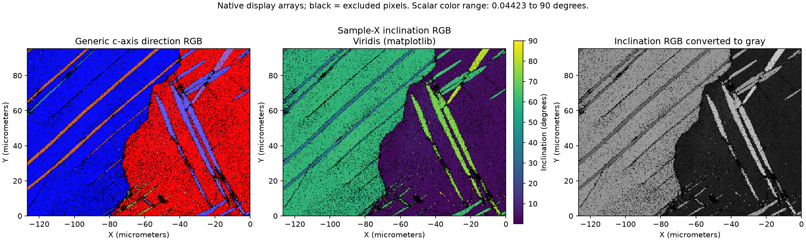

# Cambridge Ti Import and C-Axis Directions

Executable pipeline: `(01) Cambridge Ti Import and C-Axis Directions.d3dpipeline`

> **Before adapting:** Confirm the indexed-pixel rule and sample/crystal reference frames. Keep the validity mask with numeric and display arrays; RGB and gray fields are derived display encodings.

Use this stage when you need a validity-aware, measured alpha-Ti map before any segmentation. Place the original `case_study_2_titanium_data.cpr` and `.crc` together in `Data/CambridgeTitanium/` and run from a writable working directory. The map is one XY slice of 507 by 381 pixels with 0.25 µm spacing. The importer creates unit z spacing for software geometry; it is not a measured 3D section. Preserve the raw arrays and decide your own indexed-pixel rule for another scanner or dataset.

## At a glance

| Item | Value |
| --- | --- |
| Input | `Data/CambridgeTitanium/case_study_2_titanium_data.cpr` plus paired `.crc` |
| Output | `Data/Output/Cambridge_Ti_CAxis_Examples/Prepared/CambridgeTi_Prepared.dream3d` |
| Main fields | `IndexedPixels`, unchanged `Phases`, `AnalysisPhases`, `Quats`, `CAxisDirections`, `CAxisInclinationXDegrees` |
| Measured map | 193,167 pixels; 164,274 indexed, 28,893 excluded by the stated quality rule |
| Preview | [Native vector, inclination and gray display layers](CambridgeTiCAxisInclination.png) |

## Purpose and real-world setting

The paper compares spatial orientation relationships in commercially pure alpha titanium after room-temperature ballistic deformation. This preparation isolates interpretable c-axis directions in the measured specimen frame. It does not assign deformation mechanisms.

## Data flow and filter choices

`ReadChannel5DataFilter` reads both Oxford files and retains the native hexagonal crystal alignment with `edax_hexagonal_alignment=false`. `RotateSampleRefFrameFilter` applies the documented Oxford **sample** correction: 180° about sample Y. It remaps pixels without an additional crystal/Euler rotation. A basal crystal-reference change would not change projected c-axis directions, but it can change full misorientation coordinates.

`MultiThresholdObjectsFilter` marks `Error == 0 AND Bands > 0 AND Phases == 1`. The original map reports raw `Phases=1` even at unusable pixels. `CopyDataObjectFilter` and `RenameDataObjectFilter` preserve this raw array as `Phases` and create `AnalysisPhases`; `ConditionalSetValueFilter` sets only excluded analysis phases to zero. This prevents finite but unindexed orientations from entering c-axis calculations. No pixel infill or cleanup occurs. `ConvertOrientationsFilter` converts radians-based Euler angles to `Quats`, then `ComputeCAxisLocationsFilter` writes sample-frame `CAxisDirections`. The display steps below use those prepared vectors before `WriteDREAM3DFilter` saves the full checkpoint.

The following display steps preserve those inputs and keep quantitative values separate from presentation choices:

| Operation | Choice and reason |
| --- | --- |
| Generate Vector Colors | Normalize valid `CAxisDirections` and color their sample-plane azimuth, blending toward white near +Z. Negative-Z vectors are reversed; this generic hemisphere key is useful for an axis field but does not encode full crystallographic orientation or vector magnitude. |
| Array Calculator | Save `acos(abs(CAxisDirections[0]))` with **Degrees** selected as `CAxisInclinationXDegrees`. The absolute value treats ±c as equivalent. Excluded directions produce NaNs, which remain undefined analysis values. |
| Copy; Replace Value in Array | Create `CAxisInclinationXDegrees_Display` and replace only excluded entries with 90. Color-map range calculation scans masked values too; the separate finite copy makes that behavior explicit without changing scientific values. The placeholder is not an observation. |
| Create Color Map | Use the exact preset **Viridis (matplotlib)** on the display copy; `IndexedPixels` makes excluded RGB pixels black. For this fixture, the native scalar range is about **0.04423 to 90 degrees**. |
| Color to GrayScale, twice | Make `Gray_CAxisVectorRGB` and `Gray_CAxisInclinationX_RGB` with weights [0.2125, 0.7154, 0.0721]. Select one RGB array per call to avoid [#1759](https://github.com/BlueQuartzSoftware/simplnx/issues/1759). These are monochrome previews of display colors. |

The corrected NX sample-frame view has a different left/right display convention from paper figure 10; do not transfer figure labels to this map.

## Outputs and interpretation

Indexed c-axis vectors are finite, approximately unit length, and oriented with nonnegative z by the native filter. Excluded vectors are undefined; mask them before visualization or statistics. For this source, the accepted and excluded counts above came from the native output. A small inclination means c is close to sample X, not a measured slip response or strain estimate.

All panels display saved native arrays. In `Titanium/Cell Data`, compare `CAxisVectorRGB` with `CAxisInclinationX_RGB`: the first conveys the generic direction key, while the second represents one scalar inclination. Both are uint8 RGB arrays and leave the 28,893 excluded pixels black. Gray copies also have zero at excluded pixels; accepted gray ranges are 20-251 for direction RGB and 21-222 for inclination RGB. Gray levels are dimensionless display values, not degrees or detector intensity.

Keep `CAxisInclinationXDegrees` and `IndexedPixels` for quantitative work. The finite `_Display` copy exists only for rendering. The color-map filter normalizes the whole input array, so the same preset need not give the same numeric value the same color on another map. Use a controlled scalar visualization range when cross-map comparison is required. Grayscale can merge distinct colors and cannot recover the original direction or angle.

## Adaptation, alternatives, and pitfalls

For a different Oxford map, inspect `Error`, `Bands`, and `Phases` distributions before copying this mask. A simple `Phases>0` rule would falsely accept 28,893 pixels here. Do not rotate Euler values by a compensating 30° to imitate a basal-axis option; this c-axis example intentionally keeps the source alignment and names that choice. A different sample-frame convention changes the visual coordinate directions and requires a documented transform. Check that raw `Phases` remains unchanged, `AnalysisPhases` equals 1 only where `IndexedPixels` is true, and undefined c-axis locations are excluded.

## Scientific basis and assistant guidance

[Krakow et al. (2017), *On three-dimensional misorientation spaces*](https://doi.org/10.1098/rspa.2017.0274) uses this original alpha-Ti EBSD case in its full misorientation and twin-boundary analysis. The [Cambridge companion dataset](https://doi.org/10.17863/CAM.8815) supplies the original Oxford CPR/CRC pair and author `section4b.m` script under CC BY 4.0. Credit Robert Krakow and coauthors and the Cambridge repository when adapting or redistributing derived work. This example is **illustrative**: it does not reproduce MTEX grain identifiers, full three-parameter misorientation clusters, twin classifications, or figure-10 pixels.

For an LLM or MCP assistant: inspect the authoritative JSON before recommending edits; keep the paired original files, relative working directory, mask semantics, and sample/crystal-frame distinction explicit. The [suite README](README.md) gives run order and provenance. Generated Python and OOC execution are separate checks.
