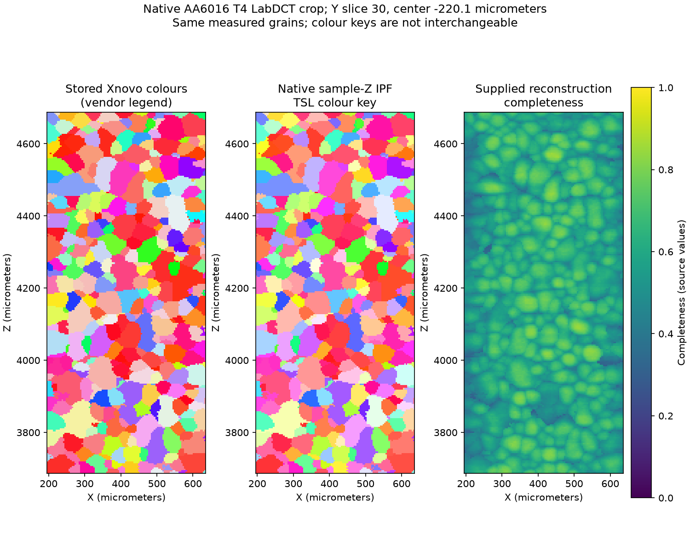

# Gille Aluminum LabDCT Preparation

Executable pipeline: `(01) Gille Aluminum LabDCT Preparation.d3dpipeline`

> **Before adapting:** Confirm orientation conventions, geometry units and prior preprocessing. This is an already prepared crop; boundary grains are incomplete, and the pipeline does not reproduce the paper's deformation simulation.

## At a glance

| Item | What to expect |
| --- | --- |
| Question | How do I bring a measured LabDCT grain map into NX without losing its orientation meaning, units or grain identity? |
| Data | Public AA6016 T4 aluminium crop linked to Gille et al.; [README setup](README.md) |
| Grid | **110 × 60 × 250**, spacing **0.004 mm** = 4 µm; 1,650,000 voxels |
| Population | **1,666** source grains; **931** touch crop faces and **735** are interior |
| Results | `GilleAluminum.dream3d` and `GilleAluminum_Grains.csv` under `Data/Output/Gille_Aluminum_LabDCT_Examples/` |
| Main choices | Keep original labels; convert orientation convention once; recompute NX IPF colours; flag crop truncation instead of deleting grains |

## Purpose and real-world setting

[Gille et al. (2024)](https://doi.org/10.1016/j.ijplas.2024.104146) used measured grain structure to investigate deformation in an automotive aluminium alloy. The later [public dataset](https://doi.org/10.18126/yc1m-nk41) provides a central undeformed crop for microstructure preparation and meshing examples. This pipeline prepares that reconstruction for inspection and further analysis. It does not reconstruct diffraction images or predict deformation.

## Data flow and choices

| Stage | Motivation, alternatives and pitfalls |
| --- | --- |
| Read GrainMapper3D, LabDCT only | Import the measured grain labels, reconstruction completeness, phase metadata and orientations. Keep **millimetres**, including the source's virtual shift. AbsorptionCT is omitted because this task needs the grain map; reading the accompanying CT would add a much larger volume without reproducing registration or strain analysis. |
| Compatible phase and orientation data | Widen PhaseId to Int32 and convert source Rodrigues triples **r** to NX's inverse-convention **[-r/‖r‖, ‖r‖]**. The four-component result is unit axis plus magnitude, not three Rodrigues components or axis plus angle. This source has no zero vectors; the current reader needs separate handling for identity vectors. |
| Mask; Convert Orientations | Combine supplied Mask, positive phase and positive grain ID. All cells pass here. Convert the compatible four-component Rodrigues array to **Euler radians**. No second conjugation or CTF/ANG frame correction is appropriate. |
| Native IPF colours; explicit vendor RGB | Recompute sample-Z colours with **TSL**, colour-key choice 0, for use with the matching NX legend. Preserve the source float `IPF001`; scale a copy by 255 to UInt8 for a separate vendor-colour display. Similar colours do not establish identical legends. |
| Statistics by GrainId | Create a grain table using the original IDs and summarize supplied completeness. No completeness threshold or segmentation is added. Completeness is a reconstruction-quality field, not strain or a probability. |
| Feature sizes, crop-boundary flags and phases | Count retained voxels and measure their observed volumes and equal-volume sphere diameters. Flag grains touching any crop face before interpreting those sizes as whole-grain measurements. |
| Below-27 flag; feature CSV; native save | Audit the published 27-voxel statement without deleting or reassigning data. Export all positive grain IDs; reserved row 0 is omitted from the feature CSV. |

The validity mask controls colours and completeness statistics; the size filter counts all retained `GrainId` labels. Every cell is valid here. With another source, resolve invalid labels and mixed-phase grains explicitly before treating the sizes as valid measurements.

**Reader colour limitation:** [#1805](https://github.com/BlueQuartzSoftware/simplnx/issues/1805) tracks a failure when compatible IPF conversion expects missing `IPF010`/`IPF100` arrays. This file contains only `IPF001`, so **Create Compatible IPFColor Data is off**. The explicit scaling step handles that one array. If a fixed reader later converts it to UInt8, remove the scaling step to avoid multiplying byte colours by 255 again.

## Outputs and interpretation

Display `AluminumLabDCT` using `NX_IPF001_RGB`, or inspect the same native arrays below. The figure shows Y index 30; plot axes are labelled in micrometres for readability while the saved geometry remains in millimetres.

| Inspect in the native result or CSV | Expected result and interpretation |
| --- | --- |
| `Cell Data/GrainId` | Original IDs 1–1,666 and every voxel label preserved. No resegmentation or renumbering. |
| Geometry | Origin approximately **[0.19552725, -0.34209903, 3.68725684] mm**, from Center − Extent/2 + VirtualShift. The published coordinate roles are X thickness, Y near-zero-strain direction and Z tensile direction. |
| `Grain Data/NumElements`, `ObservedVolume_mm3` | Counts sum to **1,650,000**; observed volumes sum to about **0.1056 mm³**. One voxel occupies 0.000000064 mm³. |
| `AtCropBoundary` | 931 flagged grains. These are crop faces, not physical free surfaces; their volumes and equivalent diameters describe retained fragments. |
| `Below27Voxels` | Only **grain 1049**, with **23 voxels**, is flagged, and it touches a crop face. It remains in the output. |
| Completeness columns | Minimum, maximum and mean of the original voxel values within each grain. Grouped means use Float32 accumulation; retain sensible precision rather than interpreting their last digits. |

The [catalogue](https://acdc.alcf.anl.gov/mdf/detail/0989ee07-e015-494d-8805-8e2703e76763-1.0/) and tutorial state a 27-voxel minimum, but the actual download contains the 23-voxel boundary grain above. Cropping can truncate grains; this file alone does not establish why the discrepancy occurred. We preserve and flag it rather than silently forcing the stated minimum. A 27-voxel criterion also represents a different physical size when voxel spacing changes.

The dense grain map contains no void labels. That does **not** mean the real alloy contains no pores or intermetallic particles: this is a prepared grain reconstruction, not a porosity measurement. Neither an equivalent sphere diameter nor reconstruction completeness predicts mechanical response.

## Relationship to the paper and extensions

| Published step | Why it is outside this example; how to continue |
| --- | --- |
| Small-grain removal/filling and crop preparation | The released crop is already prepared. Repeating cleanup would alter the supplied labels; inspect the flags and processing history before doing so. |
| Laguerre tessellation, regularization and quadratic tetrahedral meshing | These are Neper operations, not this import pipeline. Follow the [Xnovo/gm3dh5 Neper workflow](https://github.com/xnovotech/gm3dh5/blob/main/doc/source/user/neper/index.rst) when that mesh construction is required. |
| Multimodal registration, projection-DIC and CP-FE | One undeformed crop is insufficient. Reproduction requires the additional scans, alignment, calibrated material model and loading boundary conditions described in the paper. A mesh or grain table alone is not a validated simulation. |

For another GrainMapper3D file, inspect available orientation and colour arrays, phase mappings, units, invalid voxels and crop boundaries before reusing these settings. Preserve the [CC BY 4.0 attribution](SourceDataLicense.md) with derived results.
