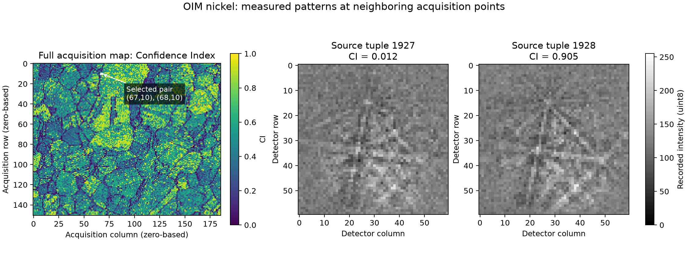

# OIM Nickel Pattern Inspection

Executable pipeline: `(01) OIM Nickel Pattern Inspection.d3dpipeline`

**Before adapting:** Confirm the scan, detector layout, and coordinate conventions for your input; this pair is an inspection example, not a good/bad indexing rule.

## At a glance

- **Question:** What detector patterns underlie the sharp Confidence Index (CI) difference between two adjacent nickel scan points?
- **Input:** The official measured `EdaxOIMData.h5` sample, `Scan 1`: 186 by 151 points at 1.5 micrometers XY spacing, each with a 60 by 60 `uint8` detector pattern.
- **Result:** Full scalar-map context, the two unmodified patterns, a 7,200-byte raw export, and a two-row identity/metrics manifest.
- **Scope:** Inspect acquisition data and prepare a small external handoff. No reindexing, orientation analysis, or explanation of the CI difference is claimed.

## Purpose and real-world setting

Follow two neighboring EBSD map points back to their measured detector patterns for inspection or external analysis. Their CI contrast makes the pair easy to locate; it does not establish correct indexing or explain the difference.

## Input and assumptions

Place the [official sample](https://github.com/BlueQuartzSoftware/simplnx/releases/download/Data_Archive/6_6_ImportH5Data.tar.gz), archive member `6_6_ImportH5Data/EdaxOIMData.h5`, at `Data/OrientationAnalysis/EdaxOIMData.h5` in the working folder. Existing builds copy it to runtime data; normal package installation is pending. `DataSources.json` records checksums.

The required Z spacing of 1 is a single-slice placeholder, not measured thickness. Acquisition order and imported Euler angles are preserved because this task inspects detector data. Before extending to IPF colors or specimen-direction analysis, confirm acquisition settings and apply the appropriate crystal/sample frame corrections from the reader documentation; rotations from another acquisition may be inappropriate.

## Data flow and choices

| Stage | Why this choice, and what to watch for |
|---|---|
| Read EDAX OIMAnalysis Data, with **Import Pattern Data** on | Retains measured detector intensities alongside CI, Image Quality (IQ), and Fit. The default without patterns cannot answer this inspection question. Import reads all 28,086 patterns, about 101 MB before other overhead. |
| Create `SourceScanIndex`, then crop | Sequential `uint32` IDs preserve acquisition identity. Inclusive bounds `[67,10,0]` to `[68,10,0]` copy two adjacent map cells and all their arrays together. The crop selects scan points; it does not crop detector pixels. Copied fixed phase metadata remains valid (warning `-4015`); derived feature statistics would need updating after a different crop. |
| Delete redundant patterns and empty coordinate arrays | The selected patterns have their own copy, so remove the full-map `Pattern` to reduce the saved result. Also remove both geometries' unpopulated `X Position`/`Y Position` arrays; zero placeholders would mislead later consumers. Import peak memory and source HDF5 are unchanged. |
| Write Binary Data and Write ASCII Data | Export a raw stream plus source identity/metrics in matching order. Include tuple zero: both rows are records, with no reserved background row. |
| Write DREAM3D | Keep shapes, geometry, scalar context, and selected patterns together; the raw stream cannot carry metadata. |

## Outputs and interpretation

All products are under `Data/Output/OIM_Nickel_Pattern_Examples/Inspection/`:

- `OIM_Nickel_PatternInspection.dream3d`: `OIM Nickel` contains the full scalar map; `Selected Patterns/Cell Data/Pattern` contains only the selected patterns.
- `SelectedPatternManifest.csv`: columns `SourceScanIndex`, `Confidence Index`, `Image Quality`, and `Fit`, with the two rows below. X/Y positions are **not** CSV columns.
- `Pattern.bin`: headerless `uint8`, shape `(2,60,60)` in **pattern, then detector row, then detector column** order, 7,200 bytes. Native tuple shape is `[1,1,2]` and component shape `[60,60]`; no reshape filter is needed. Little endian is selected, but byte order does not affect one-byte values. This is not an EDAX UP1 file; renaming its extension would not make it one.

| SourceScanIndex | Acquisition-grid (x, y), zero-based | CI | IQ | Fit |
|---:|---|---:|---:|---:|
| 1927 | (67, 10) | 0.012 | 4128.9492 | 1.753 |
| 1928 | (68, 10) | 0.905 | 4468.7432 | 0.818 |

Recover grid indices with `x = SourceScanIndex % 186`, `y = SourceScanIndex // 186`. Source HDF5 XY positions are `(100.5,15)` and `(102,15)` micrometers, distinct from detector pixels and Image Geometry cell centers. The current reader creates X/Y arrays but leaves them zero for this input; this pipeline removes those placeholders ([simplnx #1789](https://github.com/BlueQuartzSoftware/simplnx/issues/1789)). Match records by source index and use saved geometry origin/spacing for map display.

The figure uses saved native arrays: acquisition-grid CI with the pair marked, and detector images with shared 0 to 255 grayscale limits and nearest-neighbor display. CI contrast alone proves neither noise, a boundary, deformation, nor indexing correctness.

## Adapting and checking

For another location, change both inclusive crop endpoints and check IDs, byte count, detector dimensions, and tuple order. Larger or multiscanned selections need an updated binary contract and explicit scan identity.

The source `Phase` and `Valid` fields are all zero in this sample. The reader maps nonpositive phase IDs to 1 and does not import `Valid`: **`Phases > 0` is not an indexing-validity mask here**. No CI threshold is imposed, and the two points are not labeled good or bad. A later analysis needs a justified admission rule and confirmed frame conventions.

Check byte-for-byte agreement between the two source patterns, saved native array, and `Pattern.bin`, plus both manifest rows and retained scalar map. The exact binary SHA-256 is `3bb5537eda525095b25f26df9f55377b71eef94b2aa13b01f64be4d44cedd783`.

## Scientific basis and reuse

This is an **illustrative measured-data workflow**, not reproduction of a scientific paper. The [official Data_Archive release](https://github.com/BlueQuartzSoftware/simplnx/releases/tag/Data_Archive) supplies the sample. Public distribution is established, but no separate dataset license or additional redistribution permission was found; this example does not install or upload the input data. Current filter implementations define import, crop, tuple order, and binary/CSV behavior.

For an AI assistant: distinguish acquisition indices, physical map coordinates, and detector pixels; retain the binary contract and source identity. Confirm frames and indexing validation before adding orientation analysis. The `.d3dpipeline` is authoritative.
