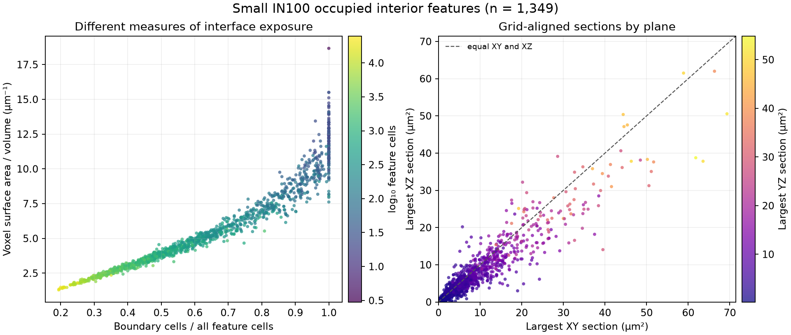

# Small IN100 Boundary and Section Measurements

Executable pipeline: `(01) Small IN100 Boundary and Section Measurements.d3dpipeline`

> **Before adapting:** **Validation warning:** Do not treat this example as a validated acceptance procedure. Adapt and validate it for the scanner, material, resolution, and quality requirement.

## At a glance

| Question | Answer |
| --- | --- |
| Use this when | You want to compare grain boundary exposure and largest grid-aligned sections in a reconstructed 3D EBSD image |
| Input | Full Small IN100 Feature Measurements checkpoint |
| Main result | Boundary-cell fraction, voxel surface-to-volume ratio, sphericity, and largest XY/XZ/YZ slice areas per feature |
| Reporting cohort | Occupied positive IDs; use `InteriorFeatures` for whole-grain interpretation |

## Purpose and real-world setting

An analyst comparing reconstructed grains may ask how much of each grain lies at a segmented interface, how much voxel-face area it has relative to its volume, and how large a section it presents in each image plane. This example computes those descriptors on the same original `FeatureIds`. It helps prioritize grains for inspection, but a large boundary-cell fraction is not a surface-area fraction, and an axis-aligned slice is not the maximum possible oblique section.

The 2014 [Groeber and Jackson paper](https://doi.org/10.1186/2193-9772-3-5) provides the measured 3D reconstruction and feature-statistics setting. The present descriptor comparison is an **illustrative extension** using the public Small IN100 measured sections. It does not reproduce a named numerical result or prove exact identity with the publisher's supplements.

## Input and workflow

Run the Archive, Feature Preparation, and Feature Measurements pipelines in that order. The [README](README.md) gives their exact paths and a command-line example. This pipeline reads `Data/Output/Small_IN100_Examples/Measurements/SmallIN100_FeatureMeasurements.dream3d`, a full 189 × 201 × 117 image on an isotropic 0.25 µm grid. It does not crop, resample, or change the final `FeatureIds`. `ParentIds` describe twin grouping and are not used here.

| Step and key choice | Why it is here |
| --- | --- |
| Read DREAM3D | Reuse the full measurement checkpoint and its `NumElements` feature rows |
| Compute Surface Features, mark feature-0 neighbors | Flag grains touching either the image frame or in-bounds background 0 |
| Multi Threshold, `NumElements > 0 AND SurfaceFeatures == 0` | Create `InteriorFeatures`, the occupied, uncut cohort for whole-grain reading |
| Compute Boundary Cells, `ignore_feature_zero=false`, `include_volume_boundary=false` | Count each cell's unlike in-bounds face neighbors, including contacts with label 0 and excluding faces beyond the image |
| Compute Boundary Element Fractions | Divide the number of cells with one or more unlike neighbors by each feature's cell count |
| Compute Surface Area to Volume, sphericity enabled | Estimate exposed voxel-face area per feature volume and a compactness descriptor |
| Compute Largest Cross Sections, XY/XZ/YZ | Store the largest feature area among slices parallel to each image plane |
| Write DREAM3D | Preserve the full source arrays and original IDs beside all new results |

The boundary-cell output is a per-cell **count** of unlike neighbors, not a Boolean or a physical area. A cell can have several unlike faces but contributes once to `BoundaryCellFractions` whenever its count is positive. Surface area instead adds face areas. The current surface-area algorithm includes in-bounds contacts with background 0 and omits faces outside the image, so the chosen boundary-cell settings align with that observed contact policy. They do not make the two quantities interchangeable.

## Outputs and interpretation

The output is `Data/Output/Small_IN100_Boundary_Examples/Measurements/SmallIN100_BoundarySections.dream3d`. `BoundaryNeighborCounts` is under `DataContainer/Cell Data`. `InteriorFeatures`, `BoundaryCellFractions`, `SurfaceAreaToVolume`, `Sphericity`, and `LargestSectionXY/XZ/YZ` are under `DataContainer/Cell Feature Data`. Each feature array uses the original feature-row index.

Interpret `BoundaryCellFractions` as a unitless cell fraction. `SurfaceAreaToVolume` has units µm⁻¹; it is the algorithm's voxel-face estimate, with a stair-step resolution bias. `Sphericity` is unitless. The largest section arrays have units µm²: each stores the maximum count in the selected stack of grid-aligned slices multiplied by 0.25 × 0.25 µm². They do not search rotated or oblique planes and do not identify a grain's principal section.

Background feature 0 is not a grain. The predecessor deliberately stores `NumElements[0] = 0`. Unused positive rows also have zero elements; the boundary-fraction algorithm produces NaN for those rows. Analyze positive rows with `NumElements > 0`, and use `InteriorFeatures == true` when claiming a complete observed grain. A feature touching the image frame can have omitted exterior faces, so its reported surface-to-volume ratio and sphericity are partial-domain descriptors.

The preview plots only occupied interior features. It is a visual guide to the saved output, not a criterion for accepting a reconstruction.

## Adaptation and checks

When changing the label image, first check geometry dimensions, spacing, units, feature-row count, and whether `NumElements` matches the final labels. Recompute Surface Features and `InteriorFeatures` after any crop, background cleanup, or relabeling. Include image-frame faces only if that is the intended physical boundary rule, and document the resulting mismatch or match with the surface-area computation.

For a different voxel size, expect surface and section estimates to change with segmentation and voxel aliasing. This example uses isotropic 0.25 µm spacing. The current surface-area implementation has a [confirmed anisotropic face-weighting defect](https://github.com/BlueQuartzSoftware/simplnx/issues/1780): X/Y-normal face areas are wrong when X and Y spacing differ. This isotropic example is unaffected. Do not use that filter's surface-to-volume or sphericity results for unequal X/Y spacing until the defect is fixed and verified. For smooth-interface area, oblique maximum sections, or calibrated material acceptance, choose and validate a method designed for that purpose.

After a run, confirm that the output contains the original `FeatureIds` and `NumElements`, that boundary counts lie in 0–6, that occupied feature fractions lie in [0, 1], and that all section areas are nonnegative and no larger than `NumElements × 0.0625 µm²`. Compare a few features with independent face-neighbor and slice counts. Missing predecessor files, absent output folders, label IDs beyond the feature-matrix extent, and mismatched spacing are reasons to stop and correct the inputs.

The registered Windows in-memory Release CTest passed 1/1 in 19.67 seconds. An independent audit of the saved output passed 17/17 checks: all 4,444,713 cell boundary counts and all three feature-section arrays matched direct counts, and 27 input datasets were preserved. The output has 2,317 occupied positive features, 1,349 interior features, and 17 unused positive rows. The sphericity comparison had a maximum relative difference of 5.29543 × 10⁻⁵, within the algorithm's 5.34110 × 10⁻⁵ formula-approximation bound. These checks cover this input and Windows in-memory execution; OOC, generated Python, GUI, and exact paper-result reproduction remain unverified.

## Scientific basis and assistant guidance

[Groeber and Jackson (2014)](https://doi.org/10.1186/2193-9772-3-5) describe a 3D microstructure reconstruction and feature-statistics workflow. The [public Small IN100 archive](https://www.dream3d.io/Data_Archive/Small_IN100.tar.gz) supplies 117 measured ANG sections; the suite README records its SHA-512. The article is CC BY 2.0. Separate raw-archive redistribution terms have not been established, and this folder contains no raw sections or processed DREAM3D volume.

For an LLM or MCP assistant: establish whether the user wants a fraction of boundary **cells**, a physical **face area**, or a largest **grid-aligned slice**. Keep those definitions separate. Check the `InteriorFeatures` cohort before comparing complete-grain shapes. Treat the `.d3dpipeline` as the executable authority; its YAML sidecar records every argument and parameter version.
