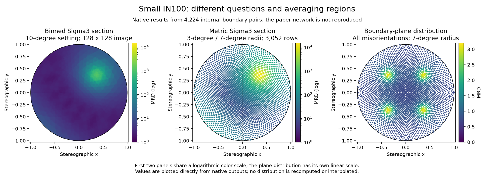

# Small IN100 Boundary Distribution Comparison

Executable pipeline: `(01) Small IN100 Boundary Distribution Comparison.d3dpipeline`

> **Before adapting:** Boundary distributions depend on reconstruction quality, sampling, and estimator settings. Confirm the source's orientation conventions and physical calibration; this example interprets normalized area weights, not absolute physical areas.

## At a glance

| Item | Meaning |
| --- | --- |
| Input | Public, already processed Small IN100 boundary mesh; original grain orientations and unique boundary-pair table |
| Question | How do a binned fixed-misorientation section, a metric section, and a boundary-plane distribution differ? |
| Population | **4,224 internal grain-boundary pairs / 636,954 valid internal triangles** after removing 12 degenerate faces |
| Fixed misorientation | Sigma3: 60° about [111]; a relationship between neighboring crystal orientations, not a declaration that every selected face is a coherent twin |
| Main outputs | A native GBCD array and pole image, distribution/error text files, and a triangle-data export |
| Scope | Illustrative analysis of a released prepared network; original paper reconstruction and peak values are not reproduced |

## Purpose and real-world setting

A grain boundary has both a rotation between its two crystals and a plane direction. A GBCD describes their joint, five-parameter distribution. A fixed-misorientation section asks which planes occur near a selected crystal relationship. A GBPD instead summarizes planes over all misorientations. These answer different questions even when they use the same mesh.

Values are **multiples of a random distribution (MRD)**: 1 is the random-reference density, not 100% of boundary area. A high peak is a concentration within the estimator's neighborhood. It is not a boundary strength, energy, or material acceptance score.

## Input and data flow

Download and stage the original file as described in the [README](README.md). The prepared input already includes paired face labels, average Euler radians, phase metadata, node types, and a unique boundary-pair table. Its construction is not rerun here. The imported `Meter` tag does not establish physical calibration; this example makes no absolute size claim. A common length-scale factor cancels from normalized area weights, but inconsistent scaling or incorrect normals would change the analysis.

| Operation | Choice and reason |
| --- | --- |
| Threshold and remove degenerate triangles | Remove exactly the 12 source faces with zero area and undefined normals. Keep all other triangle coordinates, winding, and grain labels. This is not a small-boundary cutoff. |
| Recompute triangle areas and normals | Use the reduced mesh consistently. All 4,224 internal pairs remain represented, so the supplied unique-pair table is still suitable for counting boundaries. Its original per-pair triangle counts describe the source mesh, not the reduced mesh. |
| Compute GBCD | Use phase 1 and a nominal **10°** resolution to inspect a coarse partition on the paper's comparison scale. Native bins are not equal-radius angular neighborhoods; a finer partition costs memory and needs more boundary data. The populated phase histogram has mean 1 after normalization. Reserved phase 0 has no observations and is undefined; do not aggregate it with phase 1. |
| Compute pole figure; export GMT section | Probe the binned distribution at 60°/[111]. The image is **128 × 128**; the GMT writer samples a different angular grid. More image pixels improve display sampling, not experimental resolution. Projection coordinates are dimensionless despite the current image unit tag ([#1803](https://github.com/BlueQuartzSoftware/simplnx/issues/1803)). |
| Compute GBCD, metric approach | Select **3° misorientation / 7° plane** radii, following the paper's example bandwidth choice. Request 3,000 hemisphere points and save absolute sampling errors. These radii need reassessment for another reconstruction; they are not validated measurement uncertainties for this fixture. |
| Compute GBPD, metric approach | Use a **7° plane** radius over all eligible same-phase boundaries. There is no fixed-misorientation selection here. A plane-distribution peak cannot be interpreted as a Sigma3 population. |
| Keep junction-adjacent faces | Set triple-line exclusion off in both metric filters to keep a consistent baseline population. Turning it on selects only triangles whose three node types are ordinary interior nodes, also dropping box-edge and higher-junction faces. Reassess the contributing boundary count before interpreting errors for a changed population. |
| Write triangle data | Export both grain orientations, normals, and areas for other boundary tools. This is a four-decimal text transfer, not a lossless mesh export; retain the native checkpoint for precision. |

**Parameter-order pitfall:** the binned pole-image and GMT filters take **[angle, axis X, axis Y, axis Z] = [60,1,1,1]**. The metric GBCD filter takes **[axis X, axis Y, axis Z, angle] = [1,1,1,60]**. All angles are degrees in these controls; grain Euler arrays remain radians. Do not copy the four values unchanged between these filters.

## Outputs and interpretation

The first two panels share a logarithmic MRD scale; the third uses a separate linear scale. All values come from native outputs. The plotter only displays the image or projects supplied angular coordinates; it does not compute distributions. Different kernels and sample grids can give different maxima without showing which reconstruction is more accurate.

All files below are in `Data/Output/Small_IN100_Distribution_Examples/`:

| Output | What to inspect |
| --- | --- |
| `SmallIN100BoundaryDistributions.dream3d` | `BoundaryMesh/Face Ensemble Data/GBCD`, **phase 1**; `BinnedSigma3Section/Cell Data/MRD`; source and reduced meshes |
| `BinnedSigma3.dat` | 3,751 samples; maximum about **1,120 MRD**. The image-grid maximum is about **1,154**, because its sample positions differ. |
| `MetricSigma3_1.dat`, `MetricSigma3Errors_1.dat` | 3,052 matched rows; peak about **12,176 MRD**. The second file reports absolute estimated sampling errors in MRD. |
| `PlaneDistribution_1.dat`, `PlaneDistributionErrors_1.dat` | 3,624 symmetry-expanded rows; density about **0.732–3.144 MRD**. Output rows are sampling directions, not independent boundaries. |
| `InternalBoundaryTriangles.ph` | 636,954 rows: three Euler radians for each grain, three normal components, then area in the unconfirmed source coordinate scale squared. Four-decimal formatting rounds **178 positive areas to zero**; avoid this text file for lossless area-weighted recalculation. |

Each `.dat` has a four-number axis-angle header; GBPD uses four zeros. Subsequent columns are **azimuth degrees, elevation degrees, value**. Preserve the `_1` filenames used by the metric writers. Error rows match their distribution coordinates.

The error model uses **distinct boundaries**, not triangle count; subdividing a face does not create new observations. Report the estimates as sampling-model outputs, not total uncertainty from segmentation, surface reconstruction, reference frames, or calibration. Uncertainty interpretation and materials conclusions need expert review.

## Scientific basis and adaptation

[Glowinski and Morawiec (2014), *Analysis of Experimental Grain Boundary Distributions Based on Boundary-Space Metrics*](https://doi.org/10.1007/s11661-014-2325-y) motivates the comparison and metric radii. Their network had about 13,000 boundaries and 2.5 million triangles. This later public validation fixture has fewer boundaries and a different prepared mesh; its cleanup history and exact identity with their input have not been established. Do not claim reproduction of the paper's peaks or use its error levels as targets.

For another mesh, verify face-label/normal correspondence, radians, phase/symmetry, finite positive areas, and one row per distinct boundary. Rebuild that pair table if whole boundaries disappear. The existing Shared Feature Face issue [#1772](https://github.com/BlueQuartzSoftware/simplnx/issues/1772) is avoided here by using and checking the supplied table. Preserve source attribution and review redistribution terms before packaging a new input.

For an assistant: keep the three statistical questions separate, inspect exact JSON parameter ordering, retain phase-1 selection and source history, and do not describe more triangles or more plotted points as more independent evidence.
