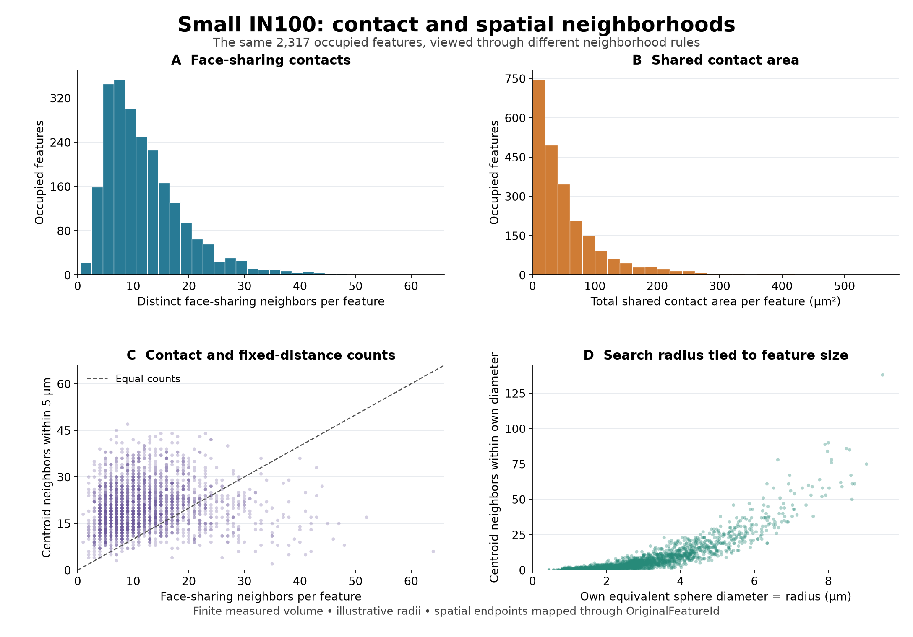

# Small IN100 Neighbor Relationships

Executable pipeline: `(06) Small IN100 Neighbor Relationships.d3dpipeline`

> **Before adapting:** This pipeline is configured for SmallIN100. Review its input requirements, assumptions, units, and parameters before using other data. Do not treat this example as a validated acceptance procedure. Adapt and validate it for the scanner, material, resolution, and quality requirement.

## At a glance

- **Input:** The saved `(02) Small IN100 Feature Measurements` DREAM3D file.
- **Question:** Which final features touch, which have nearby centroids, and how do the answers change with the neighborhood definition?
- **Result:** Face-contact and spatial-neighborhood graphs in one DREAM3D file, with separate rectangular CSV tables and a mapping back to the original feature IDs.
- **Run order:** Archive -> [Feature Preparation](%2801%29%20Small%20IN100%20Feature%20Preparation.md) -> [Feature Measurements](%2802%29%20Small%20IN100%20Feature%20Measurements.md) -> this branch. See the [quick start](README.md#quick-start-117-section-3d-example).

## Purpose and real-world setting

Feature size and shape do not show which segmented regions touch or which feature centers are close. This illustrative branch compares those questions using the same measured checkpoint. It preserves the final segmentation and adds three views of each feature's surroundings: shared voxel faces, centroids within 5 µm, and centroids within a distance set by the target feature's own size. These views can support later studies of local grain environments, but none by itself measures interaction strength or predicts material response. This example does not reproduce the published numbers in [Groeber and Jackson (2014), DOI 10.1186/2193-9772-3-5](https://doi.org/10.1186/2193-9772-3-5).

## Contact rule and units

`ComputeFeatureNeighbors` uses the final `DataContainer/Cell Data/FeatureIds`. Two different positive IDs are neighbors when their cells share at least one face. Background ID 0, exterior faces, edge-only contact, and corner-only contact are excluded as graph endpoints. This branch does not wrap opposite image faces or use twin `ParentIds`. Recomputing contacts from the final labels avoids reusing the temporary graph from before cleanup changed the boundaries. Raw EBSD orientations and a surface mesh are not needed for this voxel-face calculation.

Each contact list is sorted by original feature ID. `NeighborList` and `SharedSurfaceAreaList` align row by row: an area belongs to the neighbor at the same position. Every undirected pair appears once in each endpoint's row with equal area. For one feature, `TotalSharedArea` already sums all its contacts and needs no halving. To get unique shared area between positive feature IDs, halve the directed sum over the complete positive-positive contact graph. This excludes background and exterior faces; halving an arbitrary subset with missing endpoints is not valid.

The area is a voxel-face estimate in the geometry length unit squared. This checkpoint has 0.25 µm spacing in X, Y, and Z, so every shared face contributes 0.0625 µm². With anisotropic spacing `(dx, dy, dz)`, faces normal to X, Y, and Z contribute `dy*dz`, `dx*dz`, and `dx*dy`, respectively. These are physical contact areas, not dimensionless face counts or smooth grain-boundary estimates. Resolution, segmentation, and image truncation affect them.

`ComputeNeighborListStatistics` writes `SharedAreaListLength`, `MeanSharedArea`, `LargestSharedArea`, and `TotalSharedArea` in the original `Cell Feature Data` table. Length should equal `NumNeighbors`. The mean is the unweighted arithmetic mean of one feature's distinct neighbor areas; it is not a global area-weighted grain statistic. Use `NumElements>0` to exclude unused rows. An occupied feature isolated from other positive IDs can still have an empty list. Zero total then means no positive-feature contact area, but zero mean is a placeholder, not a measured interface size.

`GeometrySurfaceFeatures` marks features touching the finite image box. Pipeline [03's surface comparison](%2803%29%20Small%20IN100%20Surface%20Selection%20Comparison.md) uses a broader `ComputeSurfaceFeatures` rule that also marks face-adjacent background contact. Do not substitute these flags when selecting interior features.

## Preparing occupied features for distance searches

The measured table contains 17 unused positive rows left by feature cleanup. Their placeholder centroids do not represent physical grains. Because `ComputeNeighborhoods` has no occupancy-mask input, the branch builds a separate `DataContainer/SpatialFeatures` table containing only occupied features and reserved row 0. The original feature table, cell labels, and contact graph remain unchanged.

To keep the measurements aligned during row removal, `CreateGeometry` copies the centroids into a temporary vertex geometry and `CopyDataObject` copies the centroids, equivalent diameters, and voxel counts into its vertex table. `CreateDataArrayAdvanced` fills `OriginalFeatureId` with the int32 sequence 0, 1, 2, ... using incremental initialization, an addition step of 1, and the table's inherited tuple count. This records the original row identity before compaction.

`MultiThresholdObjects` marks `(NumElements == 0) AND (OriginalFeatureId > 0)` in a uint8 `UnusedPositiveRows` mask. `RemoveFlaggedVertices` removes those rows from all copied arrays together. Retaining row 0 matters because the neighborhood filter reserves the first row for background. The compact table is copied under the original micrometer image geometry, then both temporary vertex geometries are deleted. This produces 2,318 rows: reserved row 0 plus 2,317 occupied features.

The current vertex-removal filter does not preserve the geometry's length-unit metadata ([issue #1782](https://github.com/BlueQuartzSoftware/simplnx/issues/1782)). Keeping only the compact table under the original micrometer image avoids saving a point cloud with incorrect units. If adapting this preparation to retain a vertex geometry, resolve that limitation before using its physical coordinates.

## Spatial-neighborhood rules

Both searches use the measured three-dimensional centroid coordinates. A feature cannot be its own neighbor, and row 0 is excluded. A candidate is included when the centroid distance is **less than or equal to** the target's search radius. Face contact is not required, and touching features can have centroids farther apart than the chosen radius.

| Search | Radius for target feature `i` | Saved count and list | Interpretation |
|---|---|---|---|
| Fixed distance | 5 µm | `NumNeighborsWithin5um`, `NeighborsWithin5um` | A common physical distance for every feature; the relationship is reciprocal. |
| Feature size | `EquivalentDiameters[i] × 1.0` | `NumNeighborsWithinOwnDiameter`, `NeighborsWithinOwnDiameter` | A radius equal to the target feature's own equivalent sphere **diameter**; the relationship can be one-way. |

The 5 µm radius is an illustrative length equal to 20 voxel edges for this input. It is not a calibrated interaction distance. The second search uses each feature's own diameter, not half its diameter or the population mean. Its dimensionless multiplier is 1.0. Thus a large feature can include a small feature whose smaller search radius does not reach back. Do not halve all directed counts from this mode to estimate unique reciprocal pairs.

Spatial list entries are **compact row indices** into `SpatialFeatures`; they need not be sorted. For a source row `i` and a listed neighbor `j`, use `OriginalFeatureId[i]` and `OriginalFeatureId[j]` to find both endpoints in the original feature table or cell `FeatureIds`. The spatial CSV's `Feature_ID` column also gives the compact index. Join the spatial and contact CSVs using spatial `OriginalFeatureId` and contact `Feature_ID`, never by row position.

These searches use the observed finite volume. They do not wrap periodic boundaries, infer centroids outside the image, or correct edge effects. Image-boundary features may therefore have smaller observed neighborhoods. Changing the radius answers a different scientific question; inspect the resulting scale and counts before adopting it.

## Outputs and interpretation

All three outputs are written under `Data/Output/Small_IN100_Examples/NeighborRelationships/`:

- `SmallIN100_NeighborRelationships.csv` contains the original scalar feature rows and contact reductions. It omits row 0 but retains unused positive rows. Its `Feature_ID` is the original feature ID.
- `SmallIN100_SpatialNeighborhoods.csv` contains 2,317 occupied rows with compact `Feature_ID`, `OriginalFeatureId`, centroids, equivalent diameters, voxel counts, and both spatial-neighbor counts. It omits reserved row 0. Neighbor-list export is disabled for both CSVs so each remains rectangular.
- `SmallIN100_NeighborRelationships.dream3d` contains the original geometry, labels, measurements, full contact lists and areas, plus `SpatialFeatures` with both complete spatial-neighbor lists and the original-ID mapping. XDMF export is disabled.

The figure compares the contact and distance-based views of the same occupied features. Panels A and B show contact counts and per-feature shared areas. Each point in panels C and D is one occupied feature. The diagonal in C marks equal counts, which does not imply identical neighbor sets. In D, the search radius itself grows with feature diameter, so the rising count is partly built into the neighborhood definition. The figure is derived from the example output.

The reference contact graph has 14,003 unique pairs and 28,006 directed entries. Its unique shared area is 66,156.4375 µm²; summing all feature totals gives twice that value. Occupied contact counts range from 1 to 64, and the image-box flag marks 448 positive-ID features.

The fixed 5 µm search finds 23,537 reciprocal pairs, with 2–47 neighbors per occupied feature. Of its 47,074 directed entries, 22,118 are also face contacts and 24,956 connect features without a shared voxel face. Another 5,888 directed face contacts fall outside the fixed radius. The own-diameter search has 15,987 directed entries and 0–138 neighbors per occupied feature; these comprise 2,107 reciprocal pairs and 11,773 one-way entries. These input-specific values illustrate why the three definitions cannot be substituted for one another.

## Adapting and checking the workflow

For another segmentation, provide final `FeatureIds` and matching measured centroids, equivalent diameters, and `NumElements`. Confirm that unused rows have zero counts and that row 0 is reserved. Check the compact row count and the `OriginalFeatureId` mapping before joining or interpreting tables. Each saved spatial count should equal its list length, every list endpoint should map to an occupied original feature, and no list should include itself or row 0. Check reciprocity for the fixed-radius lists; one-way entries are expected in the own-diameter lists.

Keep centroid coordinates, diameters, image spacing, and geometry length units consistent. This example uses micrometers. After correcting spacing or units, rerun feature measurements, contact computation, list statistics, and both spatial searches; stored physical quantities do not update automatically. Labels and topology can remain unchanged only when the correction changes geometry metadata without changing cell assignments. Do not treat zero-neighbor features as missing data without checking the selected radius and finite image boundary.

The [suite README](README.md) records the public archive provenance and dataset terms. The publication provides workflow context; the current filters and selected radii make this an illustrative example. The Windows in-memory command-line output has been checked; OOC, generated Python, and native GUI execution remain unverified. An LLM or MCP assistant adapting this branch should preserve the ID mapping, distinguish contact from proximity, state the selected radius and units, and recompute expected results for the new input.
