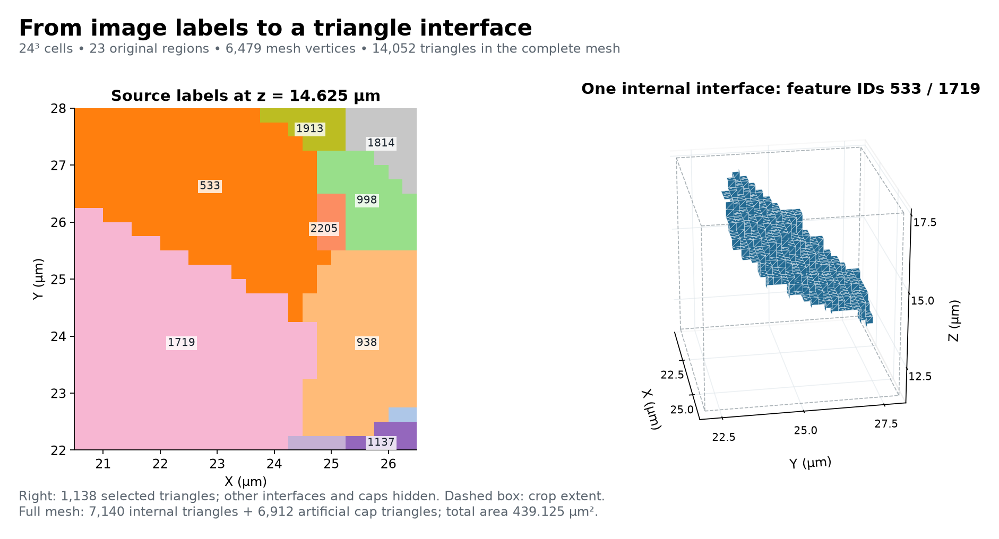
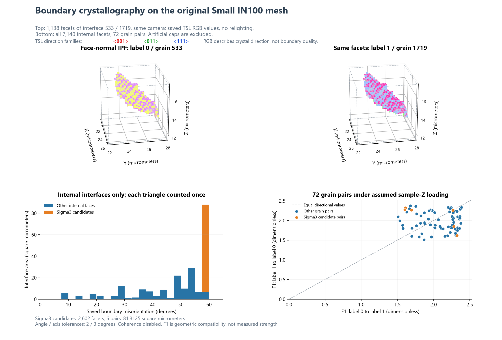

# Small IN100 Surface Mesh

Executable pipeline: `(01) Small IN100 Surface Mesh.d3dpipeline`

> **Before adapting:** Check labels, crystal symmetry, coordinate frame, and units. This cropped, voxel-shaped mesh illustrates boundary descriptors; it is not a validated strength prediction, coherent-twin measurement, or solver-ready mesh.

## At a glance

| Item | Contract |
| --- | --- |
| Prerequisite | Small IN100 archive, then Feature Preparation in `Small_IN100_Examples` |
| Input | `Data/Output/Small_IN100_Examples/Preparation/SmallIN100_Features.dream3d` |
| Region | Inclusive XYZ `[82,88,46]` through `[105,111,69]`; 24 cells per axis at 0.25 micrometers |
| Grain representatives | Fresh phases and average orientations from the full cleaned grains, before cropping |
| Mesh | Original `SurfaceMesh`, with labels, areas, normals, and boundary crystallography |
| Assumptions | FCC nickel slip systems; illustrative sample-Z loading; Sigma3 angle/axis tolerances 2/3 degrees; coherence disabled |
| Output | `Data/Output/Small_IN100_Geometry_Examples/Surface/SmallIN100_SurfaceMesh.dream3d` |

## Purpose and real-world setting

A segmented EBSD volume identifies which grain owns each voxel. A surface mesh lets us locate interfaces and ask which adjoining grains differ in orientation, have a near-twin relationship, or have compatible slip geometry under an assumed load. This example connects those questions in one bounded Small IN100 nickel-superalloy region. It keeps original grain IDs so every face can be traced back to the cleaned reconstruction.

## Input data and assumptions

The preparation checkpoint comes from 117 measured EBSD sections of 189 by 201 cells. Spacing is 0.25 micrometers on all axes. The six-micrometer cube contains grain fragments and artificial crop walls. `FeatureIds` identify the cleaned child grains; `ParentIds` describe a separate twin-grouping relationship and are not used as mesh labels.

Preparation removed stale feature measurements after cleanup. This pipeline rebuilds only `BoundaryFeaturePhases`, `BoundaryAvgQuats`, and `BoundaryAvgEulerAngles` on the **full cleaned volume**, then crops without renumbering. Those retained feature-table rows describe full-grain orientation representatives, even for grains absent from the crop. They are not cropped-fragment volumes, centroids, or orientations averaged only within the crop. Unused rows and row zero must not be treated as measured grains.

SurfaceNets does not propagate the image's length-unit metadata. Explicit Triangle/Copy/Micrometer construction preserves its coordinates and connectivity while assigning the correct units; it does not rescale the mesh. Areas are square micrometers; normals are dimensionless unit vectors.

## Data flow and filter choices

Read preparation -> full-grain phases and average orientations -> crop -> unsmoothed mesh -> explicit units and ownership copies -> areas and normals -> per-face crystallography -> save.

| Filter or choice | Motivation and alternatives |
| --- | --- |
| `ComputeFeaturePhasesFilter` and `ComputeAvgOrientationsFilter` before crop | Rebuild representatives consistent with the cleaned `FeatureIds`. Rodrigues averaging retains the existing orientation-analysis convention. Averaging after crop would answer a different question about only the surviving fragments. |
| `CropImageGeometryFilter`, no renumbering | Bound mesh size while preserving source IDs. Inclusive upper bounds give 24, not 23, cells per axis. |
| `SurfaceNetsFilter`, smoothing off, skin index 0 | Keep a raw baseline and identifiable artificial caps. Relaxation would change areas and normals; example 02 explores that separately. Winding repair is not proof of globally outward normals or manifoldness. |
| `CreateGeometryFilter`, ownership copies, then delete temporary mesh | Publish explicit Micrometer metadata and unchanged FaceLabels/NodeTypes. No optional cell or feature arrays are transferred by SurfaceNets. |
| Triangle areas and normals | Measure the current geometry. Total area includes internal interfaces and caps, not just specimen surface. |
| `ComputeFeatureFaceMisorientationFilter` | Attach the symmetry-reduced angle between adjoining full-grain orientations. Version 2 saves **one scalar in degrees**, not an axis-angle vector or RGB color. |
| `ComputeFaceIPFColoringFilter`, TSL key 0 | Show the crystal direction parallel to each face normal separately for each adjoining grain. A global sample-Z IPF map would describe a different direction. These are orientation colors, not a low-to-high heat map. |
| `ComputeBoundaryStrengthsFilter`, loading `[0,0,1]` | Put FCC slip-compatibility descriptors on the boundary faces under one explicit assumed specimen-Z load. Change the load to study a different scenario; it is not a measured loading history or strength in MPa. |
| `ComputeTwinBoundariesFilter`, angle 2 degrees, axis 3 degrees | Select near-Sigma3 orientation relationships using both proximity to 60 degrees and to a <111> axis. A 60-degree angle threshold alone is insufficient. These are separate illustrative tolerances, not calibrated uncertainty bounds. |
| Find Coherence off | The raw normals follow voxel facets and vary among six Cartesian directions. They do not establish physical twin planes, so this example records candidates without claiming coherent twins. |
| `WriteDREAM3DFilter` | Keep the orientation table, image, mesh, and named arrays together. STL export alone loses this context. |

The IPF arrays `BoundaryIPFLabel0` and `BoundaryIPFLabel1` correspond to components 0 and 1 of `FaceLabels`. The second calculation uses the opposite normal. Triangle winding is not consistently oriented from one label component to the other; cubic centrosymmetry makes the two signs equivalent for this IPF interpretation. Do not generalize that observation to an arbitrary directional boundary calculation.

`BoundaryMPrime_Z`, `BoundaryF1_Z`, `BoundaryF1spt_Z`, and `BoundaryF7_Z` each contain two dimensionless components: label 0 -> label 1, then the reverse. The latter three can differ by direction. The implementation uses FCC `{111}<110>` slip geometry; sharing cubic symmetry does not make it a generic BCC slip model. It does not use the mesh normal: in particular, F1spt uses slip-plane-normal alignment, not slip traces on the actual boundary. None of these values proves slip transmission, crack initiation, or boundary strength.

## Outputs and interpretation

The crop contains 23 positive IDs and no background cells. The original mesh has 6,479 vertices and 14,052 triangles: 7,140 internal faces and 6,912 artificial cap faces. Total area is 439.125 square micrometers, counting each triangle once. The existing preview shows a section at z = 14.625 micrometers and only the 1,138-triangle interface between IDs 533 and 1719; other interfaces and caps are hidden in its 3D panel.

For boundary summaries, select **both FaceLabels components > 0**. Caps have NaN misorientation, false `Sigma3Candidate`, zero strength metrics, and a black exterior IPF side. Those zeros and black colors are missing-boundary placeholders, not low-strength observations. Grain-pair misorientation, slip metrics, and Sigma3 flags repeat across faces of the same pair; face IPF colors can vary with the facet normal.

The saved results contain 72 internal grain pairs. Six satisfy the chosen Sigma3 test: 460/1137, 533/1719, 533/2173, 938/998, 938/1137, and 998/1992. Together they occupy 2,602 triangles and 81.3125 square micrometers in this crop. The two top panels display the same 533/1719 facets using each adjoining grain's saved face-IPF colors. Their different colors express different crystal directions, not different boundary quality. The bottom panels summarize saved misorientation, candidate flags, face areas, and F1 values; plotting does not recalculate crystallography. Departures from the F1 diagonal show why the two directions must remain distinguishable.

The combined mesh is a network of internal interfaces and artificial walls, not a single exterior shell. Several sheets can meet at junctions. A candidate flag establishes the chosen orientation test, not a coherent twin plane or a material-wide twin fraction.

## Adaptation and quality checks

Keep the full-grain versus fragment-orientation choice explicit. Recompute phases and orientations after changing segmentation, and preserve a mapping if renumbering features. Change the load only in the same specimen reference frame as the orientations; rotating mesh coordinates alone does not rotate the crystal orientations or load.

Check finite positive face areas, finite unit normals, valid vertex indices, and matching label-to-feature rows. Exclude caps before angle, area, or strength summaries. Count each triangle once for interface area; counting both labels doubles it. Prefer area weighting to triangle counts when comparing differently refined meshes. Neither weighting turns this deliberately small crop into a representative bulk measurement.

Examples 02 and 03 retain the original `SurfaceMesh` with this crystallography. Their new smoothed/transformed meshes do **not** copy these arrays. Recompute geometry-dependent colors or coherence on any new surface, using consistently transformed orientation and loading frames where applicable. Smoother appearance alone does not validate the physical boundary plane.

## Scientific basis, differences, and extension

[Groeber and Jackson (2014)](https://doi.org/10.1186/2193-9772-3-5) provide the reconstruction and geometric-representation context. This crop and current filters are illustrative; the public archive's identity with publisher-processed outputs is unproven. The article is CC BY 2.0. Separate raw-archive redistribution rights were not established; this bundle includes no volume data.

[Frisken (2022)](https://jcgt.org/published/0011/01/03/paper.pdf) explains shared multi-label surfaces and constrained relaxation using medical and synthetic examples. The current diagonal-area helper does not establish its section 4.4 minimum-area selection, so no related intersection-reduction claim is made. The article is CC BY-ND 3.0 and its code supplement MIT licensed.

[Morawiec and Glowinski (2013)](https://doi.org/10.1016/j.actamat.2013.06.019), section 6, analyze Small IN100 grain boundaries after DREAM.3D reconstruction, QSLIM simplification, and further distribution calculations. This example keeps a raw crop to make label/orientation joins inspectable; it does not reproduce that mesh, mixed-boundary classification, random normalization, or distributions. Its independent 2-degree angle and 3-degree axis tests also differ from the paper's 2-degree distance from Sigma3. To pursue those results, first validate reconstructed boundary planes and implement the paper's full symmetry-aware boundary treatment and statistical sampling. A scalar misorientation angle or Sigma3 flag is insufficient. No paper figures are redistributed.

## Guidance for an LLM or MCP assistant

Treat the `.d3dpipeline` as executable authority. Keep the preparation prerequisite, child-grain label namespace, full-grain averaging before crop, explicit units, and face-side component order. Explain changes to the load, tolerances, crop, or surface treatment. Regenerate dependent examples after changing the baseline. Do not infer measured strength, coherent twins, whole-grain shape, manifoldness, or paper reproduction from successful execution.
