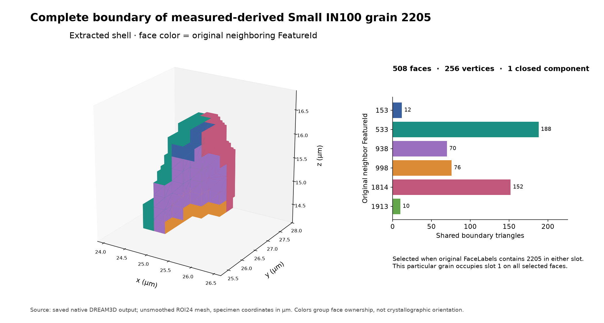

# Small IN100 complete grain surface

Executable pipeline: `(01) Small IN100 Complete Grain Surface.d3dpipeline`

> **Before adapting:** **Validation warning:** Do not treat this example as a validated acceptance procedure. Adapt and validate it for the scanner, material, resolution, and quality requirement.

## At a glance

- **Input:** The unsmoothed multi-label `SmallIN100_SurfaceMesh.dream3d` checkpoint from the [geometry example](../Small_IN100_Geometry_Examples/%2801%29%20Small%20IN100%20Surface%20Mesh.md).
- **Question:** Which triangles form the complete boundary of original reconstructed grain `FeatureId` 2205, including faces shared with any neighbor?
- **Output:** A calibrated, compacted, consistently outward-wound `Grain2205` shell with original ownership labels and local component IDs.
- **Run order:** Archive → Feature Preparation → Surface Mesh → this pipeline → [measurements](%2802%29%20Small%20IN100%20Grain%20Surface%20Measurements.md). See [README](README.md) for paths and commands.

## Purpose and real-world setting

The 117-section measured Small IN100 reconstruction discussed by [Groeber and Jackson (2014)](https://doi.org/10.1186/2193-9772-3-5) contains many labeled grains. A single-grain surface includes every shared interface around that grain, regardless of whether its ID appears in component 0 or 1 of `FaceLabels`. These two components hold the **original pair of adjacent region IDs**, not a ready-made single-grain orientation convention. `NodeTypes` classify junction topology in the *original network* and do not identify all boundary triangles of one grain.

The existing 24 × 24 × 24 voxel crop contains all 170 voxels of feature 2205. Its bounds are separated from each crop wall, so this grain has no artificial exterior `-1` face. This is an illustrative measured-derived target, not a representative grain-size distribution or an exact reconstruction of a paper result.

## Data flow and choices

`ExtractComponentAsArray` exposes `OriginalLabel0` and `OriginalLabel1` while leaving the two-component `FaceLabels` unchanged. `MultiThresholdObjects` builds `RemoveOtherGrains` with `(OriginalLabel0 != 2205) AND (OriginalLabel1 != 2205)`. A **true** mask removes a face. Testing only one label component would lose valid boundary patches in general; this particular grain happens to occupy component 1 of all 508 selected faces, so it does not by itself test both membership branches.

`RemoveFlaggedTriangles` keeps all remaining faces, compacts shared vertices, and copies the original labels. It deliberately does not copy the old network `NodeTypes`, `FaceAreas`, or `FaceNormals`. The extracted geometry lacks inherited unit metadata, so `CreateGeometry` copies its coordinates and connectivity into a new Triangle Geometry with Micrometer unit index 6. The copied `FaceLabels` is named `OriginalFaceLabels`: it remains immutable evidence of original grain-neighbor ownership. A local connected-surface label is created separately.

`LabelTriangleGeometry` writes `SurfaceRegionIds`. One occupied positive region means one connected surface here; the filter's feature matrix can have an extra empty row, so use the actual positive face IDs and `NumTriangles`, not matrix row count, to assess that claim. `VerifyTriangleWinding` uses this **single-component local region ID**, never the old multi-grain `OriginalFaceLabels`. It repairs the source's inconsistent triangle directions and orients the closed shell outward. `ComputeTriangleAreas` and `TriangleNormal` then recalculate measurements from the final winding. The original mesh is removed from this checkpoint; the cropped image remains for source context, and the predecessor checkpoint still contains the full mesh.

## Outputs and interpretation

`Data/Output/Small_IN100_Grain_Surface_Examples/Extraction/SmallIN100_Grain2205_Surface.dream3d` contains `Grain2205`, its `Face Data/{OriginalFaceLabels,OriginalLabel0,OriginalLabel1,SurfaceRegionIds,FaceAreas,FaceNormals}`, and the cropped source image. All coordinates remain in the source specimen frame in micrometers. `OriginalFaceLabels` pairs original `FeatureId` 2205 with six neighboring positive IDs; they are not local shell labels. The local region is `1`, distinct from original `FeatureId` 2205.

For this checkpoint the expected shell has 508 faces, 256 used vertices, 762 unique edges, and 15.875 µm² area. Each edge should meet exactly two faces, the vertex graph should be connected, and the Euler characteristic should be 2. These checks establish a closed, connected genus-zero triangulation for this saved mesh; they do not establish a general self-intersection-free or simulation-ready surface.

## Adapting and checking the workflow

Choose the target original positive `FeatureId` from the **same** reconstruction used by the mesh, then change both threshold leaves. Confirm that the entire source grain is inside the mesh crop; a crop-wall grain can acquire artificial `-1` caps. Preserve both extracted label components, the either-slot selection rule, and original ownership labels. The `CreateGeometry` unit must match the input coordinate scale; this step changes metadata and does not rescale vertices. If smoothing or geometry transformation is introduced, recalculate areas/normals and recheck closure and winding before using volume.

Inspect the selected face count, original neighbor IDs, component counts, edge incidences, zero-area faces, duplicate used-vertex coordinates, and repaired signed volume. A positive volume alone is insufficient because the volume filter takes an absolute value and can obscure topology or orientation defects. A missing patch, multiple components, boundary edge, or contradictory winding must be resolved before stage 02.

The public [Small IN100 archive](https://www.dream3d.io/Data_Archive/Small_IN100.tar.gz) supplies the measured ANG sections. The original article is CC BY 2.0; separate archive redistribution terms are not established, and this bundle contains no volume data. The numerical surface here follows the current ROI crop, SurfaceNets mesh, and selected filters, not a paper figure. For an LLM or MCP assistant, use the `.d3dpipeline` for exact parameters and ask which original ID, crop, coordinate unit, and closure criterion apply before adapting the method.
