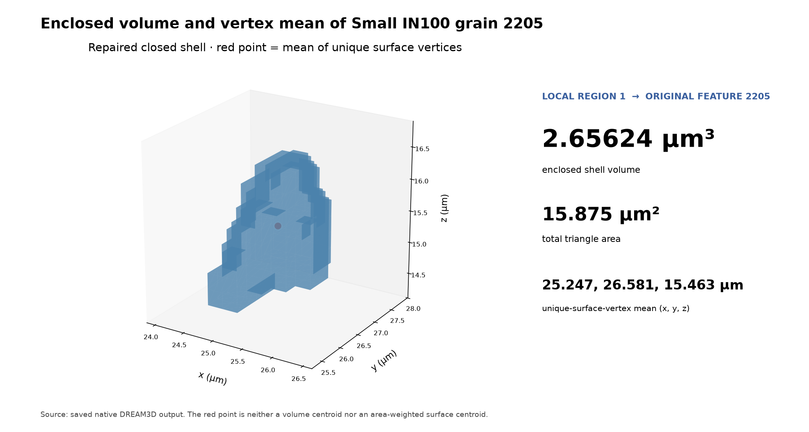
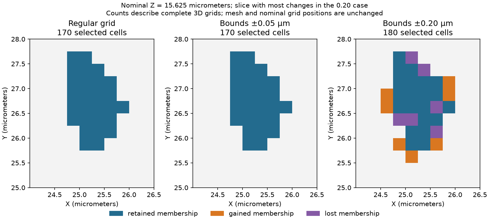

# Small IN100 grain surface measurements

Executable pipeline: `(02) Small IN100 Grain Surface Measurements.d3dpipeline`

> **Before adapting:** Verify a complete closed shell, its local label mapping and grid calibration. The perturbation bounds are illustrative positioning scenarios, not measured instrument uncertainty.

## At a glance

- **Input:** The complete, winding-repaired [grain 2205 shell](%2801%29%20Small%20IN100%20Complete%20Grain%20Surface.md).
- **Question:** Does sampling recover the original grain, how do vertex and volume centers differ, and how do positioning offsets change apparent membership?
- **Output:** `SmallIN100_Grain2205_Measurements.dream3d` and a scalar feature CSV with the explicit local-to-original ID map.
- **Run order:** Archive → Feature Preparation → Surface Mesh → Complete Grain Surface → this pipeline. See [README](README.md) for paths and commands.

## Purpose and real-world setting

The measured-derived Small IN100 grain boundary becomes a standalone geometric object in stage 01. This stage evaluates a small set of physical descriptors while retaining the original grain identity. The setting follows the reconstructed three-dimensional EBSD analysis described by [Groeber and Jackson (2014)](https://doi.org/10.1186/2193-9772-3-5), but the selected grain, modern mesh, and numerical outputs are illustrative rather than a reproduction of a reported paper result.

Use these measurements only after confirming that the extracted surface is complete, closed, consistently wound, and calibrated. The mesh is built from source cells spaced 0.25 µm in each direction; its coordinates remain in the source specimen frame.

## Data flow and choices

`CreateDataArray` allocates two-component int32 `LocalSurfaceLabels`. `InitializeData` fills every face with `[-1,1]`: local exterior is component 0 and the single enclosed grain is component 1. A single scalar fill string in `CreateDataArray` cannot express this pair. The original two-component `OriginalFaceLabels` is retained unchanged because it identifies original neighbors, but those neighbors now form *open patches* on the isolated mesh. Using them for closed-volume integration would report misleading results.

The pipeline creates a two-row `Grain Measurements` matrix and an `OriginalFeatureIds` lookup. Row 0 is unused local exterior (`0`); row 1 maps to original reconstructed ID `2205`. This map prevents a local connected-component number from being mistaken for the source segmentation ID. `ComputeTriangleGeomVolumes` integrates the repaired shell with local labels and stores `ClosedSurfaceVolumes`. `ComputeTriangleGeomCentroids` stores `SurfaceVertexMeans`; current code averages each distinct used vertex once. It is **not** an enclosed-volume centroid, area-weighted surface centroid, or source-voxel center of mass. `WriteFeatureDataCSV` exports the scalar measurement rows, and `WriteDREAM3D` keeps labels and full face-level geometry for audit.

The grid comparison uses the same shell without changing its shape:

| Operation | Choice and reason |
| --- | --- |
| Create sampling labels | `SamplingPartLabels = [0,1]` uses zero outside the selected grain and one inside. Keep the original and `[-1,1]` measurement labels unchanged. Outside means outside grain 2205, including other grains; it does not imply void. |
| Sample Triangle Geometry on Regular Grid | Reuse `DataContainer` so origin, 0.25 micrometer spacing and cell centers match the source exactly. `MeshSampledGrainIds == 1` should equal original `FeatureIds == 2205`. |
| Compute Feature Sizes and Centroids | Count the recovered cells, calculate their voxel volume and equivalent diameter, and store `VoxelVolumeCentroids`. Equal-volume cell centers give the reconstructed-volume centroid, avoiding the mesh-vertex weighting of `SurfaceVertexMeans`. |
| Sample Triangle Geometry on Uncertain Regular Grid | Keep seed 2205 fixed and compare bounds ±0.05 and ±0.20 micrometers per coordinate. They lie below and above this voxel-faithful shell's 0.125 micrometer center-to-face margin. No instrument-error calibration is implied. |
| Rebuild image association; summarize and compare | Recreate each result with the same calibrated grid, copy labels unchanged, then compute counts/volumes and `ChangedFromNominal`. This corrects the cell-matrix association defect [#1800](https://github.com/BlueQuartzSoftware/simplnx/issues/1800). The reference grid is cubic; check tuple order separately before adapting to non-cubic grids. |

The uncertain sampler draws X per point, Y once per row, and Z once per slice. These are correlated positioning offsets. Labels are stored at the **nominal** grid locations even though classification uses perturbed sample positions; the output geometry does not record those actual probe positions.

## Outputs and interpretation

`Data/Output/Small_IN100_Grain_Surface_Examples/Measurements/SmallIN100_Grain2205_Measurements.dream3d` contains `Grain2205/Face Data/LocalSurfaceLabels` and the two-row `Grain2205/Grain Measurements/{OriginalFeatureIds,ClosedSurfaceVolumes,SurfaceVertexMeans}` arrays along with the original identity arrays, final face areas/normals, and source crop. The CSV at the same path stem writes a count line, header, and **one** data row for `Feature_ID` 1; the CSV writer omits the unused row 0. Read its `OriginalFeatureIds` field to recover source ID 2205.

For this saved source, occupied local row 1 encloses approximately 2.65625 µm³, the 170-voxel source grain's volume (`170 × 0.25³ µm³`); the native float32 result is 2.6562402 µm³. The unique-vertex mean is approximately `(25.2471, 26.5811, 15.4629)` µm. Face area sums to 15.875 µm². These values describe this measured-derived reconstruction and the current mesh. Similar volume does not prove identical boundary topology or an unbiased shape estimator.

Regular sampling recovers all 170 source grain cells. `Grain2205/Grain Measurements` now also contains `NominalVoxelCounts`, `NominalVoxelVolumes`, `NominalVoxelEquivalentDiameters` and `VoxelVolumeCentroids`; these columns are included in the same CSV. The volume centroid is approximately **(25.2529, 26.6044, 15.4441) micrometers**, distinct from the vertex mean above. Row 0 remains excluded from interpretation.

| Result | Selected cells | Apparent voxel volume (µm³) | Changed memberships |
| --- | ---: | ---: | ---: |
| Regular source grid | 170 | 2.65625 | 0 |
| `Jitter005` | 170 | 2.65625 | 0 |
| `Jitter020` | 180 | 2.8125 | 62: 36 gained, 26 lost |

Inspect each jitter geometry's `Cell Data/{GrainIds,ChangedFromNominal}` and row 1 of `Grain Measurements`. The mesh is unchanged: the apparent volume difference comes from counting sampled labels on nominal cells. One seeded realization is a sensitivity illustration, not a confidence interval. For another mesh, even small perturbations may change membership when nominal centers lie close to its surface.

## Adapting and checking the workflow

If the source contains multiple disconnected shells, cavities, or open surfaces, decide how each local region should map to original features before reusing `[-1,1]`; this fixed pair is designed for one outward-oriented closed grain. Update the `OriginalFeatureIds` mapping and the row count together. Recheck shell edge incidence, connectedness, winding, nonzero face areas, and signed volume independently. The volume filter stores the absolute result, so a positive value alone does not certify outward winding. Compare its output to a separately computed source-voxel volume only when the original feature is completely retained and the meshing method is known to preserve that volume.

Alternative measurements serve different questions. A source-voxel centroid integrates the segmented volume; an area centroid weights triangle areas; `SurfaceVertexMeans` averages unique vertices. Triangle-shape calculations remain deferred because rigid rotation changes their current Omega3 and axis-length results ([#1801](https://github.com/BlueQuartzSoftware/simplnx/issues/1801), [#1802](https://github.com/BlueQuartzSoftware/simplnx/issues/1802)); no such shape outputs are included here. The public [Small IN100 archive](https://www.dream3d.io/Data_Archive/Small_IN100.tar.gz) supplies measured sections; the article is CC BY 2.0, while separate archive redistribution terms have not been established. No volume file is packaged here. Use the `.d3dpipeline` for exact paths, local-ID conventions and arguments.
