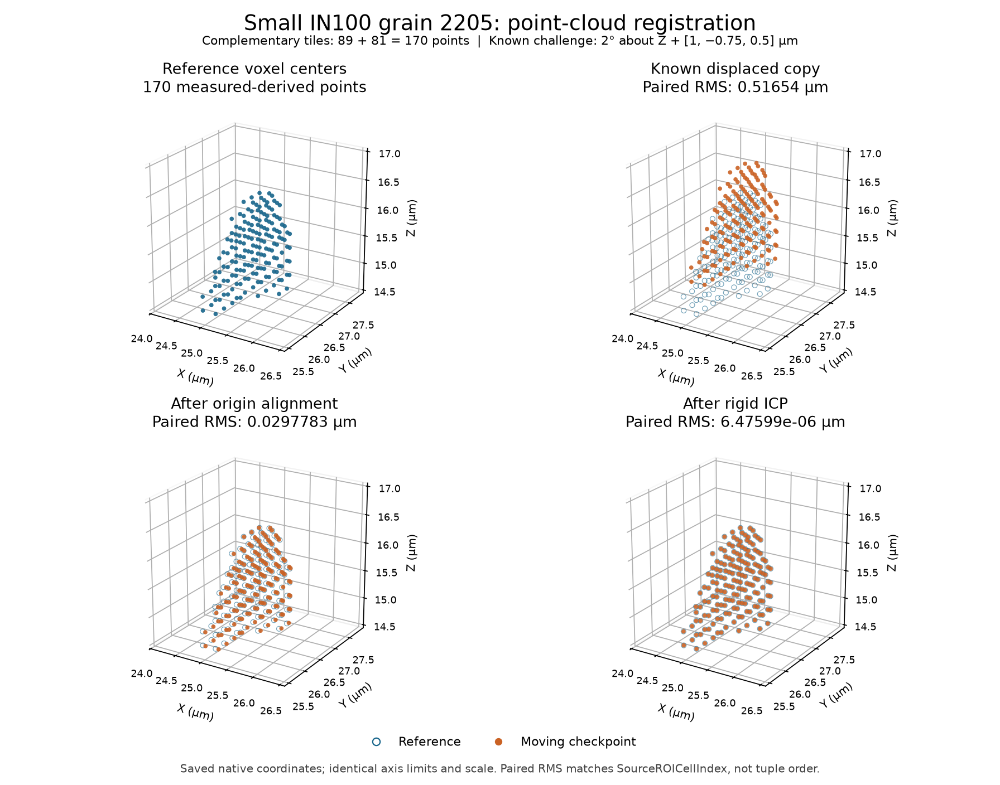

# Small IN100 Grain Point Cloud Registration

Executable pipeline: `(03) Small IN100 Grain Point Cloud Registration.d3dpipeline`

**Before adapting:** Choose a meaningful partition and initial pose for the new data, preserve its coordinate units, and check registration against information independent of closest-point distance.

## At a glance

| Item | This example |
|---|---|
| Task | Reassemble complementary point-cloud tiles and recover a known rigid displacement. |
| Input | Stage 01's cropped Small IN100 image and complete grain-2205 surface checkpoint. |
| Points | 170 voxel centers from original reconstructed `FeatureId` 2205; 0.25 µm source spacing. |
| Challenge | Tiles with 89 and 81 points, then a 2° Z rotation and `[1, -0.75, 0.5]` µm translation. |
| Result | Reference, tiles, reassembled cloud, three moving checkpoints, and two transform matrices in one DREAM3D file. |
| Dependency | Run stage 01 first. Stage 02 measurements are optional. |

## Purpose and real-world setting

Point-cloud assembly and registration help compare spatial datasets expressed in different coordinate frames. This small example combines those operations on a grain reconstructed from public serial-section EBSD data. Iterative closest point (ICP) repeatedly matches nearby points and fits a rigid transform. A coarse translation supplies its initial pose.

The tiles and displaced copy derive from one measured-grain reconstruction. They are **not independent acquisitions**. This controlled challenge demonstrates coordinate recovery and metadata tracking; it does not measure registration accuracy between instruments or reproduce a paper's numerical result.

## Input data and assumptions

Read `Data/Output/Small_IN100_Grain_Surface_Examples/Extraction/SmallIN100_Grain2205_Surface.dream3d`. The [category README](README.md) gives the archive, feature-preparation, surface-mesh, and stage-01 run order. Relative `Data/...` paths resolve from the CLI working directory. Create `Data/Output/Small_IN100_Grain_Surface_Examples/Registration` before execution; use absolute file parameters in the GUI if its working directory differs.

The checkpoint contains a 24 × 24 × 24 **Image Geometry** named `DataContainer`, calibrated in micrometers. Its `Cell Data/FeatureIds` retains the original reconstructed labels. Grain 2205 occupies 170 cells. Extracting their centers creates 170 points; the retained `Grain2205` surface has 256 mesh vertices and is separate context.

`SourceROICellIndex` numbers all cropped cells from 0 through 13823 in flat storage order, with X varying fastest. It identifies a tuple in this ROI, not a global acquisition location or grain ID. Each point carries that index, `FeatureIds`, and `Image Quality`. Image quality is inherited from the processed reconstruction: it is neither a calibrated confidence score nor an ICP weight.

## Data flow and parameter rationale

The executable contains 29 steps. Repeated copy and unit-preservation helpers are grouped here by purpose.

| Operation and filters | Choice and reason |
|---|---|
| Read, Create Data Array Advanced, Multi-Threshold Objects | Preserve the checkpoint, create an incremental int32 ROI index, and select `FeatureIds == 2205`. The extraction mask's true values mean keep. |
| Extract Vertex Geometry | Copy the selected cell centers and three scalar arrays into `ReferenceCloud`; preserve original image arrays. |
| Crop Vertex Geometry, twice | Tile A uses min `[24.5,25.5,14.5]`, max `[25.25,27.75,16.5]` µm; tile B uses min `[25.25,25.5,14.5]`, max `[26,27.75,16.5]` µm. The split plane lies between voxel centers, retaining 89 and 81 points with no overlap. |
| Combine Node Based Geometries | Reassemble the 170 points and matching scalar arrays. Compare by source-cell index because concatenation changes tuple order. No deduplication is performed. |
| Create Geometry, Copy Data Object, Delete Data | After extraction, cropping, and combination, copy coordinates into an explicit Micrometer geometry, copy scalar arrays, and delete only the temporary raw geometry. Use the same calibrated copying method for each moving checkpoint, preserving its source. |
| Apply Transformation to Geometry | Create `MovingChallenge` from `CombinedTiles` and apply the stated rotation about global Z followed by translation. Save its 4 × 4 `KnownTransform`. No translation to a local origin is enabled. |
| Align Geometries | Preserve the challenge. Origin alignment translates `MovingCoarse` until its coordinate-wise minimum equals the reference minimum. This is a bounding-box alignment, not a centroid fit. |
| Iterative Closest Point, Write DREAM3D | Preserve the coarse checkpoint, run 10 rigid iterations on `MovingRegistered`, apply the result, and save `ICPResidualTransform` plus all retained data. |

Explicit units address the [length-unit propagation defect](https://github.com/BlueQuartzSoftware/simplnx/issues/1784) in these fresh geometry outputs and whole-geometry copies. Independent coordinate arrays keep later transforms from moving the reference or earlier checkpoints.

## Outputs and interpretation

The output is `Data/Output/Small_IN100_Grain_Surface_Examples/Registration/SmallIN100_Grain2205_PointCloudRegistration.dream3d`. Inspect `ReferenceCloud`, `TileA`, `TileB`, `CombinedTiles`, `MovingChallenge`, `MovingCoarse`, and `MovingRegistered`. All seven point clouds use Micrometer units.

The preview uses native coordinates, common axis limits, and equal scale. Match points by `SourceROICellIndex` rather than tuple position. The measured paired root-mean-square (RMS) displacement falls from 0.51654 µm to 0.029778 µm after origin alignment and 0.00000648 µm after ICP. The registered three-pipeline Windows in-memory Release CTest passed 1/1; the independent saved-output audit passed 67/67 checks. Python, OOC, GUI, and installed-app execution remain unverified.

`ICPResidualTransform` maps the coarse pose to the registered pose. It does not include the earlier origin translation. With homogeneous column vectors, verify `ICPResidualTransform × CoarseTranslation × KnownTransform` against identity. Derive `CoarseTranslation` from the saved challenge and coarse clouds.

## Adaptation and quality checks

Change the label, crop bounds, and initial transform together when selecting another grain. Check that the tiles remain disjoint, their union equals the reference, and scalar values agree by source-cell index. Overlapping-tile deduplication is excluded because [duplicate detection can miss identical coordinates on tied grid planes](https://github.com/BlueQuartzSoftware/simplnx/issues/1783). This example makes no duplicate-removal claim.

ICP is local: a poor initial rotation, symmetry, outliers, or partial overlap can produce an incorrect nearby solution. Here the maximum coarse displacement is approximately 0.05277 µm, below half the 0.25 µm minimum point spacing, so the intended correspondence is unambiguous. More iterations alone cannot make arbitrary starting poses reliable.

Check recovered coordinates by identity, matrix composition, rotation orthogonality, and determinant near +1. Confirm the reference and original image/mesh remain unchanged. Preserve vector-field semantics separately when adapting: this example carries scalar metadata only.

## Scientific basis and references

1. [Groeber and Jackson (2014), DREAM.3D](https://doi.org/10.1186/2193-9772-3-5) supplies the 3D EBSD reconstruction setting. The current grain selection and registration challenge are illustrative. The article is CC BY 2.0; separate redistribution terms for [Small_IN100.tar.gz](https://www.dream3d.io/Data_Archive/Small_IN100.tar.gz) have not been established. No measured volume is included here; archive checksum and provenance are in the category README.
2. [Besl and McKay (1992), A method for registration of 3-D shapes](https://doi.org/10.1109/34.121791) explains closest-point rigid registration and its local convergence. The executable uses the current simplnx implementation and does not reproduce that paper's experiments.

## Guidance for an LLM or MCP assistant

Use the pipeline as executable authority and the matching YAML for exact arguments. Preserve stage 01 as the only direct prerequisite. Describe this as a derived registration challenge, retain micrometer units and ROI-index semantics, and distinguish native execution from independent scientific checks and any separately verified Python, OOC, or GUI execution.
