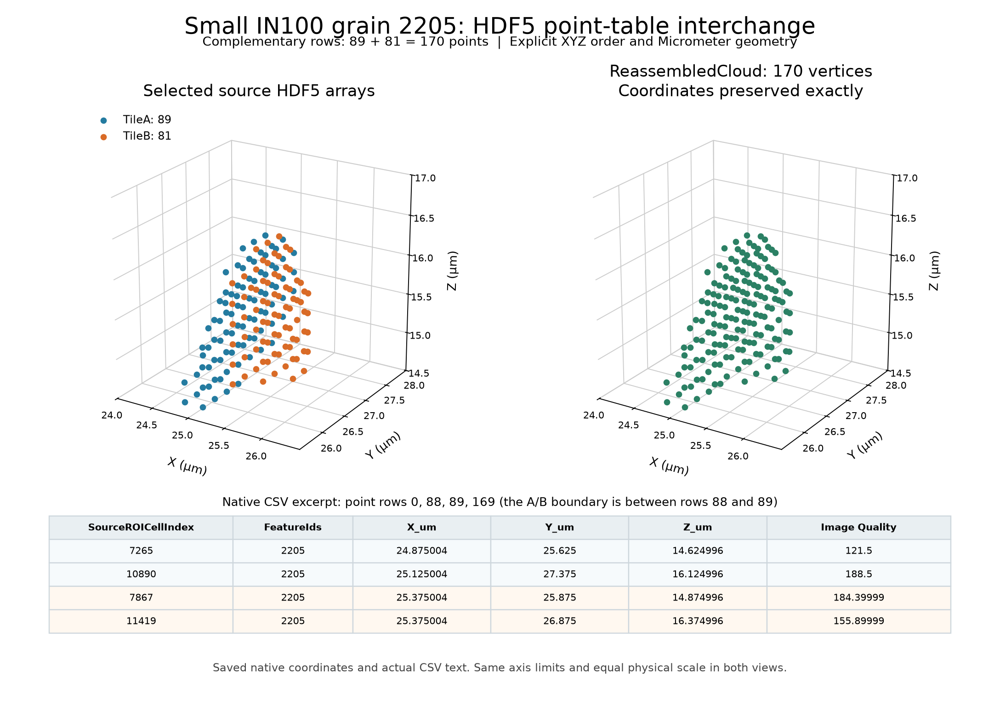
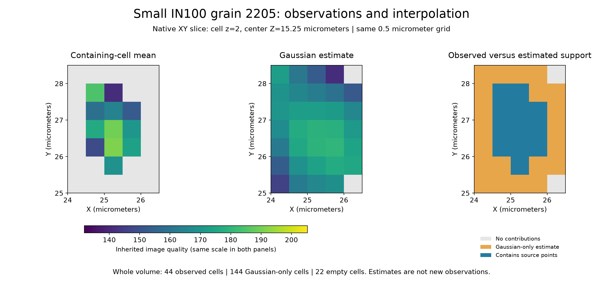

# Small IN100 Point Cloud Interchange

Executable pipeline: `(04) Small IN100 Point Cloud Interchange.d3dpipeline`

**Before adapting:** Verify shapes, numeric types, axis order, units, and row identities. Choose grid spacing and kernel support for the measurement. Interpolation can populate cells with no observations; it does not establish new measured coverage.

## At a glance

| Item | This example |
|---|---|
| Task | Reconstruct calibrated geometry and CSV columns from numeric HDF5 arrays, then compare observed and interpolated grid support. |
| Prerequisite | Stage 03's saved registration file; stage 02 measurements are optional. |
| Input | Complementary TileA (89 points) and TileB (81 points), derived from measured grain 2205. |
| Output | Original 170-point cloud and six-column CSV, plus two 0.5 micrometer grids with image-quality values and contribution counts. |
| Main choices | Append A then B; preserve integer IDs and XYZ units; compare containing-cell averages with a Gaussian neighborhood. |
| Reproduction status | Illustrative interchange and interpolation using subsets of one reconstruction. |

## Purpose and real-world setting

Materials workflows exchange point arrays, reconstruct geometry, then place scalar measurements on regular grids for visualization or comparison. This example makes the coordinate and identity contract explicit and shows how interpolation changes the area with populated values.

Read DREAM3D is simpler for importing a complete NX DataStructure. Generic HDF5 import serves numeric datasets whose interpretation is documented separately. These points are voxel centers from one reconstructed grain, not an independent point survey. Image quality is inherited EBSD metadata, not calibrated confidence, composition, or a grain-boundary indicator.

## Input data and assumptions

Run [(03) Small IN100 Grain Point Cloud Registration](%2803%29%20Small%20IN100%20Grain%20Point%20Cloud%20Registration.md) first. Its file must exist before stage 04 preflight:

`Data/Output/Small_IN100_Grain_Surface_Examples/Registration/SmallIN100_Grain2205_PointCloudRegistration.dream3d`

Under `/DataStructure/TileA` and `/DataStructure/TileB`, import `Shared Vertex List` and three arrays under `Vertex Data`. Coordinates are float32 `[N,3]` in XYZ order. `SourceROICellIndex` and `FeatureIds` are int32 `[N,1]`; `Image Quality` is float32 `[N,1]`. Here `N` is 89 or 81. Reader tuple/component dimensions are strings (`"89"` or `"81"`, and `"3"` or `"1"`); changing them does not transpose axes.

`SourceROICellIndex` is the X-fastest flat index into the cropped 24-cubed image, not a global acquisition ID. Every `FeatureIds` value is 2205. The original geometry declares Micrometer units; numeric HDF5 import does not recover that metadata.

## Data flow and parameter choices

The 24 steps form seven groups. Step numbers are one-based; YAML indices are zero-based.

| Steps and filters | Choice and reason |
|---|---|
| 1-4: Create Data Group; Read HDF5 Dataset | Import four arrays per tile into separate groups to avoid identical leaf-name collisions. |
| 5-9: Create Data Group; Concatenate Data Arrays | Append A then B for coordinates and all scalar fields. Each result has 170 tuples with the same row identity. |
| 10-13: Split Data Array by Component; Rename Data Object | Expose coordinate columns as `X_um`, `Y_um`, `Z_um`, retaining the assembled XYZ checkpoint. |
| 14-16: Combine Attribute Arrays; Create Geometry; Move Data | Recombine XYZ in that order, copy into `ReassembledCloud`, set Micrometer units explicitly, and attach matching scalar rows. |
| 17-18: Write ASCII Data; Convert AttributeArray DataType | Export all original point rows, including row zero. Preserve float32 image quality and create `ImageQuality64` for fractional interpolation. |
| 19-21: Create Geometry twice; Map Point Cloud to Regular Grid | Create identical explicit grids and save each point's containing-cell index. Error on any point outside the grid. |
| 22-24: Interpolate Point Cloud to Regular Grid twice; Write DREAM3D | Compare a containing-cell Uniform kernel with Gaussian spreading, keep contribution counts, and save both grids beside the original cloud. |

Concatenation appends **rows**: 89 XYZ tuples plus 81 XYZ tuples make 170 XYZ tuples. Combining attributes joins **columns**: three 170-tuple scalar arrays make one three-component array. Normalization stays off because scaling coordinates into `[0,1]` would destroy physical positions. Integer IDs never enter the coordinate combination or interpolation.

Both grids use dimensions `[5,7,6]`, origin `[24,25,14]` micrometers, and spacing `[0.5,0.5,0.5]` micrometers. The coarser cells aggregate the source's 0.25 micrometer voxel centers. Explicit identical bounds isolate the effect of the kernel; automatic bounds would obscure this comparison. `GridCellIndex` records point ownership for inspection. Interpolate v4 computes indices itself and does **not** consume that array.

| Grid | Kernel choice and meaning |
|---|---|
| `ObservedGrid05um` | Uniform size `[0.25,0.25,0.25]` micrometers is below the grid spacing. The integer radius is zero, so only points inside a cell contribute to its arithmetic mean. |
| `GaussianGrid05um` | Size `[1,1,1]` micrometers gives integer radius `[1,1,1]`, a 3 by 3 by 3 neighborhood. Sigmas `[1,1,1]` mean one grid-cell offset per axis, or 0.5 micrometers here. |

Kernel size is converted to a radius using `ceil(size / (2 * spacing))`, with radius zero when size is below spacing. Gaussian weights use integer offsets from the point's containing cell, not exact point-to-cell-center distances. The main output is `sum(weight * value) / sum(weight)`. **Find Length** counts contributing points; it is not the sum of weights. Other optional statistics stay off because their weighted-value summaries answer different questions.

## Outputs and interpretation

Outputs use `Data/Output/Small_IN100_Grain_Surface_Examples/Interchange/`:

- `SmallIN100_Grain2205_PointCloudInterchange.dream3d` contains `ReassembledCloud`, import/assembly checkpoints, and both calibrated grids. Each grid's `Cell Data` contains `ImageQuality64` and `ImageQuality64_ContributionCount`.
- `SmallIN100_Grain2205_PointTable.csv` retains the original 170 rows and columns: `SourceROICellIndex,FeatureIds,X_um,Y_um,Z_um,Image Quality`. Tuple zero is a valid point; no extra export index is requested.

Create the Interchange folder in the CLI working directory before running; the [category README](README.md) provides the chain. Use absolute GUI file parameters when its working directory differs.

This preview shows original native coordinates on equal micrometer axes and actual CSV rows.

The native XY slice at Z=15.25 micrometers uses the same `viridis` scale for both scalar panels; the right panel uses categorical colors. Across the complete 210-cell volume, 44 cells contain source points, 144 more receive Gaussian contributions only, and 22 remain empty. Contribution counts sum to 170 for the containing-cell grid and 4,590 for the Gaussian grid: each of the 170 points contributes to 27 cells. Those 4,590 contributions are not independent measurements.

Cells without contributions contain zero values. Use the counts to distinguish an empty cell from a measured or interpolated zero. A Gaussian-only cell is an estimate supported by neighbors, not evidence that this cell was measured or belongs to the grain. This example does not reconstruct a new grain boundary.

## Adaptation and quality checks

Change file paths, array shapes, axis/row contracts, units, and grid bounds together. Separate import groups cannot repair mismatched identities. Check imported arrays, A-then-B order, XYZ recombination, scalar placements, explicit units, and the 170 unique source IDs. Compare the original cloud with stage 03's `CombinedTiles`, and by source ID with `ReferenceCloud`. The CSV must retain all six columns and every point, allowing only decimal rounding for floats.

For gridding, verify point bounds before interpolation because Interpolate silently skips out-of-bounds points. Keep the mapping error policy or another explicit check. Compare containing-cell counts with point ownership, require their sum to equal the input point count, and inspect where Gaussian support extends beyond observed occupancy. Empty and boundary regions need a deliberate downstream policy. Overlapping tiles need a separate overlap policy; this example performs no deduplication.

Keep `SourceROICellIndex` and `FeatureIds` on the source points. **Arrays to Copy** also averages values over kernel support; its name does not imply categorical preservation. Averages of IDs have no identity meaning. The float64 image-quality copy preserves the original field and supports older snapshots with an output-type mismatch. Builds containing the [merged correction](https://github.com/BlueQuartzSoftware/simplnx/pull/1763) promote interpolated outputs themselves; they do not require this copy.

Saved native outputs passed all 51 original interchange checks and 27 additional grid and preservation checks. Original arrays remain exact and the CSV is byte-identical. Independent binning and weighted-mean checks cover every cell; these checks establish the stated arithmetic, not scientific suitability for another measurement.

## Scientific basis and references

1. [Groeber and Jackson (2014), DREAM.3D](https://doi.org/10.1186/2193-9772-3-5) provides the 3D EBSD reconstruction setting. Interchange and grid comparison are illustrative extensions, not a published numerical reproduction. The article is CC BY 2.0; separate archive redistribution terms are unestablished. No measured volume is included; archive provenance and checksum are in the category README.
2. [The HDF Group, HDF5 Datasets](https://support.hdfgroup.org/documentation/hdf5/latest/_h5_d__u_g.html) describes datasets, dimensions, datatypes, and attributes. The application must still establish the meaning of coordinates and units.

## Guidance for an LLM or MCP assistant

Treat the pipeline as executable authority and YAML as its argument record. Preserve stage 03 as prerequisite, A/B row order, XYZ order, IDs, and checked units. Describe populated Gaussian-only cells as estimates. Do not replace integer identities with averages, infer grain geometry from image quality, or equate native numerical checks with scientific suitability for another dataset.
