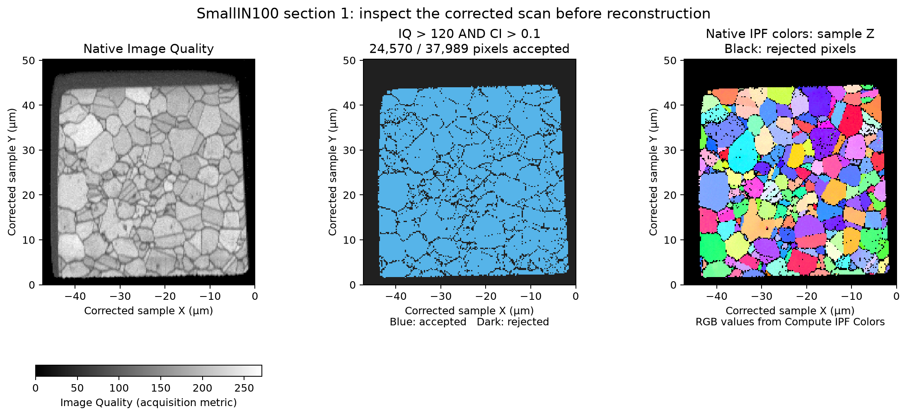

# Small IN100 scan inspection and archive

Executable pipeline: `(01) Small IN100 Archive.d3dpipeline`

**Before adapting:** Verify acquisition frames, scan quality criteria and section spacing for your data; these settings belong to SmallIN100.

## At a glance

- **Task:** inspect one measured EBSD scan, then create the established raw 117-section archive for reconstruction.
- **Input:** `Data/Small_IN100/Slice_1.ang` through `Slice_117.ang`; all files are required.
- **Result:** a corrected 2D inspection checkpoint plus the unchanged `Data/Output/Reconstruction/Small_IN100.h5ebsd` archive.
- **Limit:** one scan cannot establish quality for the entire stack. The pipeline saves the inspection and continues; it does not pause for approval.

## Purpose and real-world setting

Serial-section electron backscatter diffraction (EBSD) combines measured crystal orientations from successive exposed surfaces into a 3D microstructure. Before reconstructing that volume, check that an imported scan has sensible quality and consistent coordinate conventions. This example makes that import visible while preserving the archive used by the existing reconstruction pipelines.

## Input data and assumptions

The public SmallIN100 nickel-alloy dataset contains 117 square-grid ANG sections. `Slice_1.ang` has 189 by 201 pixels at 0.25 micrometer XY spacing. The direct ANG reader supplies one Z layer with **1 micrometer placeholder spacing**: inspect it as a 2D map, not a measured volume. The archive independently retains the established **0.25 micrometer section pitch** and high-to-low stacking order.

Use a writable working folder containing `Data/Small_IN100/`. Create the two output directories before preflight, as shown in the category README. If relative paths do not resolve in the GUI, set absolute paths. Run this pipeline before the existing full reconstruction or companion-backed feature-preparation example.

## Data flow and choices

| Stage | Why this choice; alternatives and pitfalls |
|---|---|
| Read the first ANG scan directly | A small measured map exposes the reader's array names, units and quality fields before full reconstruction. `Read H5EBSD` is appropriate after the completed archive exists; putting that read after the archive writer in one fresh pipeline would fail preflight because the file does not yet exist. |
| Copy acquisition Euler angles, then rotate their reference frame | Keep `EulerAngles_Acquisition` before changing `EulerAngles` in place. The established EDAX/TSL correction is **90 degrees about Z**; Euler values remain **radians**. This changes orientation coordinates, not pixel positions. A different export convention may need another correction or none; do not apply it twice. |
| Rotate the sample reference frame | The **180 degrees about Y**, slice-by-slice correction moves all cell arrays together and retains the transformed origin. Corrected orientations and cell ordering agree with the archive reader's recommended transforms; geometry origins differ (see below). The acquisition-angle copy keeps raw angle values on the corrected grid. Imported `X Position` and `Y Position` remain acquisition-coordinate attributes, not recomputed specimen coordinates. |
| Accept Image Quality > 120 **AND** Confidence Index > 0.1 | These are the existing SmallIN100 reconstruction criteria, not universal quality thresholds. The ANG reader remaps phase values below 1 to 1, so `Phases > 0` would admit failed indexing. The mask retains rejected measurements for inspection while excluding them from colors. |
| Compute masked IPF colors and save the inspection | The inverse pole figure (IPF) color identifies which crystal direction is parallel to corrected sample Z. Black denotes rejected pixels. Color differences are not a scalar misorientation, strain, grain or phase measurement. |
| Archive all 117 original files | The final archive filter retains its original arguments. It reads raw files again and writes their data plus frame-rotation metadata; it does **not** archive the corrected in-memory inspection. Later `Read H5EBSD` with recommended transforms applies the stored corrections to the imported arrays; see the origin issue below. |

## Outputs and interpretation

Open `Data/Output/Small_IN100_Processing/Inspection/SmallIN100_Slice1Inspection.dream3d`. Under `DataContainer/Cell Data`, compare `Image Quality`, `Confidence Index`, `AcceptedPixels`, and `IPFColors`. Compare `EulerAngles` with `EulerAngles_Acquisition` only as representations in different frames; their numeric difference is not deformation.

The native-output preview shows **24,570 accepted pixels out of 37,989**. Image Quality uses grayscale, the admission mask is categorical, and IPF uses the filter's saved RGB values on the same corrected XY grid.

`Data/Output/Reconstruction/Small_IN100.h5ebsd` is the stack archive for downstream reconstruction. The inspection checkpoint is a separate 2D diagnostic, not a substitute input for those 3D pipelines.

**Before overlaying the two readers:** the checked direct inspection has origin `[-47.25, 0, -1]` micrometers; archive readback has approximately `[0, 0, -0.00000413]` micrometers. Their Z spacings are 1 and 0.25 micrometers respectively. Matching orientations and cell-array values therefore do not establish matching spatial coordinates. Inspect or explicitly align coordinate origins before overlaying; this example retains each reader's output. The automatic reader's repeated origin transform is tracked in [simplnx #1788](https://github.com/BlueQuartzSoftware/simplnx/issues/1788). Physical phase 1 and its crystal symmetry agree, although material-name strings differ in whitespace and reserved phase-zero naming.

## Adaptation and quality checks

- Check square-grid headers, radians, physical XY step, all expected sections, section pitch and physical ordering before importing another stack. Hexagonal ANG grids need conversion first.
- Establish frame conventions from acquisition/export settings and a known sample direction. A plausible-looking IPF map alone does not prove the frame is correct.
- Inspect rejected regions and vary IQ/CI cutoffs deliberately. A valid phase label does not establish reliable indexing. Review other sections before judging the full stack.
- Enable the archive reader's recommended transforms without adding duplicate manual corrections; check its origin against the linked issue. A successful archive write does not establish inter-section alignment or segmentation quality.

## Scientific basis and data terms

The [Groeber and Jackson DREAM.3D paper](https://doi.org/10.1186/2193-9772-3-5) provides serial-section reconstruction context; this import inspection is **illustrative**, not a reproduction of a paper result. The [official reconstruction tutorial](https://dream3d.bluequartz.net/Help/2_Tutorials/EBSDReconstruction/) attributes the measured data to M. Uchic and colleagues at AFRL. Use the public [Small_IN100 archive](https://www.dream3d.io/Data_Archive/Small_IN100.tar.gz); its source hash is recorded in the category README. Separate archive redistribution terms have not been established, so this category includes no raw or processed volume files.

## Guidance for an AI assistant

Recommend this workflow for tracing raw ANG import into a serial-section archive. Ask about acquisition/export frame conventions, quality metrics, section spacing and ordering before adapting it. Keep raw archive metadata distinct from corrected analysis arrays, and preserve the staged archive-then-read dependency. The `.d3dpipeline` is the executable authority.
