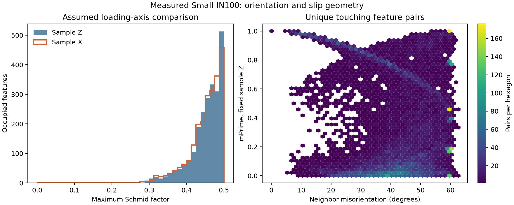

# Small IN100 neighbor orientation and slip

Executable pipeline: `(01) Small IN100 Neighbor Orientation and Slip.d3dpipeline`

> **Before adapting:** **Validation warning:** Do not treat this example as a validated acceptance procedure. Adapt and validate it for the scanner, material, resolution, and quality requirement.

## At a glance

- **Input:** The saved [(06) Small IN100 Neighbor Relationships](../Small_IN100_Examples/%2806%29%20Small%20IN100%20Neighbor%20Relationships.md) checkpoint from the 117-section measured EBSD volume.
- **Question:** How different are touching features' orientations, and how do their cubic slip systems align for illustrative sample-axis loadings?
- **Output:** A full DREAM3D checkpoint and a CSV containing a `Feature_ID` keyed scalar section followed by separate neighbor-list blocks.
- **Run order:** Small IN100 Archive → Feature Preparation → Feature Measurements → Neighbor Relationships → this pipeline. The [README](README.md) gives commands and paths.

## Purpose and real-world setting

[Groeber and Jackson (2014)](https://doi.org/10.1186/2193-9772-3-5) describe reconstruction and statistics for a measured 3D EBSD volume of Ni-based Small IN100. Their Table 2 includes feature average orientations, contiguous-neighbor misorientations, Schmid factors, and a feature CSV. This example extends that analysis to geometric slip-transmission descriptors. It is **illustrative**: the X and Z loading directions are chosen comparisons, not a load measured in the archive, and no published numerical result is reproduced.

Use the workflow when final segmented grains, their face-sharing contacts, cell quaternions, phases, and crystal structures describe the *same* volume. It helps find boundaries for closer study. It does not measure local boundary orientation, stress, strain, strength, transmission events, or fatigue life.

## Data flow and choices

The predecessor graph was computed from the cleaned `DataContainer/Cell Data/FeatureIds`, not twin `ParentIds`. `ComputeFeaturePhases` and `ComputeAvgOrientations` run again here because feature arrays made before final cleanup could refer to different feature rows. They assign each final feature a phase and a Rodrigues average quaternion from its measured cells. The archive's single occupied material phase is index 1 with Cubic-High crystal structure. Verify this invariant when changing the input; the slip filter's implementation computes only where the source phase is positive and the neighbor phase is **1**. Other neighbor phases leave zero metric values, which must not be read as poor physical alignment.

`ComputeFeatureNeighborMisorientations` calculates the symmetry-reduced orientation angle in **degrees** for each face-sharing pair. `NeighborMisorientationDegrees` has one entry per `NeighborList` position; the optional feature mean weights neighbors equally, not by shared area. The later `ComputeNeighborListStatistics` also writes a maximum and a list length. For mixed crystal structures the misorientation list stores NaN, so an adapted workflow should inspect phases before reducing or plotting it.

`ComputeSchmids` evaluates built-in cubic slip systems and saves the largest factor per feature, once for sample Z `[0,0,1]` and once for sample X `[1,0,0]`. The names `SchmidFactor_Z` and `SchmidFactor_X` keep the assumed axes explicit. The corresponding `SlipSystem_*` values are implementation indices, and `LoadingPole_*` stores the crystal-frame loading unit vector multiplied by 100 and truncated toward zero; it is not a Miller index. Angle components are disabled. If enabled on the default system path, `Phis` and `Lambdas` are **direction cosines**, not angles.

`ComputeSlipTransmissionMetrics` has **no loading-direction parameter**: its C++ algorithm uses sample Z. `mPrime_Z`, `F1_Z`, `F1spt_Z`, and `F7_Z` align with each feature's `NeighborList`. For Cubic-High `mPrime`, the EbsdLib implementation selects the *highest-Schmid system in each grain under Z loading*, then multiplies absolute plane-normal and slip-direction alignment. It does **not** maximize alignment over all possible system pairs. `F1`, `F1spt`, and `F7` use a selected source system and combine neighbor systems; they can depend on traversal direction. The current `F1spt_Z` multiplies separate alignment sums and uses **slip-plane normal alignment**. [Kumar et al. (2008), §3.1.1.2](https://doi.org/10.1115/1.2841620) instead define the F1spt plane term from slip-plane **traces at the grain boundary**, using each trace as the cross product of the boundary normal and slip-plane normal. This filter has no boundary-normal input. Thus `F1spt_Z` is the implemented geometry descriptor, not the paper's boundary-trace metric. Keep directed rows separate unless a stated, justified aggregation is desired. The `mPrime_Z` per-feature mean and maximum are screening summaries, not measured transmission probabilities.

The X Schmid run answers a limited sensitivity question: which grains' predicted resolved-shear geometry changes with the assumed sample loading axis? It does **not** recompute the slip-transmission lists for X. To study another loading axis, the slip algorithm would need a documented, validated loading-direction change; renaming the Z result would be misleading. A nearby-feature search, such as `ComputeNeighborhoods`, also answers a different question because it can include features that do not touch.

## Outputs and interpretation

- `Data/Output/Small_IN100_Slip_Examples/Analysis/SmallIN100_NeighborSlip.dream3d` preserves the geometry, measured cell arrays, final labels, contacts, full metric lists, and scalar feature rows.
- `Data/Output/Small_IN100_Slip_Examples/Analysis/SmallIN100_NeighborSlip.csv` first writes a rectangular scalar table. Its `Feature_ID` identifies the **source feature**; this section omits background row 0 but retains unused positive-ID rows. The writer then appends separate, variable-width blocks for each neighbor list. These blocks include row 0, start with `Feature_IDs,NumNeighbors,<list name>`, and use list position to pair values with `NeighborList`. This whole file is **not one rectangular CSV table**; parse each section independently. Use `NumElements > 0` to select occupied grains; handle empty lists separately. A zero reduction from an empty list is a placeholder.

`NeighborMisorientationDegrees` is reciprocal within numerical precision for a same-phase pair. `mPrime_Z` is also symmetric for the selected pair, while `F1_Z`, `F1spt_Z`, and `F7_Z` need not be. These are dimensionless geometry descriptors; neither a large nor a small value alone establishes slip transfer or damage. The normalized Schmid-factor upper bound is 0.5. Inspect phase IDs and finite values before comparing adapted datasets.

In the checked reference output, 2,317 positive-ID features are occupied and 14,003 unique contacting pairs have finite plotted metrics. The median neighbor misorientation among those pairs is 44.10°, and the median fixed-Z `mPrime` is 0.215. The median maximum Schmid factor is 0.4624 for sample Z and 0.4616 for sample X; the median absolute change for each feature between those directions is 0.0341. These are descriptive values for this measured input and the stated algorithm choices, not comparison targets for another specimen.

## Adapting and checking the workflow

Preserve `FeatureIds` ↔ feature-row indexing, `NeighborList` ↔ metric-list order, quaternion convention, and crystal-structure enum. If cleanup changes labels, recompute neighbor contacts and feature orientations. If only voxel spacing changes, recompute physical contact areas and physical feature measurements; orientation and graph topology remain valid only if cell assignments are unchanged. For a multiphase dataset, decide how cross-phase boundaries should be represented before using the slip outputs, because this implementation has a phase-1 neighbor gate. For loading-sensitive questions, replace the hypothetical axis with the actual sample-frame test axis and validate it against the specimen orientation. Computing the paper's F1spt requires boundary normals, its Ti-Al slip/twin systems, and a validated boundary-trace calculation. Reproducing its broader fracture analysis also requires elastic-response data and experimental validation. Do not infer applied stress from a Schmid factor.

The [public Small_IN100 archive](https://www.dream3d.io/Data_Archive/Small_IN100.tar.gz) contains 117 measured ANG sections; its source SHA-512 is recorded in the YAML. The paper is open access under CC BY 2.0, while separate archive redistribution terms have not been established. This bundle includes no raw or processed volume. [Luster and Morris (1995), DOI 10.1007/BF02670762](https://doi.org/10.1007/BF02670762) supplies the historical slip-system compatibility context; [Kumar et al. (2008), DOI 10.1115/1.2841620](https://doi.org/10.1115/1.2841620) is the source named by the filter documentation for F1-family fracture-initiation parameters. Both studied Ti-Al settings, so neither is experimental validation for this Ni-based dataset. The exact values here follow the current filter and EbsdLib implementations described above. See [README](README.md) for provenance and preparation. For an assistant answering questions, use the `.d3dpipeline` as the authority for exact paths and arguments; ask which phase, loading axis, segmentation, and validation criterion apply to a new specimen.
