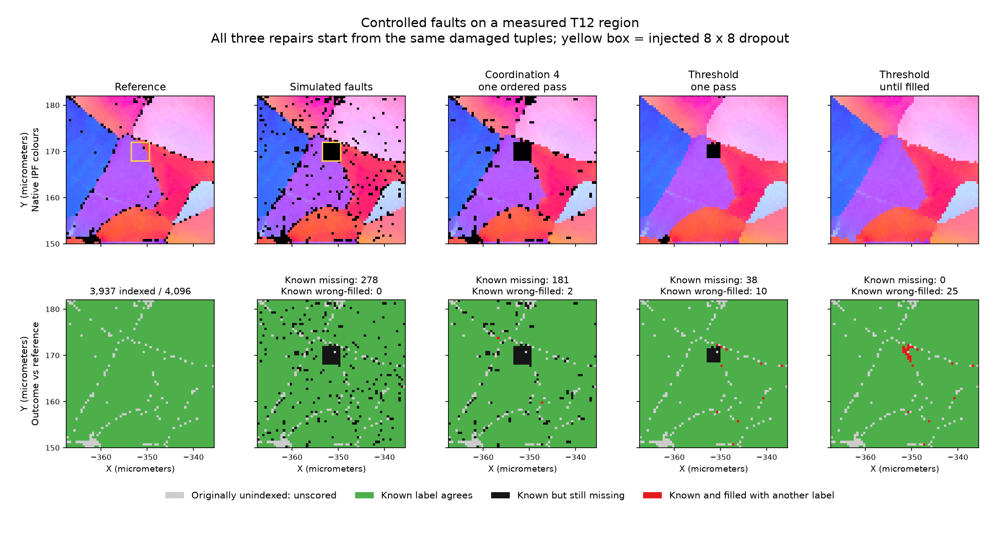

# T12 Missing Data Cleanup Comparison

Executable pipeline: `(01) T12 Missing Data Cleanup Comparison.d3dpipeline`

> **Before adapting:** This experiment deliberately damages a measured map. Neighbor copies are estimates, not recovered measurements. Select cleanup rules for your data and preserve an untouched reference and validity mask.

## At a glance

| Item | Meaning |
| --- | --- |
| Prerequisite | Run `(01) T12 Orientation Case Study` from `T12_Orientation_Examples`; use its preparation checkpoint. |
| Region | 64 × 64 pixels, 32 × 32 µm, one XY slice; 3,937 indexed and 159 originally unknown pixels. |
| Question | How do neighborhood rules and repeated filling change missing data and grain boundaries? |
| Comparison | Identical damaged input → coordination-4 single pass; threshold single pass; threshold repeated until filled. |
| Result | Complete filling leaves **25 disagreements with known reference labels**, plus **159 inferred pixels with no known reference label**. |
| Output | `Data/Output/T12_Cleanup_Examples/T12CleanupComparison.dream3d` and four `*_Summary.csv` tables. |

## Purpose and real-world setting

EBSD maps can contain isolated indexing failures and larger missing patches. Filling these holes can help later segmentation, but a smooth-looking map can conceal a moved grain boundary. This controlled experiment uses measured IF-steel orientations from T12, removes known pixels, and compares repair choices against the retained labels. It demonstrates a cleanup tradeoff; it does not establish an optimal T12 correction or reproduce the paper's noise-reduction method.

## Data flow and choices

| Stage | Choice, motivation, and alternative |
| --- | --- |
| Crop and retain reference | Inclusive source bounds X 520–583, Y 300–363, Z 0 give a small region with 13 positive grain IDs. Keep original IDs, corrected coordinates, and µm units. Discard stale feature statistics and acquisition-coordinate arrays; recalculate these after repair if needed. A different crop changes the comparison population. |
| Prepare validity and provenance | `Valid` is the original indexing mask as UInt8. `DonorIndex` initially stores local tuple indices 0–4095. Neighbor copying carries this index with the entire tuple, so a filled pixel can be traced to its source. |
| Rank candidate donors | Float32 `RepairScore = Valid*(1+BC)` gives invalid pixels zero and valid pixels at least one. Threshold **0.5** separates those states; band contrast (BC) only ranks eligible donors. This is not a calibrated confidence threshold. Float32 retains the fractional threshold; an integer score can truncate it. |
| Simulate isolated faults | Compute an **Int32 Manhattan** boundary map directly, then Add Bad Data with seed 20261014, global probability 0.03 and boundary probability 0.10. These are illustrative per-cell opportunities, with overlap, not exact removed fractions or measured noise estimates. Boundary eligibility is distance < 1, including negative unindexed distances. The filter zeros every sibling cell tuple. |
| Simulate a missing patch | Initialize all cell arrays to zero within inclusive local bounds [28,36,0]–[35,43,0]. This 8 × 8 patch crosses an existing grain boundary, making wrong assignments visible. Remove the now-stale distance map before repair. |
| Coordination-4 | Erode/Dilate Coordination Number counts opposite **zero versus positive** feature status. It does not smooth boundaries between two positive IDs. Four is the largest available face-neighbor count in this single-slice image. One ordered pass can fill holes **and erase good pixels**; a smaller threshold changes more boundary cells. |
| Threshold, one or repeated passes | Replace Element Attributes with Neighbor (Threshold) fills score < 0.5 from the passing face neighbor with highest score. One pass exposes the neighborhood rule; repeating isolates the effect of continued filling. There is no grain or phase barrier. Looping is safe for this verified donor-connected fixture, but can fail to terminate when no passing donor exists ([#1806](https://github.com/BlueQuartzSoftware/simplnx/issues/1806)). |
| Compare and export | Add frozen reference labels and validity **after** repair so they cannot be overwritten. Count outcomes with UInt64 lengths and a validity mask; avoid the current narrow-integer custom-range summation defect ([#1477](https://github.com/BlueQuartzSoftware/simplnx/issues/1477)). Keep class 0 in the CSV: it represents originally unknown pixels. |

Each branch uses a full-extent Crop to copy its input while preserving unit metadata; direct Image Geometry copying currently loses units ([#1784](https://github.com/BlueQuartzSoftware/simplnx/issues/1784)). All branches retain spacing [0.5,0.5,1] µm and origin [-367.5,150,-1] µm. The one-cell Z extent is a software representation, not measured specimen thickness.

## Outputs and interpretation

The top panels display saved `IPFColors`, copied with each donor tuple. Bottom panels display native `ComparisonClass`: gray = originally unknown (0), green = known label agrees (1), black = known but missing (2), red = filled with a different known label (3). These are outcome classes, not material phases. The outlined patch marks the deliberately removed region.

| Case | Known labels agree | Known but missing | Known label differs after filling | Originally unknown, now filled | Total filled |
| --- | ---: | ---: | ---: | ---: | ---: |
| Damaged | 3,659 | 278 | 0 | 0 | 3,659 |
| Coordination-4, one pass | 3,754 | 181 | 2 | 37 | 3,793 |
| Threshold, one pass | 3,889 | 38 | 10 | 143 | 4,042 |
| Threshold, until filled | 3,912 | 0 | 25 | 159 | 4,096 |

Read `ComparisonSummary/PixelCount` and `FilledComparisonSummary/FilledPixels` under each geometry, or its four-row CSV. Class IDs 1–3 always sum to the **3,937 known reference pixels**. The 159 class-0 pixels stay unscored even if filled. Coordination-4 also erases two pixels that were valid in `Damaged`; threshold repair preserves initially passing tuples in this fixture.

“Agrees” means agreement with the predecessor's grain segmentation, **not independently established ground truth**. It is a pixel-weighted label comparison, not equal-grain accuracy. A copied orientation can still differ from the original local measurement when its grain label agrees. Do not use these repaired Euler fields as evidence that KAM, grain orientation spread, or strain was recovered.

## Adaptation and scientific basis

First inspect the real failure pattern and donor quality. Preserve a separate mask for measured versus inferred values, and exclude coordinate arrays or other fields that should not follow a donor. For general data, use single-pass inspection before enabling repeated filling. Recompute segmentation, feature statistics, and derived orientation fields after modifying orientations; simply retaining their old values makes them inconsistent.

The public T12 map accompanies [Allain-Bonasso et al. (2012), *A study of the heterogeneity of plastic deformation in IF steel by EBSD*](https://doi.org/10.1016/j.msea.2012.03.068). This example adds artificial faults to a crop; its probabilities, patch, and donor rules are teaching choices, not paper parameters. To investigate experimental cleanup, use the authors' method and suitable quality/validation data rather than treating this label-recovery exercise as a reproduction. The [suite README](README.md) provides the source archive and run command.

For an assistant: inspect the executable JSON before proposing edits. Preserve donor provenance, the originally unknown population, the distinction between filling and correctness, and the dependency on the corrected T12 preparation.
