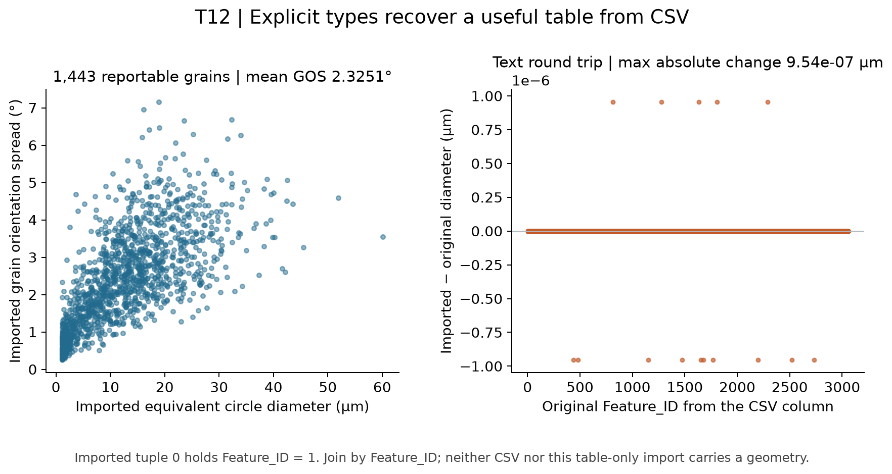

# T12 Typed CSV Import

Executable pipeline: `(01) T12 Typed CSV Import.d3dpipeline`

> **Before adapting:** Check the header, row count, column types and units. Preserve `Feature_ID` joins and the reporting mask. Reshaping does not transpose values or validate the underlying grain measurements.

## At a glance

- **Input:** `Data/Output/T12_Reporting_Examples/Report/T12_CompactReport.csv`, from [(03) T12 Compact Report](../T12_Reporting_Examples/%2803%29%20T12%20Compact%20Report.md).
- **Result:** `Data/Output/T12_Import_Examples/CSV/T12_CSVImport.dream3d`, containing the typed table, summary and a generic text-layout comparison.
- **Main choice:** Explicit column types and 3059 tuples; the reader does not infer the tuple dimensions.
- **Run order:** Run the combined orientation case study, then reporting derived fields and the compact report first. This import is independent of the selective DREAM3D import; see [run commands](README.md).

## Purpose and real-world setting

A collaborator may receive a grain measurement table without the full EBSD checkpoint. This pipeline reconstructs a typed table and checks its selected-grain GOS summary.

It also shows how a generic numeric reader represents the same file and how to preserve column meaning when arranging flat values into rows. The typed columns remain the preferred representation for analysis; the matrix is useful for tools that expect one numeric table.

[Allain-Bonasso et al. (2012)](https://doi.org/10.1016/j.msea.2012.03.068) motivates grain-size and orientation-heterogeneity measurements in IF steel. CSV import and relative z scores are illustrative NX additions using the paper-linked T12 map; they do not reproduce the paper's import method or numerical results. See [data provenance and terms](README.md).

## Data flow and choices

| Step | Purpose and parameter choice |
| --- | --- |
| `ReadCSVFileFilter` | Read the comma-separated header on line 1 and data from line 2, without a count preamble. Parse all seven scalar columns in header order. `Feature_ID` and `NumElements` are int32; diameter, GOS, z score, and area are float32; the 0/1 reporting flag is uint8, which the statistics filter accepts as a mask. |
| Create `ImportedCSV` | The reader creates an Attribute Matrix with `[3059]` tuples. Update this dimension after checking any replacement table. A larger dimension is rejected; a smaller stale dimension leaves rows unread. |
| Calculate `CSVSummary` | `ComputeArrayStatisticsFilter` reads imported GOS and masks it with imported `ReportableFeatures`. Its one-row Length counts eligible grains and Mean gives their equally weighted GOS in degrees. |
| Create Data Group; Read String Data Array | Store the seven unquoted header tokens in `CSVLayoutComparison/ColumnNames`. This free group can hold arrays with different tuple shapes; an Attribute Matrix would impose one common tuple shape. |
| Read Text Data Array | Skip the header and read 21,413 scalar Float64 values: 3,059 rows times seven fields. The generic reader follows token order rather than creating separately typed columns. Float64 is a common storage type here, not additional measurement precision. |
| Copy Data Object; Reshape Data Array | Keep `FlatValues` and reshape its copy to tuple dimensions `[3059,7]`, slowest to fastest. The component shape stays `[1]`; every printed numeric field remains one scalar tuple. Preserve the total count to avoid truncation or extension. |
| Save | `WriteDREAM3DFilter` persists both representations and the unchanged typed summary. No image geometry is reconstructed. |

The first imported tuple has **array index 0 and `Feature_ID=1`**. Join on the explicit `Feature_ID` column after checking uniqueness and completeness. The source CSV omits background row 0 but includes positive IDs whose reporting flag is 0.

### Flat values versus rows and components

| Array | Tuple shape | Components | Meaning |
| --- | --- | --- | --- |
| Each `ImportedCSV` column | `[3059]` | `[1]` | One typed scalar per grain-report row |
| `CSVLayoutComparison/ColumnNames` | `[7]` | String values | File column order |
| `CSVLayoutComparison/FlatValues` | `[21413]` | `[1]` | All numeric tokens in file order |
| `CSVLayoutComparison/FlatValues_Rows` | `[3059,7]` | `[1]` | The same scalar tuples arranged as report rows and columns |

For row r and column c, flat tuple `7*r+c` is the same value as row/column tuple `(r,c)`. In the saved HDF5 dataset this appears as `FlatValues_Rows[r,c,0]`; the final axis is its single component. This is **not** a seven-component vector per grain. Reshape neither converts components nor creates X/Y geometry. The columns have different units and cannot share one physical scale.

## Read the result

The result has **3,059 tuples and seven scalar arrays**, including **1,443 reportable grains**. Their mean GOS is **2.325059°**, matching the reporting summary to Float32 precision. The imported diameter differs from its source by at most **9.536743 × 10⁻⁷ µm**; the GOS difference is at most **7.450581 × 10⁻⁹°**. CSV decimal text can therefore preserve useful measurements without being bitwise identical to the original arrays.

## Adaptation and pitfalls

Confirm the exact header and row count before execution, then check types and selected count after import. Allow floating-point text rounding when comparing continuous values; integer IDs, counts, and flags should match exactly. The supplied comparison uses `rtol=1e-5` and `atol=1e-6` in each column's units.

CSV carries names and printed values, not geometry, explicit types, units, or background-row semantics. Keep a data dictionary: diameter is in micrometers, area in square micrometers, GOS in degrees, and z score dimensionless. A later vector-valued table needs a documented component order and array-combination step; these measurements are all scalar.

The flat and row-shaped Float64 arrays retain exactly the same bytes. Casting each generic column to its declared typed-column format reproduces `ImportedCSV`; small Float32-versus-Float64 differences reflect parsing/storage precision. IDs, counts and flags remain exact for this file. Do not generalize that to integer IDs beyond Float64's exact integer range.

The string import count must match the complete header line. This generic reader is not a quoted-CSV parser; use Read CSV for quoted or embedded-delimiter tables. The raw T12 CTF uses decimal commas and vendor-specific headers, so this exercise reads the already exported dot-decimal report instead. When changing the report, update all row, field and reshape counts together. The reshape implementation permits changed tuple counts, so successful preflight alone does not prove that all original values were retained.

The `.d3dpipeline` is authoritative. An assistant adapting it should check the actual header, count, and ID convention before proposing a type or tuple shape.
