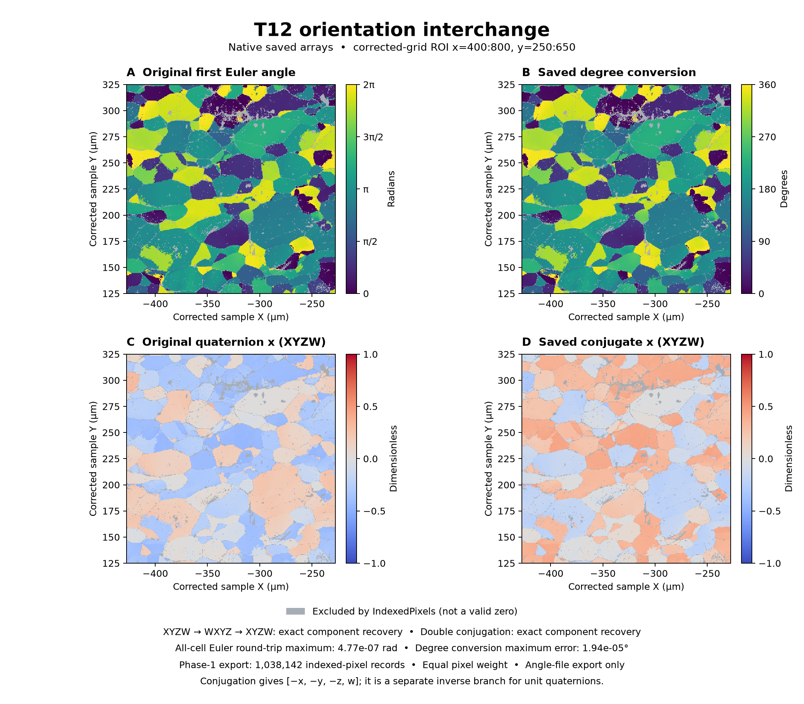

# T12 Orientation Interchange

Executable pipeline: `(02) T12 Orientation Interchange.d3dpipeline`

> **Before adapting:** Confirm the receiving program's angle units, quaternion order, rotation convention, and reference frames. Preserve a source copy and validity mask.

## At a glance

- **Question:** How can the same measured orientations be prepared for another program without losing their original representation?
- **Input:** The `Preparation/T12_Orientations.dream3d` checkpoint from [(01) T12 Orientation Case Study](%2801%29%20T12%20Orientation%20Case%20Study.md).
- **Result:** Degree Euler angles, scalar-first quaternions, unit/order round trips, a separate conjugate branch, and a phase-specific angle text file.
- **Run:** Execute (01), then this 11-step pipeline from the same working folder. See the [README](README.md) for data setup and commands.
- **Main choices:** Keep source arrays; name units and component order; export only indexed pixels; inspect conjugation separately from representation changes.

## Purpose and real-world setting

EBSD processing and downstream texture tools can expect different representations of an orientation. A numerically plausible array can still have the wrong units or component order. This example makes those conventions explicit and retains return conversions for checking the handoff.

The public T12 map comes from the steel study by [Allain-Bonasso et al. (2012)](https://doi.org/10.1016/j.msea.2012.03.068). The article provides scientific context and data provenance; it does not prescribe this interchange exercise. No article result or orientation distribution function (ODF) is reproduced here.

## Data flow and choices

| Steps | Choice and reason |
|---|---|
| 1: Read DREAM3D | Load the complete preparation checkpoint. Keep its corrected 1,255 × 911 × 1 geometry, masks, phases, features, and original arrays. |
| 2–5: Copy; convert angles; copy; convert back | `ChangeAngleRepresentationFilter` edits its input. Copy `EulerAngles` first, convert radians to degrees with choice **1**, then copy the result and return to radians with choice **0**. This retains both units and exposes float32 rounding. |
| 6–7: Convert quaternion order twice | Convert `Quats` from **XYZW to WXYZ** with choice **0**, then return to **XYZW** with choice **1**. Both source arrays remain. Component permutation should return the original values exactly. |
| 8–9: Conjugate twice | Read the original **XYZW** array and form **[-x, -y, -z, w]**, then conjugate again. Keep both results; double conjugation should return the original components exactly. |
| 10: Write StatsGenerator ODF Angle File | Read the **original radians** Euler array, convert to degrees, select `IndexedPixels`, and split by `Phases`. Use spaces, weight **1.0**, and sigma **1**. |
| 11: Write DREAM3D | Save every original object plus the six derived arrays. Array payloads add about **96 MiB** before compression; the pipeline does not copy the geometry for each branch. |

All three conversion filters process every cell without a mask. `IndexedPixels` remains the measurement-admission rule: **Phases > 0 AND Error == 0**. Finite converted values at excluded pixels do not make those orientations valid.

Reordering preserves an orientation's meaning only when the receiving program also changes its declared component order. It does not normalize quaternions, rotate data, apply crystal symmetry, or resolve active/passive conventions. **Never feed `Quats_WXYZ` to this scalar-last conjugation filter.** Conjugation represents the inverse only for a unit quaternion; it generally changes the represented rotation. It is not another form of the same orientation or an acquisition-frame correction.

The predecessor already applied the documented Oxford/HKL sample correction, **180° about Y**, with no additional Euler-frame rotation. This example leaves that frame, spacing **[0.5, 0.5, 1]**, and origin **[-627.5, 0, -1]** unchanged. Acquisition `X`/`Y` columns remain attached to their cells; geometry defines corrected coordinates.

## Outputs and interpretation

Both products are under `Data/Output/T12_Orientation_Examples/Interchange/`:

- `T12_OrientationInterchange.dream3d` retains the source plus `EulerAngles_Degrees`, `EulerAngles_Degrees_RadiansRoundTrip`, `Quats_WXYZ`, `Quats_XYZW_RoundTrip`, `Quats_Conjugate_XYZW`, and `Quats_DoubleConjugate_XYZW` in `T12/Cell Data`.
- `T12_IndexedAngles_Phase_1.txt` contains five columns: three Bunge Z-X-Z Euler angles in **degrees**, **Weight**, and **Sigma**, preceded by format comments and `Angle Count`. The configured base name `T12_IndexedAngles.txt` gains `_Phase_1`; do not look for an unsuffixed output.

The verified population is **1,038,142 indexed pixels**, all in phase 1, from **1,143,305 cells**. Text records preserve their order in the corrected source raster. Equal weight per uniformly spaced 2D pixel gives **area-weighted sampling**; larger grains contribute more records. This is not equal-grain weighting or a measured 3D-volume ODF. Sigma 1 is a fixed export setting, not measured uncertainty. The angle list lacks complete phase and crystal-symmetry metadata; configure and validate the downstream StatsGenerator phase separately. The pipeline writes only an angle file: it does not run StatsGenerator, compute an ODF, or generate a synthetic microstructure.

Windows in-memory Release execution and all-tuple/record checks passed. All 23 predecessor datasets and geometry were preserved. Maximum degree-conversion error was **1.94 × 10⁻⁵°** against float64 arithmetic; the Euler round trip differed by at most **4.77 × 10⁻⁷ rad**. Quaternion order recovery and double conjugation were bitwise exact. Maximum original norm error was **1.01 × 10⁻⁷**; no normalization was applied.

The fixed ROI uses corrected-grid indices `x=400:800`, `y=250:650`. Euler panels show the saved first component on equivalent radian/degree scales; quaternion panels share **[-1, 1]**. Gray marks excluded pixels, distinct from valid zero values. The figure displays native arrays; it does not generate conversion results.

## Checks before another handoff

Check source preservation, geometry, mask count, quaternion norms, both round trips, and the text header, count, five fields, units, and row order. Feed original radians to the exporter with `convert_to_degrees=true`. Feeding its degree copy converts twice; choosing false writes a radians header regardless of the input's actual units. This example uses the verified space delimiter.

For new data, establish phase mapping and validity first. Choose pixel or grain sampling deliberately and validate the receiving program with a known orientation. Keep `.d3dpipeline` as executable authority; an LLM or MCP assistant should inspect the YAML constraints and predecessor before adapting paths or conventions.

The archive's `PublicRelease.txt` attributes DREAM.3D distribution permission to Francis Wagner and names no standard license. Original data and article are not redistributed here. The [source implementations](https://github.com/BlueQuartzSoftware/simplnx) define current filter and export behavior. GUI, OOC, generated Python, downstream import, and materials interpretation require separate verification.
