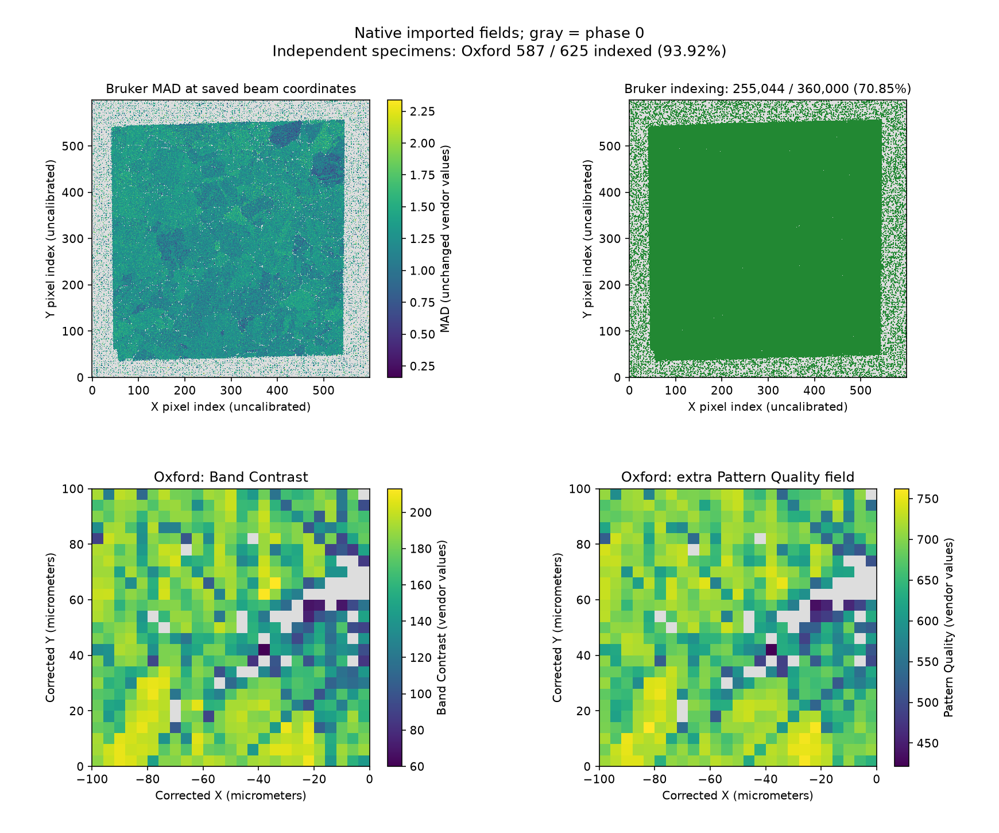

# Vendor EBSD Import Checks

Executable pipeline: `(01) Vendor EBSD Import Checks.d3dpipeline`

> **Before adapting:** Confirm vendor fields, calibration, tuple ordering and reference frames. This example exposes missing Bruker calibration and an ordering problem; its imported raster is not ready for spatial analysis. An indexed pixel is not automatically a high-quality measurement.

## At a glance

| Item | What this example establishes |
| --- | --- |
| Question | Did the vendor import preserve the map, phase information and quality fields needed before further analysis? |
| Inputs | Original public `H5EspritReaderTest.h5` and `H5Oina_Test_Data.h5oina`; [README setup](README.md) |
| Bruker map | Nickel, 600 × 600 pixels; 255,044 phase-positive pixels (**70.8456%**) |
| Oxford map | Cubic titanium, 25 × 25 pixels at 4 µm XY spacing; 587 phase-positive pixels (**93.92%**) |
| Outputs | `Inspection/VendorEBSD_ImportChecks.dream3d` and separate one-row CSV summaries under `Data/Output/Vendor_EBSD_Import_Examples/` |
| Scope | One 19-step import/quality workflow with two separate geometries; no grain reconstruction or cross-specimen comparison |

## Purpose and real-world setting

Before segmenting grains or interpreting orientations, an analyst needs to know what the importer preserved and whether a validity rule means the same thing in the source format. These measured exports come from the official DREAM3D example archives. Their value here is the real format behavior: missing calibration in Bruker, different error codes in Oxford, and a useful HDF5 column outside the dedicated reader's fixed field set. No research-paper result is reproduced.

## Data flow and choices

| Stage | Reason and alternatives |
| --- | --- |
| Read Bruker Esprit, scan `Section_435` | Convert original Euler **degrees to radians** and retain the native phase/quality fields. The file's zero X/Y steps trigger the reader's fallback spacing of 1 µm; that is not measured calibration. Work in pixel indices until an independent scale is supplied. |
| Record source rows; audit beam ordering | Compare each row with `600 * Y BEAM + X BEAM`. All beam locations exist exactly once, but **11,146 rows differ from their raster slot**. Preserve this diagnostic instead of silently treating file order as spatial order. The width 600 comes from this source header. |
| Build UInt8 `IndexedPixels`; summarize | Select **Phase > 0**, then count and average the 0/1 mask over the entire map. Its sum is the indexed count and mean is the fraction, including for multiphase input. Averaging phase IDs would not measure that fraction. |
| Summarize Bruker MAD on indexed pixels | Retain minimum, maximum, mean and population standard deviation without inventing a quality cutoff. Examine MAD and indexed-band count before choosing a criterion suited to the next analysis. |
| Read Oxford H5OINA, scan `1` | Euler values are already **radians**. Widen Phase to Int32 for downstream compatibility; leave hexagonal alignment off for this cubic phase. Pattern import is unsupported and remains off. |
| Read HDF5 `Pattern Quality`; record source indices | Import the additional 625-value scalar column with tuple shape **[1,25,25]**, matching the cell matrix. Bring extra arrays in **before** moving cells so they stay aligned. The large processed-pattern stack is unnecessary for this task. |
| Rotate Oxford sample frame, 180° about Y | Apply the documented historical Oxford/HKL sample convention and retain the transformed origin. `SourceTupleIndex` follows the cell permutation; Euler values remain unchanged. This does not identify rolling/loading axes. |
| Oxford mask; quality summaries; write results | Again select **Phase > 0**. Summarize Band Contrast and the extra Pattern Quality separately, then save native maps and one report per specimen. Their numerical scales are not interchangeable. |

No Bruker frame correction is inferred from the TSL-specific advice in the reader documentation. This branch inspects acquisition-grid quality only. Establish Bruker specimen/crystal conventions before IPF coloring, direction-dependent analysis or registration. For both maps, Z spacing 1 is a single-slice placeholder, not measured thickness.

## Outputs and checks

Gray marks phase-zero pixels. The scalar panels use **viridis** and retain native vendor values. **The Bruker panels scatter saved values at their saved X BEAM/Y BEAM coordinates**, not at the imported image's incorrect tuple positions. This rendering does not repair the native image geometry. The Oxford panels display its corrected image cells. All masks and quality values come from the native output.

| Where to inspect | Expected result and meaning |
| --- | --- |
| `BrukerNi/IndexingSummary` | 360,000 total, 255,044 indexed, fraction about 0.708456. The visible margins remain in the denominator; this is not a cropped-specimen hit rate. |
| `BrukerNi/OrderingSummary`, `OutOfRasterOrder` | **11,146** misordered records. For example, source rows 30 and 31 carry beam locations (31,0) and (30,0). Counts/quality summaries remain valid, but spatial neighborhoods do not. |
| `BrukerNi/MADSummary` | Selected MAD range about 0.158744–2.33814; mean 1.24970 in unchanged vendor values. A positive phase does not certify quality. |
| `OxfordTi/IndexingSummary` | 625 total, 587 indexed, fraction 0.9392. Here **Error=1** at indexed pixels and **Error=2** at the 38 unindexed pixels. **Error=0 would select nothing**; do not borrow the CTF rule. |
| Oxford quality summaries | Selected Band Contrast mean about 166.937; Pattern Quality mean about 668.605. These are different measures, not quantities to average together or compare to Bruker MAD. |
| `OxfordTi/Cell Data/SourceTupleIndex` | Every original row 0–624 appears once. The 180° Y correction reverses X within each row; the supplementary quality column and original fields follow it exactly. |
| Geometry and ensemble data | Oxford dimensions [25,25,1], spacing [4,4,1], origin [-100,0,-1] µm. Both sources have one cubic-high phase. Imported lattice-angle slots are degrees, while Euler arrays are radians. |

`BrukerNi_ImportSummary.csv` and `OxfordTi_ImportSummary.csv` each contain one data row, with metric-specific column names. The full masks and scalar maps remain in the native file for inspection. Source Oxford `X` and `Y` columns stay attached to their acquisition cells; use the geometry for corrected coordinates.

## Adaptation and limits

Choose an additional quality threshold only after examining its vendor definition and the intended measurement. Keep indexing status separate from that decision; do not infer strain, grain boundaries or instrument quality from these maps alone. The two specimens' indexed fractions are not an instrument ranking.

Missing Bruker spacing cannot be repaired by assuming the fallback unit is correct. Supply independent calibration before measuring grain size, area or distance. For a different source, verify scan dimensions, phase definitions, angle units, reference frames and any extra HDF5 tuple ordering before using this workflow. Import incompatible scans separately rather than treating them as adjacent sections.

[Issue #1804](https://github.com/BlueQuartzSoftware/simplnx/issues/1804) tracks the Bruker reader's ordering limitation. Before spatial processing, every associated field must be consistently placed at its beam-coordinate raster slot, or the source must be rejected as unsupported. Changing only geometry origin/spacing, sorting one array, or rotating the sample does not fix this association. This example intentionally stops at import diagnostics; its nonzero ordering result is a useful failed prerequisite, not a validated spatial reconstruction.

The source files are publicly available but await separate package/redistribution approval. Preserve [source acknowledgements](SourceDataLicense.md) when sharing derived results.
