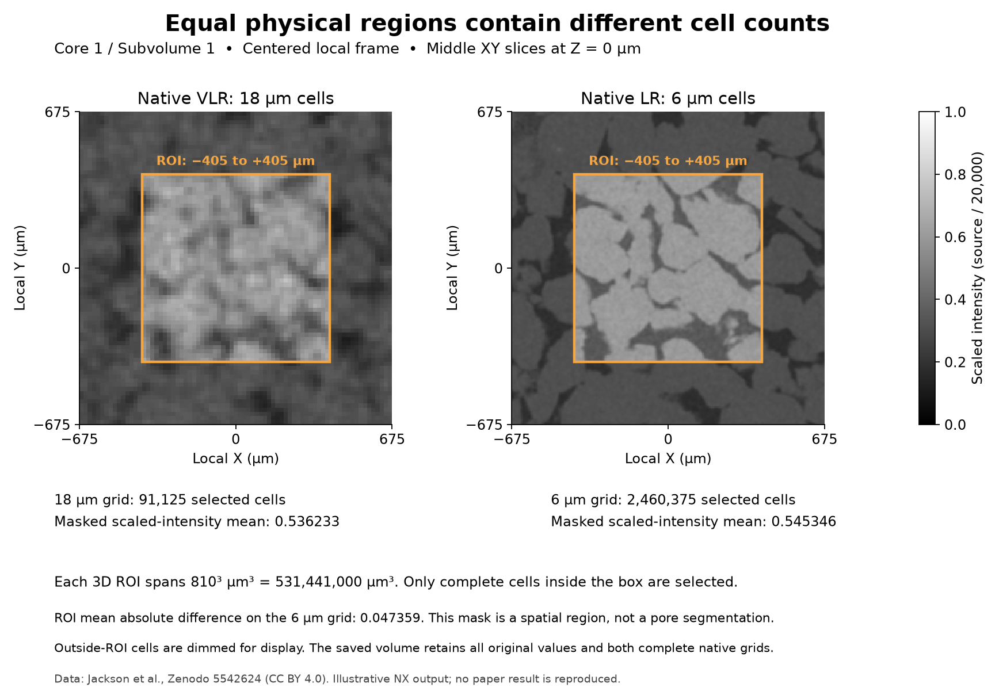
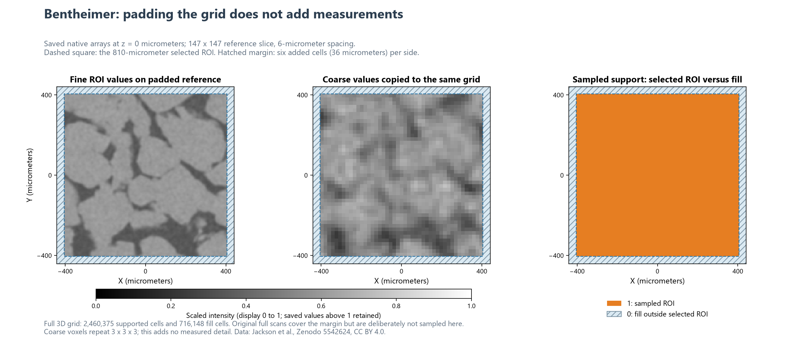

# Bentheimer Interior Region Comparison

Executable pipeline: `(03) Bentheimer Interior Region Comparison.d3dpipeline`

> **Before adapting:** Verify grid placement, units, and the intended ROI. Padding adds fill, not measurements; use the support mask before interpreting intensities or statistics.

## At a glance

| Question | Answer |
| --- | --- |
| Use this when | Two voxel sizes must describe the same physical interior region |
| Input | Common Grid Comparison checkpoint from example 02 |
| Main result | Matching native ROI summaries, preserved working crops, and coarse values sampled onto a padded fine reference with an explicit support mask |
| Region | An 810-micrometer ROI; a 36-micrometer margin on every side creates an 882-micrometer padded reference |

## Purpose and real-world setting

An analyst inspecting a registered CT pair may want to compare the interior while leaving the complete scans available for context. Choosing the same voxel-index interval on two resolutions would select different physical volumes. This example defines a region in micrometers, selects complete cells on each native grid, and shows where those cells lie in a common local coordinate frame. It then adds a controlled margin and copies coarse data onto that fixed fine grid, separating available ROI values from fill. The full scans remain available throughout.

The interior region is an example choice, not a detected specimen boundary or pore phase. Its 810 µm side length is not the paper's representative elementary volume, and its intensity mean is not porosity.

## Inputs and workflow

Run examples 01 and 02 using the [README](README.md). This example reads `Data/Output/Bentheimer_Resolution_Examples/Comparison/CommonGridComparison.dream3d`, including native scans, the mapped VLR grid, scaled intensities, and absolute differences.

| Step and choice | Reason |
| --- | --- |
| Read DREAM3D | Preserve comparison results and native sampling |
| Set Image Geometry Origin and Spacing on all three grids | Set the explicit lower-corner origin to −675 µm on each axis; leave spacing unchanged |
| Compute Image Geometry Coordinates on native grids | Store Float32 XYZ cell centers after the geometry placement is final |
| Compute Coordinate Threshold, rectangle [−405,405] µm | Select complete native cells inside the same 810 µm cube |
| Compute Array Statistics with each native ROI mask | Summarize native scaled intensities and the LR-grid absolute difference |
| Crop Image Geometry twice | Copy the already declared native ROI into separate working geometries; preserve the full scans |
| Delete unused data from working copies | Retain only `ScaledIntensity` and `InteriorROI`; discard copied coordinates and non-cell statistics before placement changes |
| Pad Image Geometry on the fine ROI | Add six cells per side, use fill 0, update the origin, and keep the unpadded crop |
| Compute fresh reference coordinates | Describe every padded reference cell center, including the margin |
| Create Attribute Matrix, then Fuse Regular Grids | Keep fine data in `CellData`; put sampled coarse values and support in separate `SampledVLR` on the same reference grid |
| Masked sampled-intensity summary | Count only supported values; zero fill must not lower the intensity mean |
| Write Vtk Structured Points | Export padded fine intensity and its support mask for the follow-up interchange check; retain the calibrated grid and typed binary values |
| Write DREAM3D | Save full scans, working crops, padded reference, masks, coordinates, and summaries |

The origin edit is a metadata translation into an example-local centered frame. `center_origin` is false because the supplied origin is already the lower corner; the pipeline does not ask the filter to interpret −675 as the center. Bounds become [-675,675] micrometers for the three original full-volume grids. Translating only one geometry would destroy their common placement even though the arrays retained identical shapes.

Physical coordinates use `origin + (index + 0.5) × spacing`. The three components are X, Y, Z, with X varying fastest through tuples. Native VLR centers run from −666 to 666 µm; LR centers run from −672 to 672 µm. Coordinates are generated after translation to avoid stale arrays copied through a later geometry edit.

## Outputs and interpretation

`Data/Output/Bentheimer_Resolution_Examples/Regions/InteriorRegionComparison.dream3d` retains all three grids. Each native `CellData` gains `CoordinatesMicrometers` and the UInt8 `InteriorROI` mask. Coordinates and masks store flattened, X-fastest cell tuples. Native intensity summaries are stored in each geometry's `InteriorIntensityStatistics`; LR discrepancy summaries are in `BentheimerLR6um/InteriorDifferenceStatistics`.

The rectangle test requires each cell's complete lower and upper corners to lie inside the inclusive bounds. It selects indices 15 through 59 on each VLR axis and 45 through 179 on each LR axis: NumPy slices `[15:60]³` and `[45:180]³`. The expected counts are 91,125 and 2,460,375, a ratio of 27. Multiplying each count by its voxel volume gives the same 531,441,000 µm³. Different cell counts therefore describe equal physical volumes.

## Padding and fixed-grid fusion

| Geometry | Dimensions | Spacing | Lower-corner origin | Role |
| --- | --- | --- | --- | --- |
| `BentheimerVLR_ROI18um` | 45 cubed | 18 micrometers | [-405,-405,-405] | Coarse sampling source |
| `BentheimerLR_ROI6um` | 135 cubed | 6 micrometers | [-405,-405,-405] | Unpadded fine ROI retained |
| `BentheimerPaddedROI6um` | 147 cubed | 6 micrometers | [-441,-441,-441] | Fixed destination grid |

The two working crops retain only `ScaledIntensity` and `InteriorROI`. Both cropped masks are all ones because the crop matches the original full-cell ROI. The original full-volume arrays and summaries are untouched.

Padding is **six cells on each side**, or 36 micrometers per side. `update_origin=true` subtracts that distance from the lower-corner origin, keeping the original cells in the same physical location. With it off, data would shift by +36 micrometers on each axis inside a grid whose lower corner stayed fixed. Padding changes the grid extent, not the voxel size. This teaching margin is an explicit processing choice, not a scanner requirement or a paper-prescribed buffer.

The padded fine values remain in `CellData`. Fuse Regular Grids reads the coarse crop and writes its scalar fields into `BentheimerPaddedROI6um/SampledVLR`; using a separate matrix avoids replacing the fine `ScaledIntensity` and `InteriorROI` arrays. It copies all numeric arrays in the selected source matrix, so the working source intentionally contains only the two needed fields. It does not average, interpolate, register, or generate new spatial detail.

**Mapping convention:** the current implementation evaluates a reference index at `origin + index * spacing` and chooses the containing source cell. It is not a general nearest-center search despite the filter name. For this aligned coarse-to-fine case, reference indices 6 through 140 map to coarse index `floor((index - 6) / 3)` on each axis; that happens to agree with nearest coarse-center assignment. Every coarse voxel is repeated 27 times. Reversing the direction would not preserve that equivalence: a coarse reference would select the first fine voxel in each block rather than its center. Do not shift either geometry artificially to conceal this difference.

The sampled `InteriorROI` is the validity indicator: 1 means the destination samples the selected source ROI; 0 means fill. The margin is outside the **chosen ROI**, not proof that the scanner failed to measure it. In fact, the preserved full scans cover that margin. Zero intensity alone cannot distinguish a valid dark observation from fill. `SampledVLRIntensityStatistics` therefore uses the sampled mask, and repeated voxels must not be counted as additional independent measurements.

`CellData/CoordinatesMicrometers` is regenerated after padding, using `origin + (index + 0.5) * spacing` for the entire reference. Copying and zero-padding the old coordinate array would give invalid margin coordinates. No source coordinate array is fused into `SampledVLR`.

The binary export `Regions/BentheimerPaddedROI6um.vtk` contains the fine `CellData/ScaledIntensity` and `InteriorROI` arrays. Its 148-cubed point grid encloses the 147-cubed cells; coordinate units remain a documented micrometer convention because legacy VTK does not encode them. Example 04 reads this file and compares its values and placement against the NX checkpoint. Keep the support mask and source attribution when transferring the volume.

The saved reference contains 3,176,523 cells: 2,460,375 supported cells in index slices `[6:141]` on every axis and 716,148 fill cells. Its regenerated cell centers run from -438 to 438 micrometers. The masked sampled-coarse mean is 0.5362334251, matching the original coarse ROI mean within floating-point precision; repetition does not create additional independent observations.

All three panels show saved native arrays at z = 0 micrometers. The hatched margin is displayed separately from intensity and is excluded from the summary. The common 0-1 display clips brighter values visually; saved values above one remain intact. The native fine ROI mask and sampled coarse support mask agree for this deliberately matched domain. Neither is a pore mask.

## Adaptation and quality checks

Verify that translation leaves all intensity bytes unchanged. Compare coordinate arrays with independent index arithmetic and masks with the full-cell corner predicate. Check masked count, minimum, maximum, and mean against independent reductions over the explicit slices. A center-only predicate happens to agree for these aligned bounds but is not the filter's general contract.

When changing the ROI, select bounds deliberately relative to each grid. Nonaligned boundaries can select different effective volumes because only complete cells qualify. Confirm counts and physical volumes rather than assuming the requested rectangle was filled exactly. Recompute coordinates and masks after any origin or spacing change; changing spacing alone also changes the represented specimen size. To study threshold or ROI sensitivity, preserve separately named variants and report each selected volume. Verify the padded reference geometry remains fixed during fusion, check all supported samples against the coarse source, and exclude fill before reduction. Unequal origins, a different resolution ratio, or nonaligned bounds require a new mapping check; matching array dimensions alone does not establish correct placement.

## Scientific basis and extensions

[Jackson et al. (2022)](https://doi.org/10.1103/PhysRevApplied.17.054046) connects multiresolution imaging with scale-dependent material analysis. The [reviewed arXiv v2](https://arxiv.org/html/2111.01270v2), Section II.5, explicitly motivates representative-volume selection; the supplement's 600 µm two-dimensional display crops are also distinct from this 810 µm three-dimensional ROI. Reproduction status is **illustrative**. The local ROI, padding margin, and fixed-grid fusion are illustrative processing choices. They do not reproduce published EDSR, pore segmentation, permeability, or representative-volume results. Padding and value repetition cannot substitute for the learned enhancement or physical validation in that work.

The author-normalized input files are CC BY 4.0 [Zenodo data](https://doi.org/10.5281/zenodo.5542624); [SourceDataLicense.md](SourceDataLicense.md) records attribution and transformations. Further material conclusions require a segmentation and independent physical checks appropriate to the selected volume.

For an LLM or MCP assistant: keep physical units, full-cell membership, voxel-center coordinates, and scanner coordinates distinct. Treat the `.d3dpipeline` as executable authority and preserve the declared predecessor chain.
