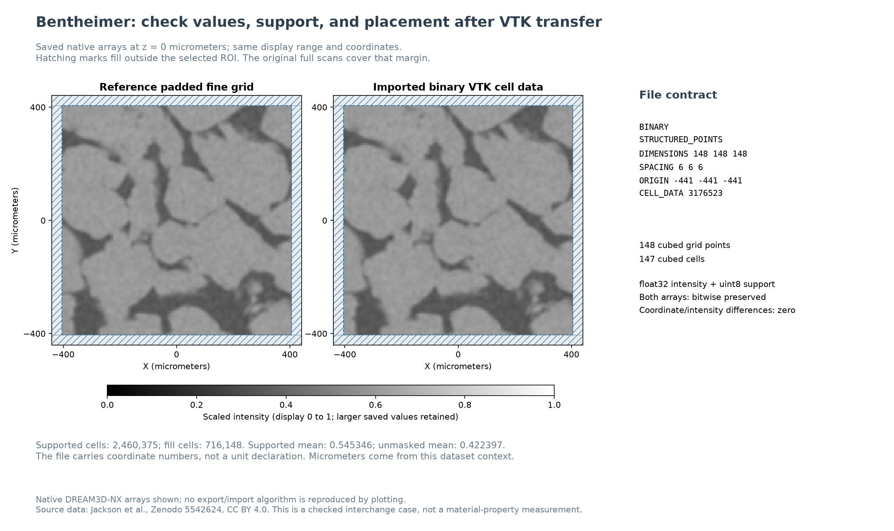

# Bentheimer VTK Interchange

Executable pipeline: `(04) Bentheimer VTK Interchange.d3dpipeline`

> **Before adapting:** Confirm coordinate units, cell-versus-point association, and which fields must travel together. Keep the support mask with the intensity values.

## At a glance

| Item | Contract |
| --- | --- |
| Question | How can I transfer a calibrated volume through legacy VTK and check that values and placement survived? |
| Prerequisite | Run examples 01 -> 02 -> 03; example 03 creates the binary VTK export |
| Inputs | `Regions/BentheimerPaddedROI6um.vtk` and the reference `Regions/InteriorRegionComparison.dream3d`, under `Data/Output/Bentheimer_Resolution_Examples/` |
| Imported grid | 147 cubed cells, spacing 6 micrometers, lower-corner origin [-441,-441,-441] |
| Output | `Data/Output/Bentheimer_Resolution_Examples/Interchange/VTKRoundTrip.dream3d` |
| Processing record | `Interchange/BentheimerRegionProcessing.d3dpipeline`, extracted from the predecessor checkpoint; retain the original source and companion for complete context |

## Purpose and real-world setting

A digital-rock analyst may prepare an intensity volume in DREAM3D-NX and inspect it in another scientific tool. A useful transfer preserves both where the cells belong and which values should participate in analysis. This example checks that contract on the measured-derived Bentheimer scan and its deliberately padded ROI.

The source is the same public, registered CT pair used by the preceding examples. The exported fine-grid intensity has already been divided by 20,000; it remains a scaled image signal, including values above one. `InteriorROI` distinguishes the selected 810-micrometer region from its added fill margin. The preserved full scans cover that margin: mask zero means outside this selected processing region, not missing scanner acquisition.

## Data flow and choices

| Stage | Motivation and alternatives |
| --- | --- |
| Example 03: Write Vtk Structured Points | Export only `ScaledIntensity` (float32) and `InteriorROI` (uint8) from `BentheimerPaddedROI6um/CellData`. Keep the data and its validity rule together. Binary encoding retains their typed values without decimal formatting choices; ASCII is easier to inspect manually. |
| Extract DREAM3D-NX Pipeline To File | Recover the predecessor's embedded processing recipe beside the exported data. This records which filters and arguments produced the checkpoint, but does not package inputs or earlier pipelines. |
| Read reference DREAM3D | Import the original padded geometry as a separate reference. This allows the transferred result to be checked against the actual source. |
| Read Vtk Structured Points, Cell Data on / Point Data off | The export contains `CELL_DATA`. Selecting point data would describe a different association. Read into `VTKImportedROI` without replacing the reference. |
| Compute image coordinates | Reconstruct cell centers from the imported geometry, so placement can be checked independently of scalar values. |
| Compute Differences Map twice | Compare intensity values and all three coordinate components with their reference counterparts. The saved diagnostics should be zero for this binary round trip. |
| Masked array statistics | Use the imported `InteriorROI` when summarizing intensity; including zero fill would lower the mean. |
| Write DREAM3D | Keep the original and imported grids, diagnostics, coordinates and supported-intensity summary together. |

The VTK file must exist before reader preflight, which is why export remains in example 03 and readback is a short follow-up stage. Both run from the same writable working folder. The [README](README.md) gives setup and commands.

### File contract and adaptation pitfalls

The [VTK legacy format](https://docs.vtk.org/en/latest/vtk_file_formats/vtk_legacy_file_format.html) distinguishes grid points from cells. This file declares **148 x 148 x 148 points** surrounding **147 x 147 x 147 cells**, and contains **3,176,523** values per selected scalar array. Its origin is the lower grid corner, and cell centers are `origin + (index + 0.5) * spacing`. Tuple order is X fastest, then Y, then Z. Binary numeric payloads use the format's big-endian representation.

The file has no length-unit declaration. Micrometers are established by this dataset's provenance; the current reader's default Micrometer metadata alone does not establish units for an arbitrary file. Do not rescale or shift one grid merely to make its arrays compare. Confirm dimensions, spacing, origin and association first.

Only the two selected cell arrays are exported. The VTK file does not preserve the NX pipeline, other attribute matrices, reference scans or provenance records. Reconstruct coordinates after import instead of treating sampled source coordinates as destination positions. The coordinate arrays and their differences use flat X-fastest tuples with three components; intensity arrays retain a three-dimensional tuple shape.

### Recovering the processing recipe

`BentheimerRegionProcessing.d3dpipeline` matches the JSON embedded in the stage-03 DREAM3D checkpoint. Its **28 filters, UUIDs, argument values, and order** match that stage, including slab reassembly. It does not include stages 01/02, their input data, plugin binaries, or companion explanations. Relative paths still require the same working-directory layout; inspect output paths before replaying to avoid replacing results.

**Current writer limitation:** embedded recipes lose filter comments and can re-enable disabled nodes ([#1807](https://github.com/BlueQuartzSoftware/simplnx/issues/1807)). All nodes in this example are enabled, so its executable choices are preserved; its comments are empty in the recovered file. Extraction cannot restore information already lost by the writer. Keep the original `.d3dpipeline` and companion as the authoritative record, and compare disabled states before replaying recipes from other files. Files written without a nonempty embedded pipeline cannot supply one.

## Outputs and checks

Open the result and compare `BentheimerPaddedROI6um` with `VTKImportedROI` at the same slice and display range. Under the imported `CellData`, inspect `ScaledIntensity`, `InteriorROI`, `CoordinatesMicrometers`, `AbsoluteIntensityDifference` and `AbsoluteCoordinateDifference`. Both difference arrays are zero in the checked output, and the independent binary-file check matches every source intensity and mask byte.

The imported mask retains **2,460,375 supported cells** and **716,148 fill cells**. `SupportedIntensityStatistics` reports the supported count and a mean near **0.545346**; averaging the entire padded array instead gives approximately **0.422397**. This difference is a support-selection effect, not a material-property change. Check mask preservation as well as intensity values: an all-zero difference image alone does not validate every aspect of the file contract.

## Scientific basis and reuse

[Jackson et al. (2022)](https://doi.org/10.1103/PhysRevApplied.17.054046) provide the multiresolution CT context. This interchange exercise is an illustrative processing extension, not part of their learned enhancement, segmentation or permeability result. It establishes the tested file transfer, not scanner calibration, pore identification or external-application behavior.

The underlying data are CC BY 4.0. Keep the attribution and license in [SourceDataLicense.md](SourceDataLicense.md) with shared derived exports. Use the `.d3dpipeline` as the authority for field names, options and execution order; a different VTK dataset type or point-data file needs a separate import check.
