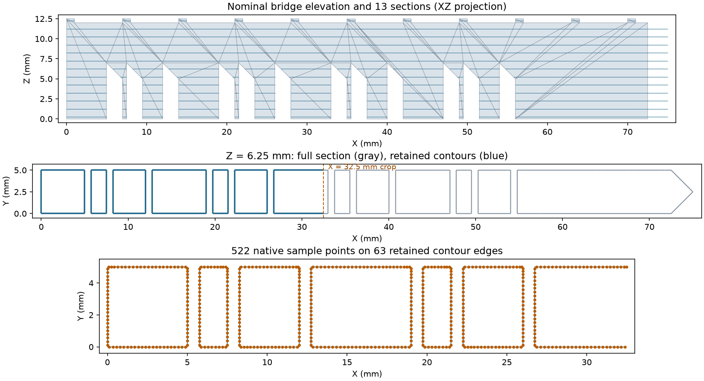

# NIST Bridge Contour Inspection

Executable pipeline: `(01) NIST Bridge Contour Inspection.d3dpipeline`

> **Before adapting:** Confirm CAD units, section heights, crop boundaries and sampling density for the inspection task. These are nominal design contours, not measured surfaces or machine instructions.

## At a glance

| Item | Contract |
| --- | --- |
| Question | How can I extract and sample a local cross-section of a real manufacturing specimen? |
| Input | Original NIST `AMB2018_01_Part.STL`; setup is in the [README](README.md) |
| Workflow | Read CAD -> slice -> crop -> select one section -> sample its edges |
| Coordinates | Millimeters; selected section Z = 6.25, retained X <= 32.5 |
| Output | `Data/Output/NIST_AMBench_2018_Examples/BridgeContourInspection.dream3d` |

## Purpose and real-world setting

An inspection engineer may need points along selected design contours to compare with a later measurement. This example uses NIST's AMB2018-01 bridge, a public laser powder bed fusion benchmark specimen with legs, overhangs and top ridges. It prepares nominal reference geometry; no measurement comparison is performed.

## Data flow and choices

| Stage | Motivation, alternatives and pitfalls |
| --- | --- |
| Read STL File; Create Geometry | Read the original 376-triangle binary STL without scaling. Set Millimeter explicitly from NIST's dimensions: STL carries no unit declaration. Create Geometry also restores units after derived-geometry filters; coordinates are copied, not rescaled. |
| Create Data Array | Assign one face `RegionIds` value of 1 so ownership follows every section edge. This means one nominal part, not a grain, phase or material. Multiple parts would need meaningful face labels. |
| Slice Triangle Geometry | Use 13 diagnostic planes from Z = 0.25 through 12.25 at 1 mm spacing. Offset planes avoid horizontal CAD facets and show legs, overhangs, body and ridges with little output. Finer spacing captures more detail but increases work; only Z slicing is supported. |
| Crop Edge Geometry | Retain X in [-1, 32.5] and interpolate an outside endpoint onto the upper boundary. The lower bound includes the original X = 0 face. This prefix region exercises clipping while avoiding segments whose two endpoints are outside opposite bounds. Cropping inserts no closing edges, so the result can be open. |
| Multi Threshold Objects; Remove Flagged Edges | Mark `SliceIds != 6` as true, then remove those edges. Zero-based slice 6 is Z = 6.25 mm, through the overhangs. Keep the full and cropped geometries so the selection can be checked. Edge and vertex indices are compacted. |
| Point Sample Edge Geometry | Request 0.25 mm spacing on the retained contour segments. Samples sit inside each edge, excluding endpoints; spacing restarts at each tessellation edge. This prepares discrete inspection locations, not a continuous traversal order. |
| Write DREAM3D | Retain CAD, all sections, cropped sections, the selected section and samples in one result. There is no need to run separate examples. |

For edge length L and requested spacing s, the sampler uses `n = floor(L/s) + 1` points at fractions `(j + 0.5)/n`. Thus actual spacing is L/n, not necessarily s. Retessellating the same curve can change the sample distribution. `SourceEdgeIds` refers to `SelectedContours/Shared Edge List`, not original STL triangle IDs. Slice and region labels are copied to each sample.

The optional cumulative-distance array is disabled because its current values omit the half-step from the first endpoint ([issue #1797](https://github.com/BlueQuartzSoftware/simplnx/issues/1797)). Explicit unit copies address [issue #1796](https://github.com/BlueQuartzSoftware/simplnx/issues/1796). Keep unit checks when adapting the workflow.

## Outputs and checks

Open the result and inspect these geometries:

| Geometry | What to check |
| --- | --- |
| `NominalCAD` | Bounds [0,0,0] to [75,5,12.5] mm; the extra 0.5 mm above the body is the ridge height. |
| `AllContours` | 1,442 edges across 13 Z planes. Color `Edge Data/SliceIds` to distinguish sections. |
| `CroppedContours` | 671 edges, all X <= 32.5. Twenty-four crossing edges are shortened; open ends at the cut are expected. |
| `SelectedContours` | 63 edges, all at Z = 6.25, with `SliceIds = 6` and `RegionIds = 1`. |
| `InspectionSamples` | 522 points lying on those edges. Inspect `Vertex Data/SourceEdgeIds`, `SliceIds` and `RegionIds`. |

The figure renders native DREAM3D-NX output arrays. The independent check matches section intersections and sample positions within 0.0001 mm. That tolerance checks numerical geometry; it is not a manufacturing acceptance tolerance. The original STL is not certified watertight, and cropped open contours cannot be interpreted as a closed area or volume.

## Scientific basis and reuse

The [NIST AMB2018-01 description](https://www.nist.gov/ambench/amb2018-01-description), especially Figures 2 and 4-6, supplies the specimen and manufacturing context. NIST used 625 layers at 0.02 mm spacing with contour and alternating infill scans. Our section heights, crop and sampling density are illustrative inspection choices. They do not reproduce laser power, speed, scan order, timing, thermal history or deformation.

A build-layer study would need the published layer sequence and process controls, not simply denser samples on these contours. Hatch generation is deferred after an exterior-gap defect was reproduced on this CAD ([issue #1795](https://github.com/BlueQuartzSoftware/simplnx/issues/1795)). See [SourceDataLicense.md](SourceDataLicense.md) for NIST attribution and reuse terms. The `.d3dpipeline` remains authoritative for execution order and parameter values.
