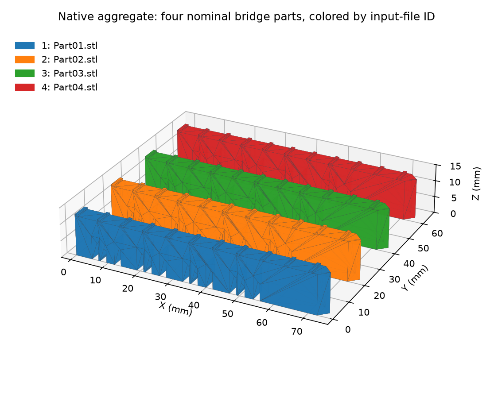

# NIST Bridge STL Assembly

Executable pipeline: `(03) NIST Bridge STL Assembly.d3dpipeline`

> **Before adapting:** Put only the intended binary STL files in the input folder and establish their common coordinate units/frame. File IDs identify imports; they do not establish materials, grains or mesh validity.

## At a glance

| Item | Contract |
| --- | --- |
| Task | Aggregate separate part meshes while retaining placement and file identity |
| Prerequisite | Run [(02) NIST Bridge Part Export](%2802%29%20NIST%20Bridge%20Part%20Export.md) first |
| Input folder | `Data/Output/NIST_AMBench_2018_Examples/Parts`, containing exactly `Part01.stl` through `Part04.stl` |
| Result | `Data/Output/NIST_AMBench_2018_Examples/Assembly/NISTBridge_STLAssembly.dream3d` |
| Expected aggregate | 1,504 triangles, 764 vertices, four disconnected parts, Millimeter coordinates |

## Purpose and real-world setting

A single native geometry is convenient for viewing or analyzing a batch of separately supplied CAD surfaces. This example reads the positioned files from the preceding export, keeps their identity, and checks that their geometry survived transfer. The source is NIST's [AMB2018-01 nominal bridge CAD](https://www.nist.gov/ambench/amb2018-01-description); local poses illustrate its multi-part context without reproducing the full build-plate or manufacturing model.

## Data flow and choices

| Stage | Motivation and pitfalls |
| --- | --- |
| Combine STL Files | Read every STL in the selected folder, sort paths, and generate both face and vertex `PartIds`. Keep `PartData/FileList` and `Active` so IDs remain interpretable. Extra files change the aggregate and its identity map. |
| Create Geometry; copy arrays | Restore known Millimeter metadata without scaling coordinates, then retain file normals, labels and lookup arrays. An STL reader cannot infer units from the file. |
| Recompute normals and areas | Compare imported normals with current triangle geometry and calculate `FaceAreas_mm2`. This checks geometry/field consistency, not closed-solid validity. |
| Array statistics by PartIds | Count triangles and sum their areas by input file. Join summary rows to `FileList`, excluding unused row 0. |
| Write DREAM3D | Save one calibrated aggregate and its provenance arrays; no extra point positioning occurs during import. |

## Outputs and checks

Display `CombinedParts`, coloring its face `PartIds` to distinguish the inputs:

| Where to inspect | Expected result |
| --- | --- |
| `PartData/FileList`, `Active` | Row 0 is unused; rows 1-4 map to `Part01.stl` through `Part04.stl` and are active. |
| `Face Data/PartIds`, `Vertex Data/PartIds` | Every triangle and all three referenced vertices identify the same input file. |
| `Face Data/FaceLabels` | `[0,PartId]` for each triangle; these are generated local labels, not original material or grain identifiers. |
| `PartAreaSummary` | 376 triangles and approximately **3,170.06 mm²** surface area per file. The area summaries are Float32; retain per-face values when assessing finer numeric precision. |
| Geometry | Bounds **[-1.5,0,0] to [75,65,12.5] mm** and exactly the exported triangle coordinates/winding. |

The imported vertex counts are **194,190,190,190**. Translation in Float32 makes a few near-coincident CAD coordinates identical in parts 02-04; STL re-import compacts those duplicates. Every triangle coordinate still matches its exported file exactly. Consequently, use the file lookup and triangle geometry for interchange checks, not equality of vertex row IDs or counts before and after transfer.

## Adaptation and limits

Aggregation does not align coordinate frames, weld across files, remove overlapping surfaces, or perform a Boolean union. One file can contain multiple disconnected objects, so file IDs are not generally connected-component IDs. The four disconnected parts are a checked property of this fixture.

Stored STL normals may be unreliable in another source; inspect `FileNormals` against `GeometryNormals`. Neither agreement nor a successful import certifies watertightness. Keep the original scalar/attribute data elsewhere when needed: STL does not carry it. The [README](README.md) gives setup/run commands, and [SourceDataLicense.md](SourceDataLicense.md) records NIST attribution and the example's derived changes.
